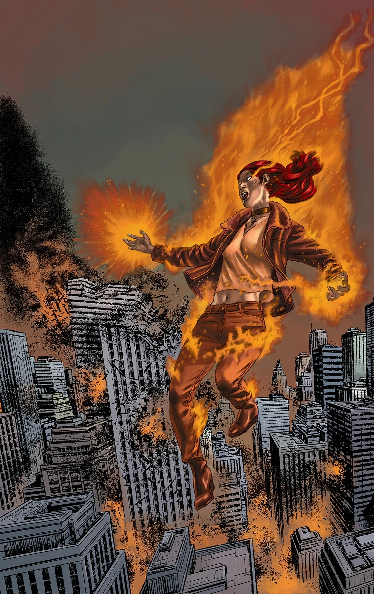
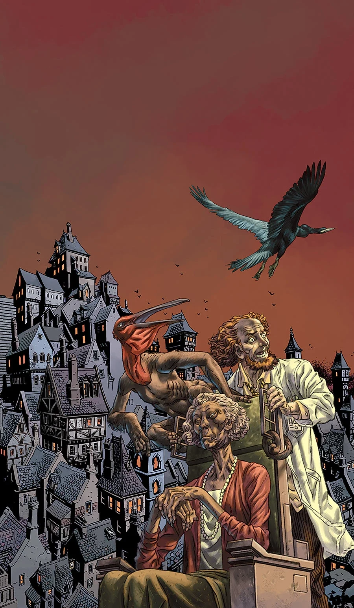
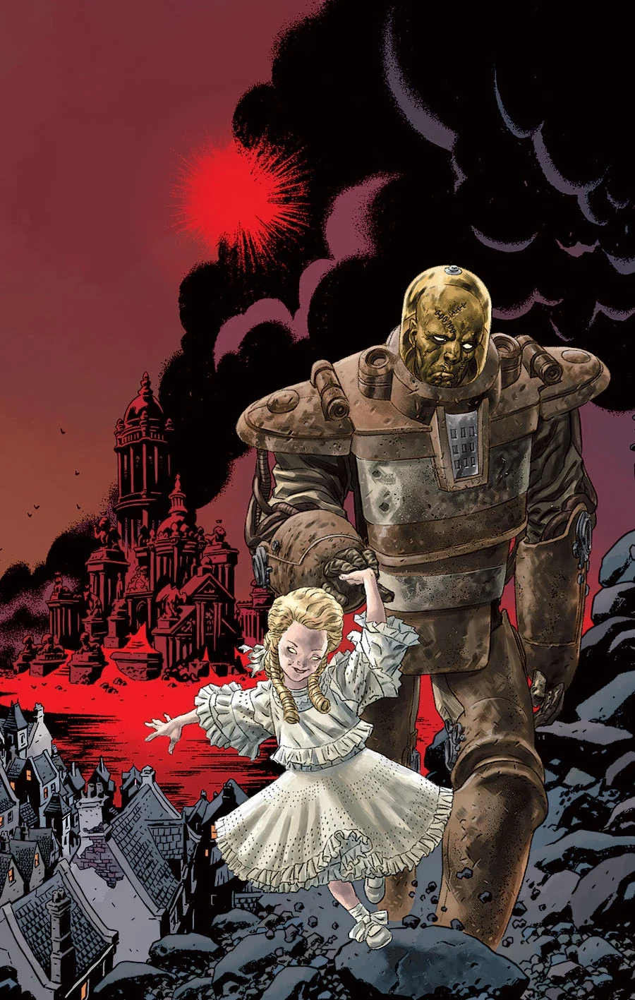
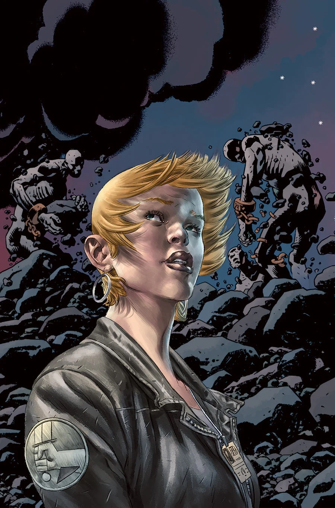
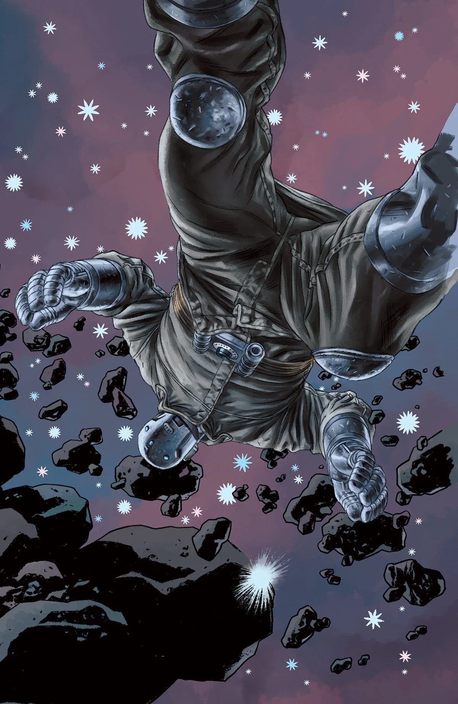

***《终结时刻》（Cometh the Hour）*** 是一部共五期的连载故事，为[*《B.P.R.D.：人间炼狱》*故事系列](/entry/Hell_on_Earth_(story_cycle))的终章，同时也为[*《B.P.R.D.》*](/entry/BPRD._%28series%29)的[最终故事系列](/entry/The_Devil_You_Know_%28story_cycle%29)埋下伏笔。

## 剧情简介

### 第一部

凯特与潘雅就是否放弃超自然调查防御署总部争执不下；与此同时在纽约市，奥古·桀哈（Ogdru Jahad）每小时都在孕育出数十只新的怪物，约翰和丽兹正与一个看似无法战胜的对手苦战。

### 第二部

丽兹与约翰奋力抵挡奥格德鲁·赫姆，凯特则要赶在高耸入云的奥古·桀哈踏平总部之前组织撤离——而瓦尔瓦拉（Varvara）正引领着约瑟夫（Iosif）深入地狱。

### 第三部

丽兹与约翰油尽灯枯，无法跟上奥古·桀哈的步伐。在科罗拉多州，凯特赶在怪物屠戮所有人之前设法组织超自然调查防御署总部撤离。

### 第四部

在与宇宙邪恶的化身奥古·桀哈的战斗中，西部各州化为废墟，超自然调查防御署伤亡惨重。消灭这头巨兽的唯一希望，或许系于小恶魔女孩瓦尔瓦拉那个亵渎神明的计划。

### 第五部

为阻止蛙人蔓延、不让黑焰借其淹没世界，丽兹·舍曼炸穿了地心。她虽然杀死了那一个黑焰，但她造成的浩劫却催生了新的黑焰，以及更恐怖的、席卷全球的怪物浪潮。前路未卜，超自然调查防御署清点着伤亡者，*《人间炼狱》*就此落幕。

## 《瓦尔瓦拉：那个邪恶的俄国小女孩》

这篇由[马特·斯特拉克拜恩（Matt Strackbein）](/entry/Matt_Strackbein)编剧并绘制的两页备用短篇，刊载于*《B.P.R.D.：人间炼狱——终结时刻》*第 2 期，回顾了[瓦尔瓦拉](/entry/Varvara)的来历。该短篇未收录进任何合订本。

## 画廊

\#143

\#144

\#145

\#146

\#147

**Category:Story** **Category:B.P.R.D. story** **Category:B.P.R.D.: Hell on Earth story**
