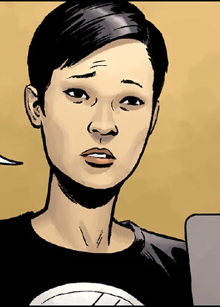

苏珊·项 **Susan "Sue" Xiang** was a Chinese American psychic woman that worked as a field agent for the [B.P.R.D.](/entry/Bureau%20for%20Paranormal%20Research%20and%20Defense) during the 1950s, alongside [Hellboy](/entry/Hellboy).

## History

Susan Xiang was an American born Chinese that grew up in San Francisco. Susan's comes from a family that was protectors of China against the supernatural. They served the [Golden Crane Society](/entry/Golden%20Crane%20Society) for generations, with great uncle being the most recent member. Susan's grandparents would tell her stories of her ancestors protecting China from supernatural threats, but she had always regarded them as stories. Her opinion changed when she was seven years old she had an experience with the supernatural witnessing a jiangshi.[1]

Sometime in the past she worked as an intelligence analyst for the F.B.I, but was recognized as a potential psychic by [Professor Bruttenholm](/entry/Trevor%20Bruttenholm) and joined the B.P.R.D since 1952. She was assisted by [Dr. N.K. Sandhu](/entry/Dr.%20N.K.%20Sandhu) to develop her abilities.[2]

In December of 1953, Susan was teamed with Hellboy and [Jacob Stegner](/entry/Jacob%20Stegner) to investigate the disappearances of six missing children and the body of a deceased adult in Rosemead, California. The team found their first lead through a suspicious man, who possessed a piece of Enkedladite. Through the artifact, Susan was able to see the incident involving monsters from a parallel reality attempting to invade Earth in Utah back in 1948.[3]

Her team managed to discover that a mutated dog of a young local boy was responsible for the killings. After the beast was slayed by Hellboy, Susan went to collect a sample of the creature before it decomposed. She had another of her flashes, this time of visions of the Ogdru Hem and the Visitor.[4]

In the same year Susan, Hellboy and [Archie Muraro](/entry/Archibald%20Muraro) had a case in KowloonWalled City to assist Roland Childe in retrieving an artifact. There was more to the case than it appeared. Susan detected that the spiritual atmosphere to be wrong. As they went deeper into the city, they discovered piles of bodies and [two rampaging demons](/entry/Ox-Head%20and%20Horse-Face) demanding the souls be returned. While Archie and Hellboy distracted the demons Susan encountered an injured Bao Zhi and was shocked to learn that he was a member of the Golden Crane Society, a group she was told by her grandparents and assumed to be a story.[5]

She told him her association with the Society ans assisted him. Bao Zhi explained to her that a British occultist, Thomas Rhymes stole a powerful spirit jar, the hunping and was using it to steal souls to empower himself to become a god. The two demons that she had encountered were Ox-Head and Horse-Face who wished to return the stolen souls to their proper places. While Childe distracted Rhymes Susan managed to retrieve the hunping and threw it to Hellboy who smashed it to pieces releasing all the entrapped souls. In his dying breath, Bao Zhi weak from his injuries passed a few words to her ear, shocking her. Before leaving China, Susan told Hellboy that once they got back to the States she would take some time from the Bureau as she needed to take care of some family business.

In June 1954, Baltimore, Susan, and Hellboy came to investigate the haunting of the Koestler family. Thomas Koestler's brother Robert had died in his apartment when it caught fire. His brother's pet monkey Diogenes also perished and for some reason came back as a ghost and began haunting the Koestler, specifically Thomas. Susan decided to investigate the house in order for her abilities to get a read. Just as she was passing her hand over a gasoline container, she had a vision of Thomas killing his brother and then setting his home afire. She realized Diogenes was out for revenge. The agents were too late to save Thomas, as its apparition mauled him to death. Much to their surprise Victor Koestler had a spiritual connection with the ghost and is able to call it to and from his body. Margret, Victor's mother begged the agents to help her son as she was unable to help him. The agents agreed to introduce Victor to the Bureau where he would get the proper attention and care.[6]

## Power & Abilities

Susan was a psychic and was adept at psychometry, able to recall events from items that had transpired.

## References

<references />

**Category:Characters** **Category:Female Characters** **Category:Psychics** **Category:B.P.R.D. agent** **Category:Americans** **Category:Humans**

[1] *[Ghost Moon](/entry/Ghost%20Moon)* \#2

[2] [Beyond the Fences](/entry/Beyond%20the%20Fences) \#1

[3] [1948](/entry/1948)

[4] [Beyond the Fences](/entry/Beyond%20the%20Fences) \#5

[5] *[Ghost Moon](/entry/Ghost%20Moon)* \#1

[6] *[The Unreasoning Beast](/entry/The%20Unreasoning%20Beast)*