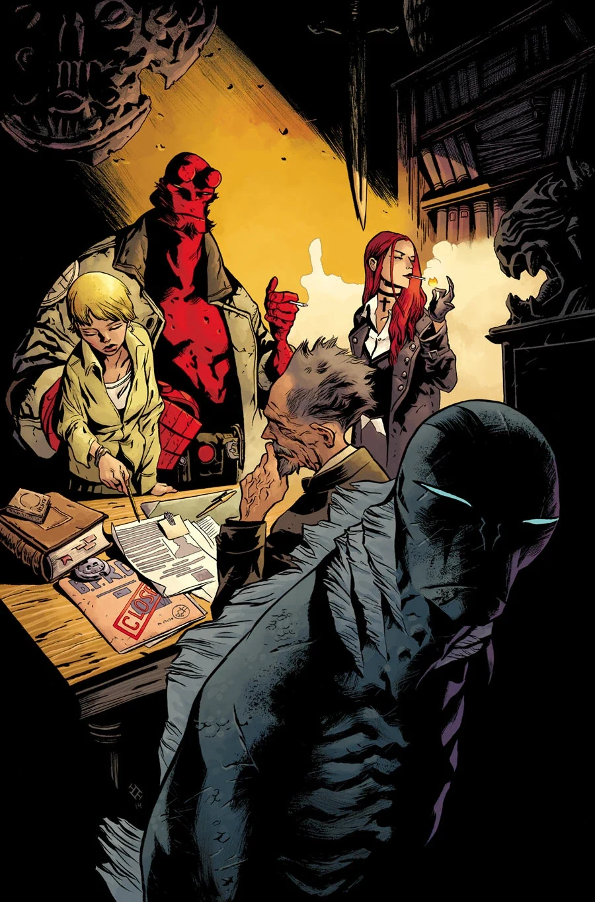
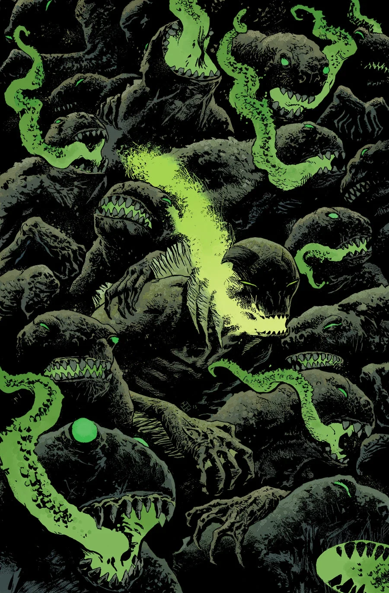
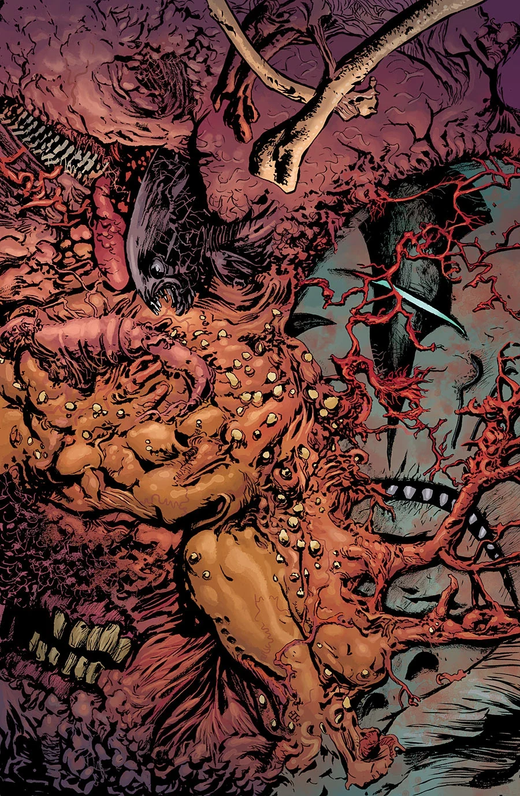

《**苏瓦尼上空的阴影**》（The Shadow Over Suwanee）是一个共三话的故事线，于 2015 年 7 月开篇。

## 剧情简介

### 第一部

被地狱男爵的记忆所困扰，亚伯在一座沉没的小镇中与一头恐怖的怪物狭路相逢，而这怪物揭示了他自身先于人类的起源秘密。

### 第二部

佛罗里达的一座小镇，在一头巨型怪物的阴影下以一种奇异的方式苟延残喘。亚伯在那里发现了有关自己的起源、以及他在世界末日中所扮演角色的秘密。

本话包含一段闪回，重现《[寻巫者：恩兰之谜](/entry/The_Mysteries_of_Unland)》（Witchfinder: The Mysteries of Unland）的最后场景。

### 第三部

亚伯离开 B.P.R.D.，正是为了直面那些人们声称与他有关的怪物。如今他找到了一头——它巍然耸立在一座注定毁灭的佛罗里达小镇上空。亚伯一头扎进关于自身起源与使命的疑问之中，迎来了一场惊心动魄的意志交锋。

## 画廊

