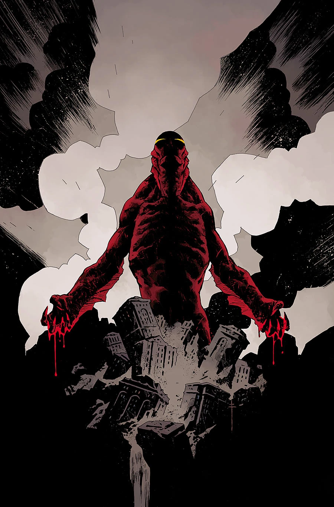

《**荒凉海岸**》（The Desolate Shore）是一个单期完结故事，由塞巴斯蒂安·菲乌马拉（Sebastián Fiumara）作画，也是《[黑暗与可怖](/entry/Dark_and_Terrible_%28story_cycle%29)》故事周期的收官之作。

## 剧情简介

人类的未来命悬一线——亚伯·塞皮恩终于登岸，去直面那名死灵法师：此人已摸清如何利用亚伯在末日中所扮演的角色为己谋利。

## 画廊

**Category:Story** **Category:Abe Sapien story** **Category:Abe Sapien: Dark and Terrible story**
