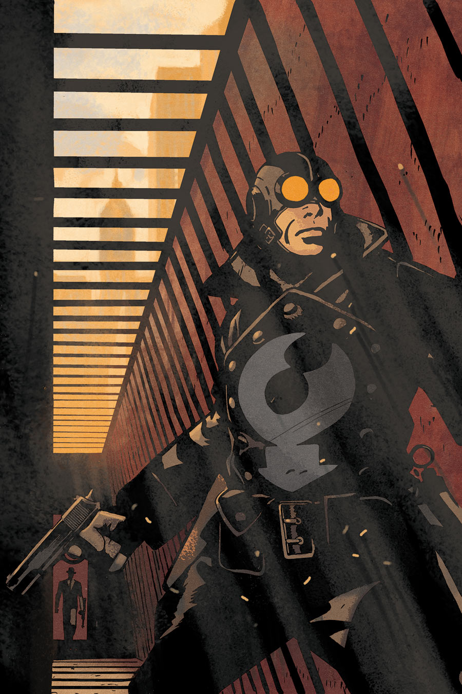

The story takes place early in [the Lobster's](/entry/The%20Lobster) career as a crime fighter in late January and early February of 1933.

## Publication History

This two-issue miniseries was published in 2013, with art by Sebastián Fiumara and covers by [Tonči Zonjić](/entry/Ton%C4%8Di%20Zonji%C4%87).

## Synopsis

### Part One

Lobster Johnson is on his way to meet a Tong contact only to find him murdered, the latest in a series of attacks on the Tong organization. Strangely, the Tong seem to be taking no retaliatory attacks.

Detective Eckerd is investigating the murders, but is actually more focused on tracking down the Lobster. He begins to follow the journalist [Cindy Tynan](/entry/Cynthia%20Tynan) in a hope to gather information on the Lobster's identity. Eckerd is lead to [Harry McTell](/entry/Harry%20McTell), but is unable to gain any further information.

The Tong send a new courier with two bodyguards to deliver a case full of cash. They are quickly ambushed by the mysterious attacker. The Lobster intercedes and the courier escapes to a safe house. The Lobster soon arrives to find the safe house in flames. Hearing voices and thinking there are people inside, the Lobster enters the building to find the [Crimson Lotus](/entry/Crimson%20Lotus) waiting for him.

### Part Two

The Lobster is shot and physically attacked by the Crimson Lotus's [Noh Monkies](/entry/Noh%20monkey). He is saved by the remaining body guard, Guan Jia, who directs the Lobster to take him to the Tong boss, Sai Wing. Sai Wing explains that the Tong are funneling money to the revolutionaries in Manchuria fighting the Japanese occupation. However, their courier runs were being intercepted by the Japanese assassin, the Crimson Lotus.

In order to draw out the Crimson Lotus, the Lobster acts as the next courier. He is intercepted by the Noh Monkies and a firefight breaks out. He falls off a building and comes face to face with the Crimson Lotus again. [Lester](/entry/Lester) is nearby and takes a picture of the Crimson Lotus before running away to have the picture published. The Crimson Lotus, realizing her cover is blown and under attack from the Lobster disappears and no longer bothers the Tong couriers.

Due to the presence of a Japanese spy, the Department of Investigation takes over jurisdiction of the Lobster case from Detective Eckerd. They confiscate all evidence, including a Noh Monkey preserved in a jar.

## Gallery

文件:A Scent of Lotus 1.jpg|Issue \#1 文件:A Scent of Lotus 2.jpg|Issue \#2

! colspan = 3 | [ Vol. 3 Satan Smells a Rat](/entry/TPB) **Scent of Lotus, A** **Scent of Lotus, A**