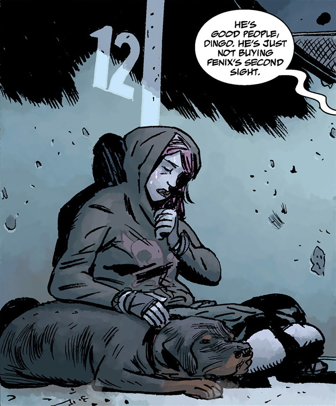
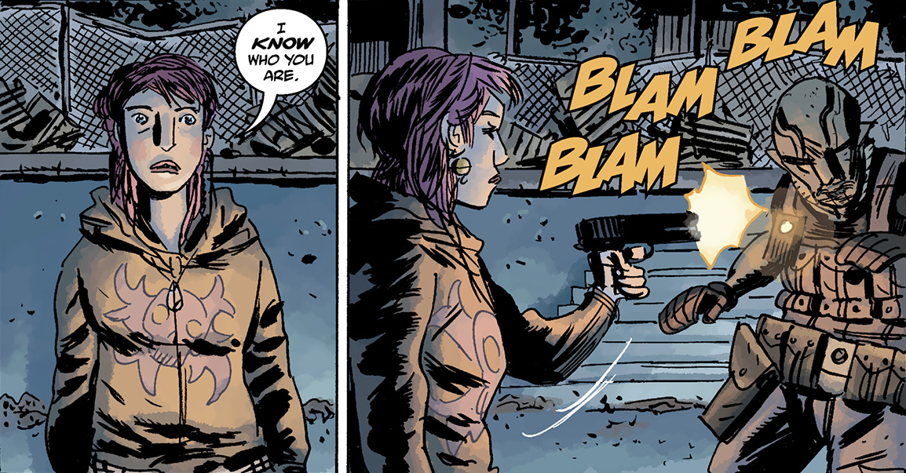
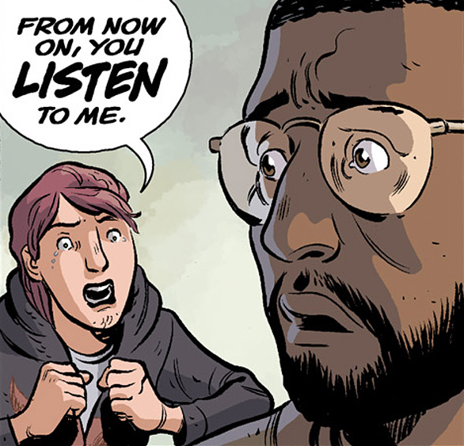
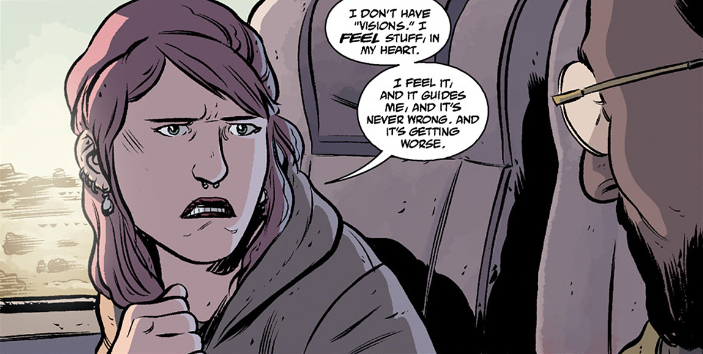

**Fenix Espejo** (pronounced *fEh-neeks ehs-pEh-hoh*) is a sixteen-year-old psychic, currently homeless and trying to survive like many others during the worldwide crisis. Due to being able to sense danger ahead of time, many others flocked to her for guidance and protection. When the [B.P.R.D.](/entry/B.P.R.D.) heard of her existence and sought her out, Fenix shot [Abe Sapien](/entry/Abe%20Sapien), nearly killing him, causing him to be out of action ever since. [Andrew Devon](/entry/Andrew%20Devon) was the only witness to this event, and later on sought her out to take her with him to BPRD Headquarters.

She is latina, her name means 'phoenix' and her surname means 'mirror', in Spanish.

## Physical Appearance

Fenix is a teenager with green eyes and dyed pink hair. She has several piercings, and usually wears a hoodie and khaki pants, as well as an assortment of jewellery. Due to always being on the move, she never changes her wardrobe.

## History

### [Gods](/entry/Gods)

Little is known about Fenix's background. When the plague of frogs broke out, she and several others began traveling to avoid them. When they were in Houston, Fenix urged them to change their course from Galveston to go north, and didn't calm down until they had gotten on a train for Austin, leaving Houston burning behind them after a volcano erupted. A week afterwards, when they were in San Angelo, Fenix once again kept the group moving before ravenous monsters hit the area to feast on the residents. She always knew which trains were safe and where to find free food and drinkable water. However, when they were in Texas she got sick, her psychic senses slightly dulled. When Dingo, Willis, and several others went to find her some medicine, she and Jorge waited at the train station, where two officers and a rottweiler dog discovered them. When they attacked Jorge and the group returned and focused their attention on beating up the officers, Fenix told them to stop, and the rottweiler dog followed her, which later on became her companion and named him Bruiser. Willis suggested they stay at an abandoned football stadium for the night, but Fenix refused and took the group elsewhere. That night, they were attacked by similar monsters that targeted San Angelo, and nearly perished had it not been for the BPRD squad that had been sent to find Fenix gunning them down. Jorge was killed by one of the monsters when he tried to save her, but Fenix survived. However, upon seeing Abe, Fenix grabbed Jorge's gun and, when Abe spotted her, led him away from the group. Despite Abe assuring her that he would not harm her and introducing himself, Fenix interrupted him, stating that she knew who he was, before gunning him down. Devon, much to his surprise and shock, saw the whole thing. Afterwards, when Willis got back to the group and apologized for leaving them somewhere dangerous, Fenix assured him it wasn't his fault Jorge died and the BPRD detained Dingo, and told them all they had to head for Colorado.

### [The Devil's Engine](/entry/The%20Devil%27s%20Engine)

Unable to make it to Colorado, Fenix and her group were stranded in New Mexico, which was where Devon found them. Between jesting and being serious, Fenix admitted to wanting to get in touch with government officials in Colorado and give herself in because she figured they had questions for her. But this way, she decided, turned out easier, because Devon would be able to pay for her and Bruiser's way out of the state. Therefore, it was decided that Devon would take Fenix to Colorado.  
  
However, due to soot and ashes blocking the sky from to the volcanic eruption that happened in Houston, Devon and Fenix were forced to find a train to get there instead of an airplane, despite the teenager's unease at the particular train. Initially, she refused to get on, but wound up doing so due to Bruiser already being on the train. Afterwards, she was continuously agitated and nervous, causing Devon to be disgruntled at her attitude and demand to know whether she knew if something was going to happen to the train.Fenix admitted to feeling that something was wrong, but due to it only being a "feeling", Devon didn't believe her.

Fenix would not be deterred. She began to scream that they all had to get off the train or else they would die, and even used the emergency exit to jump off the train. Devon pursued her angrily, but before he could scold her, the earth trembled beneath their feet, causing an earthquake that overturned the train, snapped the compartments apart, and destroyed the rail. Tearful from the ordeal, Fenix vehemently told Devon to listen to her next time.

## Personality

Like any sixteen-year-old, Fenix has a sense of humor, although hers tends to be quirkier and more cynical than most.[1] She is both fearless and clever, able to come up with plans or excuses on the spot when the need arises.[2] However, when she senses danger, she becomes agitated and frantic with worry, sometimes sounding aloof or childish in the process.[3] Despite that, she will go to any lengths to reach safety, and sometimes even act against common sense.[4]

## Powers and Abilities

 Fenix has something akin to a sixth sense, that enables her to detect danger ahead of time. According to her, it is a feeling in her heart that guides her and has never been wrong,[5] although it appeared that while she was sick, her psychic sense was dulled.[6] Felix's powers grew thanks Panya's tutelage and is able to use her sixth sense more effectively as shown in the B.P.R.D's attack on Zinco Corporation. Interestingly, animals may have an affinity towards her, such as the rottweiler owned by the two policemen that followed her and whom she now affectionately calls Bruiser.[7]

## Relationships

### [Andrew Devon](/entry/Andrew%20Devon)

Although Fenix and Devon do not know each other very long, Fenix already knows that Devon is not the type to seek revenge. Still, she isn't overtly fond of him and doesn't like the fact that he doesn't listen to her or believe her.

### Bruiser

Bruiser is the rottweiler that belonged to two policemen in Texas that wound up following after Fenix and became her new companion. She cares for Bruiser enough to get back on the train that was about to leave despite the increasing danger she felt from doing so, and even threatened one of the workers at the station to take care of her dog.

### Jorge

The extent of the relationship Fenix had with Jorge is unknown, but he affectionately called her "Fee" and "baby" and worried greatly for her safety, often saying while she was sick that they ought to take her to a proper doctor or hospital. He also cared for her enough to throw himself in harm's way when she was in danger and sacrifice his life for her sake.

## Quotes

### [Gods](/entry/Gods)

- "I *know* who you are."

### [The Devil's Engine](/entry/The%20Devil%27s%20Engine)

- "What kinda low-rent green beret takes the train?"
- "Since when is Rambo afraid of volcanoes? Swoop in on some fighter jet, take us out."
- "What's wrong, 'special forces'? Why should you be nervous? *You're* the one with the gun."
- "I don't have 'visions'. I *feel* stuff, in my heart. I feel stuff, and it guides me, and it's never wrong. And it's getting worse."
- "From now on, you *listen* to me."

## Appearances

- [B.P.R.D. Hell on Earth: Gods \#1](http://hellboy.wikia.com/wiki/Gods#Part_One)
- [B.P.R.D. Hell on Earth: Gods \#2](http://hellboy.wikia.com/wiki/Gods#Part_Two) (mentioned only)
- [B.P.R.D. Hell on Earth: Gods \#3](http://hellboy.wikia.com/wiki/Gods#Part_Three)
- [B.P.R.D. Hell on Earth: The Devil's Engine \#1](http://hellboy.wikia.com/wiki/The_Devil's_Engine#Part_One)

## References

<references/>

**Category:Characters** **Category:Female Characters** **Category:Psychics** **Category:Humans**

[1] [B.P.R.D. Hell on Earth: The Devil's Engine \#1](http://hellboy.wikia.com/wiki/The_Devil's_Engine#Part_One)

[2] [B.P.R.D. Hell on Earth: Gods \#3](http://hellboy.wikia.com/wiki/Gods#Part_Three)

[3] [B.P.R.D. Hell on Earth: Gods \#1](http://hellboy.wikia.com/wiki/Gods#Part_One)

[4]

[5]

[6]

[7]