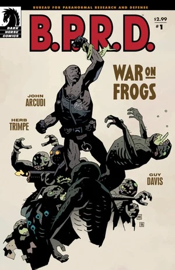
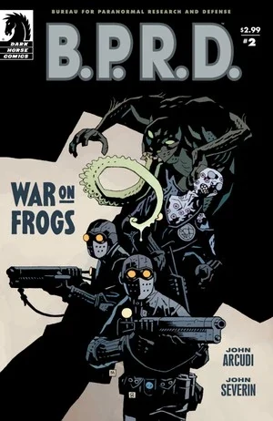
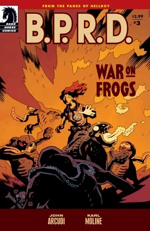
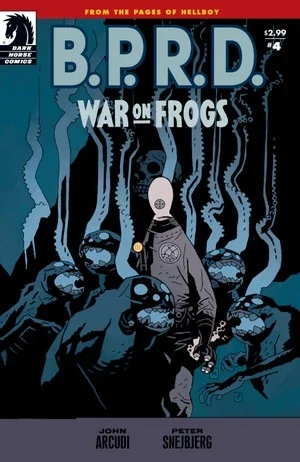
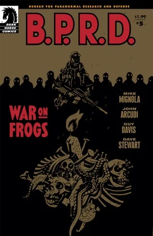

***《蛙人之战》***（War on Frogs）是一部四期限定连载，讲述 B.P.R.D. 成员在对抗[蛙怪](/entry/frog_monster)的战争中的故事。每期都由一位不同的客座画师执笔，且每期都是独立成篇的单篇故事。

## 出版历史

这部四期限定连载于 2008 年 6 月至 2009 年 12 月出版。2009 年 4 月，它与扩写版的《[重生](/entry/Revival)》一同被收录进平装合订本《B.P.R.D.：蛙人之战》（*[B.P.R.D.: War on Frogs](/entry/Trade_Collections)*）。四期连载与《重生》被重新编号，排成了另一种阅读顺序：

- 《蛙人之战》第 1 期（改题为"第 1 章"）
- 《重生》（改题为"第 2 章"）
- 《蛙人之战》第 2 期（改题为"第 3 章"）
- 《蛙人之战》第 4 期（改题为"第 4 章"）
- 《蛙人之战》第 3 期（改题为"第 5 章"）

2011 年 10 月，扩写版短篇《[重生](/entry/Revival)》由黑马数字（Dark Horse Digital）以《蛙人之战》第 5 期的名义重新发行。

该系列后来与《[斯人已逝](/entry/The_Dead)》《[黑焰使徒](/entry/The_Black_Flame_%28story%29)》一同以"宝典"（omnibus）形式收录于《[B.P.R.D.：蛙族瘟疫 第 2 卷](/entry/Omnibus_Editions)》。正如[斯科特·阿利](/entry/Scott_Allie)在序言中所述，《蛙人之战》与《黑焰使徒》被排成了另一种阅读顺序：

- 《黑焰使徒》第 1 期（改题为《蛙人之战》：第 1 章）
- 《蛙人之战》第 1 期（改题为《蛙人之战》：第 2 章）
- 《重生》（改题为《蛙人之战》：第 3 章）
- 《蛙人之战》第 2 期（改题为《蛙人之战》：第 4 章）
- 《蛙人之战》第 4 期（改题为《蛙人之战》：第 5 章）
- 《黑焰使徒》第 2–6 期（改题为《黑焰使徒》：第 1–5 章）
- 《蛙人之战》第 3 期（改题为《黑焰使徒》：尾声）

## 剧情简介

### 第一部

第 1 期由赫伯·特林佩（Herb Trimpe）绘制，聚焦于[罗杰](/entry/Roger)。

随着蛙神教在全美蔓延，人造人罗杰回到了 B.P.R.D. 首次与蛙形生物交锋的地点——卡文迪什庄园（Cavendish Hall）的废墟。正是在这里，[地狱男爵](/entry/Hellboy_%28character%29)、[亚伯](/entry/Abe_Sapien)和[丽兹](/entry/Liz_Sherman)第一次同时遭遇了蛙怪与[拉斯普京](/entry/Rasputin)。罗杰此行是为了追查卡文迪什家族之谜最后的碎片。

亚伯拒绝了[凯特](/entry/Kate_Corrigan)提出的、重返卡文迪什庄园（即《[毁灭之种](/entry/Seed_of_Destruction)》故事发生地）寻找蛙怪线索的建议，罗杰便带领一支 B.P.R.D. 外勤小队前往调查。罗杰侦察了庄园残骸下方的洞窟，在那里发现了卡文迪什兄弟为亡母所设的神龛，其中还有她保存完好的尸体。兄弟俩现出原形——一种进化后的蛙怪。一场恶战之后，一颗流弹打坏了埃玛·卡文迪什的尸体，怪物们因此分了神，罗杰这才占了上风。趁兄弟俩对着母亲的尸体哀恸之际，罗杰开枪齐射，将它们消灭。清理小队赶到时，罗杰开始怀疑当初惊动蛙怪是否值得，最终下令清理队什么也别再做，直接撤离。

### 第二部

第 2 期由[约翰·塞维林](/entry/John_Severin)绘制，讲述一队普通的 B.P.R.D. 士兵登上一艘废弃战舰，搜剿一窝蛙怪——结果反倒成了猎物的盘中餐。这一期是数名 B.P.R.D. 探员的首次也是最后一次登场，他们大概都是从军队征召来的。

2005 年 5 月，一队 B.P.R.D. 士兵被派往加利福尼亚海岸，调查一艘废弃战舰上可能存在的蛙巢。在布拉德利中尉（Lieutenant Bradley）的带领下，探员瓦拉迪、德默斯、伯尼·德安德烈、惠特科姆、巴马和科勒搜查了这艘沉船。当他们穿行在舰上令人窒息的走廊里时，发现蛙怪可能还活着。小队被蛙怪一个接一个地逐渐消灭，无助的[亚伯·塞皮恩](/entry/Abe_Sapien)只能在无线电另一端听着。最后，全队仅存的德默斯冲上甲板，迎面撞上一只蛙怪。手无寸铁的德默斯抄起一根断管武装自己，准备奋战到底。故事最后几页，一名陆军少校赶到现场，通过无线电与亚伯联络。他透露舰上其实只有一只蛙怪，并赞扬德默斯英勇——他以自己的生命为代价斩杀了怪物。

### 第三部

第 3 期由[卡尔·莫林](/entry/Karl_Moline)绘制，聚焦于[丽兹·舍曼](/entry/Liz_Sherman)和新角色[阿什莉·斯特罗德](/entry/Ashley_Strode)。

故事设定在 2006 年 7 月，阿什莉在 B.P.R.D. 食堂里向消沉而冷漠的丽兹打招呼，却被丽兹无视。阿什莉和同事们聊起，她多么钦佩丽兹，视她为 B.P.R.D. 中坚强女性的代表；但她也担心，自从《[B.P.R.D.：黑焰使徒](/entry/The_Black_Flame_%28story%29)》的事件之后，丽兹就一直状态不对。

闪回至 2005 年 4 月，丽兹在路易斯安那州的一座污水处理厂摧毁了一个蛙巢。[戴米奥](/entry/Ben_Daimio)对丽兹执行任务时鲁莽的作风表示担忧，丽兹却对他的话不以为意。一位 B.P.R.D. 同事向阿什莉·斯特罗德讲述了丽兹悲惨的过往。

在一段蒙太奇中，丽兹在整个 2005 年间带领 B.P.R.D. 外勤小队，先后在爱荷华、华盛顿、犹他和俄勒冈清剿蛙巢。

2006 年 2 月，在 B.P.R.D. 总部的走廊里，阿什莉和搭档偶遇丽兹，阿什莉试图自我介绍，丽兹却冷淡而疏远，连她的名字都没问。

在与[凯特](/entry/Kate_Corrigan)和[亚伯](/entry/Abe)的会议上，丽兹提起亚伯不愿参与外勤工作。凯特则批评丽兹近来执行任务的方式，建议她把精力放在培养探员的能力上，而不是一味冷酷地追求效率。带着这番话，丽兹被派去带队，前往蒙大拿州汉德尔森（Handelson）检查一处废弃的蛙巢。

B.P.R.D. 小队搜查现场，丽兹查地下层，阿什莉和搭档查楼上。丽兹走出大楼，以为现场安全。与此同时，阿什莉和搭档遭到蛙怪伏击，阿什莉被击昏，搭档被怪物杀害。就在阿什莉也要被杀的关头，丽兹及时赶到扭转局面。阿什莉很快恢复过来，帮丽兹消灭了剩余的蛙怪。任务结束时，两人已经能直呼其名、友好地分别。

闪回段落结束，这一期回到开篇的 B.P.R.D. 食堂，阿什莉和同事们对丽兹此刻的心境大惑不解。

在最后几格画面中，我们得以一窥丽兹的视角：那位曾在《[B.P.R.D.：黑焰使徒](/entry/The_Black_Flame_%28story%29)》中向丽兹现身的[神秘术士](/entry/Memnan_Saa)，正站在丽兹身后——一个始终挥之不去的身影。

### 第四部

第 4 期也是最后一期，由彼得·斯奈比约（Peter Snejbjerg）绘制，上色由比亚内·汉森（Bjarne Hansen）完成。故事聚焦于[约翰·克劳斯](/entry/Johann_Kraus)。

灵质人约翰·克劳斯带领一队 B.P.R.D. 探员，迎击在全国蔓延的蛙怪。但这一次，烧掉蛙巢对约翰来说并不是战斗的终点——他得以窥见防御署这些死敌死后那令人毛骨悚然的归宿。

2006 年 3 月，约翰带领一支外勤小队前往堪萨斯州剿灭一个蛙巢。迅速消灭蛙怪后，约翰命令[卡特利特探员](/entry/Agent_Catlett)烧掉残骸。然而，除了约翰谁也没看见，蛙怪们的鬼魂留了下来。约翰简短地劝鬼魂们试着往生离去，可它们仍在小队返回 B.P.R.D. 总部的路上一路纠缠。鬼魂开始让卡特利特探员生病，以此要挟约翰帮助它们。在与[本·戴米奥](/entry/Ben_Daimio)商量过、又看到卡特利特病情加重后，约翰被说动，决定帮助这些蛙怪。他以灵魂形态将它们引向高空，举行了一场降灵会。一道巨大的裂口通向另一个存在层面，蛙怪的灵魂得以超生。然而约翰自己的灵魂也险些被吸入深渊，最终才勉强逃脱。回到 B.P.R.D. 总部，约翰在诵读《圣经》。戴米奥走上前，为自己此前轻视约翰所面对的生死之险而道歉。

注：这最后一幕以及与戴米奥的对话，后来在《[漫长之死](/entry/The_Long_Death)》中约翰做的一个梦里被再次提及。

### 第五部

*完整内容见《[重生](/entry/Revival)》*

[本·戴米奥](/entry/Ben_Daimio)追猎伪装成信仰治疗师的蛙怪。

## 内容

注 1：此处不含《[黑焰使徒](/entry/The_Black_Flame_%28story%29)》第 1 期的内容——在所有合订本中，它都被改头换面为《蛙人之战》的第 1 章。
注 2：此处包含《[蛙人之战](/entry/War_on_Frogs)》第 3 期的内容——在所有合订本中，它充当《黑焰使徒》的尾声。
注 3：第 5 部分的内容见《[重生](/entry/Revival)》。

### 第一部

#### 角色

- [超自然调查防御署](/entry/Bureau_for_Paranormal_Research_and_Defense)（B.P.R.D.）
  - [凯瑟琳·考瑞根](/entry/Kate_Corrigan)
  - [亚伯拉罕·塞皮恩](/entry/Abraham_Sapien)
  - [罗杰](/entry/Roger)
  - 马泽伊探员（Agent Mazzei）
  - 其他探员
- [地狱男爵](/entry/Hellboy_%28character%29)（回忆出场）
- [拉斯普京](/entry/Rasputin)（回忆出场）
- [奥格德鲁·赫姆](/entry/Ogdru_Hem)
  - [萨杜-赫姆](/entry/Sadu-Hem)（回忆出场）
- 卡文迪什家族
  - 埃玛·卡文迪什（Emma Cavendish，尸体与照片）
  - 两兄弟（化为[蛙怪](/entry/Frog_monster)）

#### 地点

- 美国
  - [B.P.R.D.](/entry/Bureau_for_Paranormal_Research_and_Defense) 总部（科罗拉多州）
  - [卡文迪什庄园](/entry/Cavendish_Hall)废墟（纽约州北部塔卢塔湖）

### 第二部

#### 角色

- [超自然调查防御署](/entry/Bureau_for_Paranormal_Research_and_Defense)（B.P.R.D.）
  - [亚伯拉罕·塞皮恩](/entry/Abraham_Sapien)
  - 布拉德利中尉
  - 德默斯、瓦拉迪、巴马、科勒、惠特科姆、德安德烈探员
  - [凯瑟琳·考瑞根](/entry/Kate_Corrigan)
- [地狱男爵](/entry/Hellboy_%28character%29)（回忆出场）
- [蛙怪](/entry/Frog_monster)
- 军方人员

#### 地点

- 美国
  - [B.P.R.D.](/entry/Bureau_for_Paranormal_Research_and_Defense) 总部（科罗拉多州）
  - 废弃战舰（加利福尼亚海岸）

### 第三部

#### 角色

- [超自然调查防御署](/entry/Bureau_for_Paranormal_Research_and_Defense)（B.P.R.D.）
  - [丽兹·舍曼](/entry/Elizabeth_Sherman)
  - [阿什莉·斯特罗德](/entry/Ashley_Strode)
  - [约翰·克劳斯](/entry/Johann_Kraus)（回忆出场）
  - [本杰明·戴米奥](/entry/Benjamin_Daimio)（回忆出场）
  - [罗杰](/entry/Roger)（回忆出场）
  - [凯瑟琳·考瑞根](/entry/Kate_Corrigan)（回忆出场）
  - [亚伯拉罕·塞皮恩](/entry/Abraham_Sapien)（回忆出场）
  - 其他探员
- 老妇人（回忆出场）
- [蛙怪](/entry/Frog_monster)（回忆出场）
- [姆姆南·萨](/entry/Memnan_Saa)

#### 地点

- 美国
  - [B.P.R.D.](/entry/Bureau_for_Paranormal_Research_and_Defense) 总部（科罗拉多州）
  - 各任务地点：路易斯安那、爱荷华、华盛顿、犹他、俄勒冈（回忆出场）
  - 舍曼家（堪萨斯城）（回忆出场）
  - 废弃药房（蒙大拿州汉德尔森）（回忆出场）

#### 重要物品

- [姆姆南·萨](/entry/Memnan_Saa)的花（回忆出场）

### 第四部

#### 角色

- [超自然调查防御署](/entry/Bureau_for_Paranormal_Research_and_Defense)（B.P.R.D.）
  - [约翰·克劳斯](/entry/Johann_Kraus)
  - [本杰明·戴米奥](/entry/Benjamin_Daimio)（回忆出场）
  - 其他探员
- [蛙怪](/entry/Frog_monster)

#### 地点

- 美国
  - 堪萨斯州的谷仓
  - [B.P.R.D.](/entry/Bureau_for_Paranormal_Research_and_Defense) 总部（科罗拉多州）

## 画廊

 \#1

 \#2

 \#3

 \#4

 \#5

**Category:Story** **Category:B.P.R.D. story** **Category:B.P.R.D.: Plague of Frogs story**
