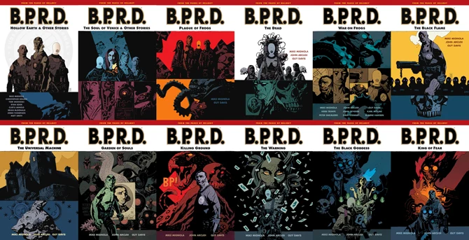

*Plague of Frogs* is the first cycle of *[B.P.R.D.](/entry/B.P.R.D.%20%28series%29)* stories.

Following the release of *[King of Fear](/entry/King%20of%20Fear%20%28story%29)* \#5 it was announced that future *B.P.R.D.* stories would come under the [*Hell on Earth*](/entry/Hell_on_Earth_(story_cycle))) title. All past B.P.R.D. titles come under the *Plague of Frogs* title, making it the first story cycle.

A number of *B.P.R.D.* stories published after this time were not collected in the [*B.P.R.D.: Plague of Frogs omnibus editions*](/entry/B.P.R.D.%20Omnibus%20Editions). These stories were set prior to the *Plague of Frogs* story cycle and were collected in the trade paperback *[B.P.R.D.: Being Human](/entry/TPB)*.

## Stories Published

- *[B.P.R.D. Promo](/entry/B.P.R.D.%20%28teaser%29)* (December 2001 – February 2002)
- *[Hollow Earth](/entry/Hollow%20Earth)* \#1–3 (January–June 2002)
- *[The Soul of Venice](/entry/The%20Soul%20of%20Venice)* (May 2003)
- *[Dark Waters](/entry/Dark%20Waters)* (July 2003)
- *[Night Train](/entry/Night%20Train)* (September 2003)
- *[There's Something Under My Bed](/entry/There%27s%20Something%20Under%20My%20Bed)* (November 2003)
- *[Another Day at the Office](/entry/Another%20Day%20at%20the%20Office)* (August 2004)
- *[Plague of Frogs](/entry/Plague%20of%20Frogs%20%28story%29)* \#1–5 (March–July 2004)
- *[Born Again](/entry/Born%20Again)* (March 2004)
- *[The Dead](/entry/The%20Dead)* \#1–5 (November 2004 – March 2005)
- *[The Black Flame](/entry/The%20Black%20Flame%20%28story%29)* \#1–6 (August 2005 – January 2006)
- *[The Universal Machine](/entry/The%20Universal%20Machine)* \#1–5 (April–August 2006)
- *[Garden of Souls](/entry/Garden%20of%20Souls)* \#1–5 (March–July 2007)
- *[Killing Ground](/entry/Killing%20Ground)* \#1–5 (August–December 2007)
- *[Revival](/entry/Revival)* (March 2008)
- *[War on Frogs](/entry/War%20on%20Frogs)* \#1–4 (June, December 2008; June, December 2009)
- *[Out of Reach](/entry/Out%20of%20Reach)* (May 2008)
- *[The Warning](/entry/The%20Warning)* \#1–5 (July–November 2008)
- *[The Black Goddess](/entry/The%20Black%20Goddess)* \#1–5 (January–May 2009)
- *[King of Fear](/entry/King%20of%20Fear%20%28story%29)* \#1–5 (January–May 2010)

Although not actually a part of the *Plague of Frogs* cycle, the following stories were still collected in the [*Plague of Frogs* omnibus editions](/entry/B.P.R.D.%20Omnibus%20Editions):

- *[Lobster Johnson: The Killer in My Skull](/entry/The%20Killer%20in%20My%20Skull)* (August 1999)
- *[Abe Sapien versus Science](/entry/Abe%20Sapien%20versus%20Science)* (September 1999)
- *[Abe Sapien: Drums of the Dead](/entry/Drums%20of%20the%20Dead)* (March 1998)

## Collections

*Plague of Frogs* was originally collected in [trade paperbacks](/entry/TPB) without the cycle title, alongside other B.P.R.D. stories.

670 px|center|The twelve <em>B.P.R.D.</em> trade paperbacks featuring stories from the <em>Plague of Frogs</em> cycle.

The *Plague of Frogs* cycle was later recollected in [omnibus editions](/entry/B.P.R.D.%20Omnibus%20Editions). These feature a slight re-ordering of the stories for a better reading experience and expanded sketchbooks.

670 px|center|The four volumes of the <em>B.P.R.D.: Plague of Frogs</em> omnibuses.

**Category:Comics**