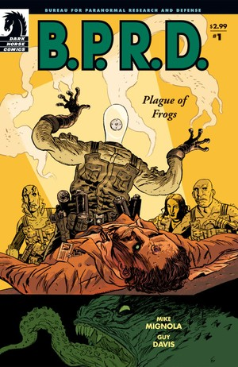
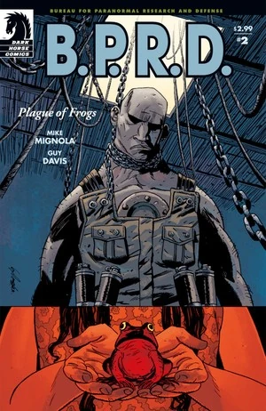
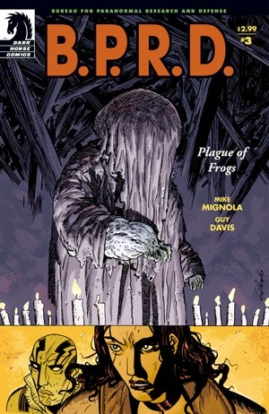
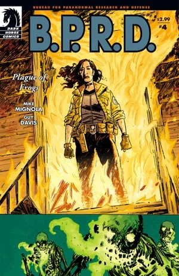
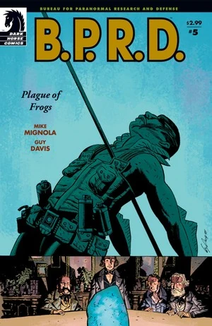

*本条目介绍的是限定连载《蛙族瘟疫》。关于故事周期，见《[蛙族瘟疫（故事周期）](/entry/Plague_of_Frogs_%28story_cycle%29)》。*

***《蛙族瘟疫》***（Plague of Frogs）是一部五期限定连载，由[迈克·米格诺拉](/entry/Mike_Mignola)编剧、[盖·戴维斯](/entry/Guy_Davis)作画。

## 出版历史

在 2003 年出版的四个 B.P.R.D. 单篇故事（《[威尼斯之魂](/entry/The_Soul_of_Venice)》、《[黑水之域](/entry/Dark_Waters)》、《[午夜列车](/entry/Night_Train)》和《[床下有鬼](/entry/There%27s_Something_Under_My_Bed)》）之后，[迈克·米格诺拉](/entry/Mike_Mignola)转变方向，重新回到《[毁灭之种](/entry/Seed_of_Destruction)》的主题。[1]

这部五期限定连载于 2004 年 3 月至 7 月出版。这是[盖·戴维斯](/entry/Guy_Davis)第一次为[迈克·米格诺拉](/entry/Mike_Mignola)的剧本作画。故事于 2005 年 2 月被收录进平装合订本《B.P.R.D.：蛙族瘟疫》（*[B.P.R.D.: Plague of Frogs](/entry/Trade_Collections)*）。

## 剧情简介

### 第一部

在新泽西州的一座 [B.P.R.D.](/entry/B.P.R.D.) 实验室里，一位研究真菌的学者向来访的同行同事展示他最新的研究成果——一株以异常形态迅速生长的巨型真菌。突然，来访的教授从背后开枪射杀了这位博士。保安冲了进来，那名男子却呼唤着他的"主人"。一阵密集的枪声后，整栋大楼陷入黑暗。

[亚伯·塞皮恩](/entry/Abe_Sapien)坐在大海中，看着人们的尸体沉入深海。背景里，他听到《[唤醒恶魔](/entry/Wake_the_Devil)》第 5 期中那位死去的祭司对他说过的同样的话："你可听见……沉没的钟声正为你敲响。在努姆-亚比斯克幽暗而可怖的深洞里，大海正在召唤她的孩子们……回家。"他追随下沉的尸体走进一道亮光，猛然惊醒。

[凯特·考瑞根](/entry/Kate_Corrigan)召集队伍，众人前往新泽西州调查。监控录像显示，教授开枪射杀了研究员，随后被两名保安击中。装真菌的容器被枪弹打碎，真菌似乎钻进了教授体内，接着整栋大楼断电。亚伯、[丽兹·舍曼](/entry/Elizabeth_Sherman)、[罗杰](/entry/Roger)和[约翰·克劳斯](/entry/Johann_Kraus)进入大楼。亚伯和丽兹搜查楼下，罗杰和约翰检查博士的办公室。

搜查途中两人聊了起来。亚伯说他担心罗杰，丽兹回应说他们都知道罗杰的过去，也知道她和约翰身上发生过什么；唯独亚伯的过去，他们一无所知。

罗杰和约翰找到了博士的尸体，他前额上留着某种印记。与此同时，一名失踪的保安变成[蛙怪](/entry/Frog_monster)袭击亚伯和丽兹，另一名保安也变成怪物攻来，亚伯将它们杀死。楼上，博士站了起来发起攻击，同样变成了蛙怪，罗杰设法杀死了它。

### 第二部

回到康涅狄格州的 B.P.R.D. 总部，探员们检查这些蛙怪。每只蛙怪的头部都进入了一枚真菌孢子，从而引发了变异。亚伯和罗杰都回忆起以前见过类似的生物：亚伯是在卡文迪什庄园（见《[毁灭之种](/entry/Seed_of_Destruction)》），罗杰是在洪特城堡（见《[征服之虫](/entry/Conqueror_Worm_%28story%29)》）。[奥唐纳教授](/entry/Professor_James_Henry_O%27Donnell)说那是[萨杜-赫姆](/entry/Sadu-Hem)，并冲[汤姆·曼宁](/entry/Thomas_Manning)大吼。曼宁解释说，每半年就有一支小队检查卡文迪什庄园。十年来一直没有生命迹象，后来却发现了一小块真菌，他们便把样本转移到新泽西的储存设施，任其生长。

由于德比教授的尸体仍下落不明，众人调查他的生平，寻找任何异常行为。他们发现他最近开始向一个总部设在密歇根州蟹角镇（Crab Point）的"新奥秘神殿"（The New Temple of Mysteries）捐赠大笔钱款。小队飞往当地进一步调查。抵达后，镇子看起来已被废弃。[约翰](/entry/Johann)感应到一座老旧教堂里有动静。屋内，一个身着长袍的男子正在向会众布道，告诉他们敌人已经来了，但不必惧怕。

突然，载着探员的直升机坠毁。罗杰被甩出机外，与众人失散。他发现一个小女孩，想上前帮忙，可她其实也是一只蛙怪。怪物发起攻击，罗杰被一条链子吊住脖子悬在半空。

与此同时，在坠毁的直升机里，昏迷的亚伯·塞皮恩再次听到一个声音呼唤："你可听见……沉没的钟声正为你敲响。"他眼前浮现出下沉的尸体。

### 第三部

在坠毁的直升机里，凯特·考瑞根通过无线电向总部请求支援，信号却没能发出去，探员们只能靠自己。

在新奥秘神殿里，亚伯、丽兹、约翰和幸存的飞行员负伤倒在地上。他们面前站着首领和一个被遮盖的巨大身影。那个被首领称为萨杜-赫姆的身影伸出手，把飞行员变成了蛙怪。约翰试图阻止那名男子，可全是蛙怪的会众拦住了他，毁掉了他的容器服。斗篷下的身影显露原形——一个人与真菌的结合体，那怪物以某种方式迫使约翰逃出了房间。

丽兹用她的能力点燃了怪物萨杜-赫姆，将它烧死。然而它的精华渗入地下，赋予墓地里的尸体以生命。发光的骷髅袭击凯特，丽兹赶去救她，亚伯则追向邪教首领。

### 第四部

丽兹放火烧掉神殿里剩余的蛙怪，又冲到外面去救凯特。她焚毁了墓地里行走的骷髅，彻底除掉了萨杜-赫姆。

与此同时，亚伯在一座宽敞的老宅里搜寻邪教首领。他找到了一些关于一个名叫亨伯特·T·琼斯（Humbert T. Jones）的男孩的剪报，还发现了一座供奉[拉斯普京](/entry/Rasputin)的神龛。邪教首领袭击亚伯，用一支长矛刺穿了他，应验了拉斯普京的预言（见《[唤醒恶魔](/entry/Wake_the_Devil)》第 5 期）。亚伯开枪击中那名男子，两人一同从近旁的窗户摔了出去。

两人流着血坐在树林里。亚伯意识到，邪教首领其实就是男孩亨伯特——他的青春被[奥格德鲁·贾哈德](/entry/Ogdru_Jahad)夺走了。他说自己和拉斯普京一样被选中，他侍奉萨杜-赫姆，让它的孩子们——蛙怪——降临世间。亚伯说 B.P.R.D. 一定会抓住那些蛙怪，亨伯特却回应说，总会有一些逃脱，它们会聚到一起，唤醒古老的众神，进而带来世界的终结与一个新世界的开端。使命既已完成，亨伯特走入火中赴死。

亚伯奄奄一息之际，约翰来到他身边想带他重返生者世界，亚伯却悄然逝去。丽兹和凯特赶到，只听到约翰告诉她们：亚伯走了。

### 第五部

小队四周整座镇子都在燃烧，其他 B.P.R.D. 探员火速赶到。

亚伯沉入大海，进入一座巨大的海底神殿。[2] 在里面他看到一个[水之精灵](/entry/Water_Spirit)。在他眼前时光流转，那生物结成了某种茧。画面跳转，一个孤独的潜水者进入神殿，取走了茧。

亚伯被传送到维多利亚时代。一场雷暴中，蛙群从天而降。亚伯穿过一个书架，走进一场秘密集会。四名男子围坐在茧旁，另一人站在他们面前。那人举起茧开始吟诵，茧碎裂开来，精灵被吸进了那名男子体内。突然，那名男子——[考尔](/entry/Caul)——竟能看见亚伯，喝令他退后。亚伯走上前与考尔融为一体。他们把他放进水里，最终却因亚伯拉罕·林肯遇刺而不得不离开考尔。

亚伯醒来，同伴探员们围在他身边。一些探员徒劳地试图捕获所有蛙怪，另一些探员则找回并救活了[罗杰](/entry/Roger)。

## 故事年表

虽未明说，但《蛙族瘟疫》的事件发生在 2004 年 7 月之前的某个时候。《蛙族瘟疫》第 2 期称这些事件发生在 1994 年《[毁灭之种](/entry/Seed_of_Destruction)》的十年之后。根据《[重生](/entry/Revival)》重印版序言，到那一年的 7 月，[蛙怪](/entry/Frog_monster)已经在蔓延。

## 内容

### 角色

#### [B.P.R.D.](/entry/Bureau_for_Paranormal_Research_and_Defense)

- [亚伯拉罕·塞皮恩](/entry/Abraham_Sapien)
- [约翰·克劳斯](/entry/Johann_Kraus)
- [丽兹·舍曼](/entry/Elizabeth_Sherman)
- [凯瑟琳·考瑞根](/entry/Kate_Corrigan)
- [罗杰](/entry/Roger)
- 储存设施人员
  - 普拉特博士（Doctor Platt）
  - 霍华德（Howard，保安）
- [汤姆·曼宁](/entry/Thomas_Manning)
- 前成员
  - [地狱男爵](/entry/Hellboy_%28character%29)（仅被提及）
  - [特雷弗·布鲁滕霍尔姆](/entry/Trevor_Bruttenholm)（仅被提及）
- [詹姆斯·亨利·奥唐纳](/entry/Professor_James_Henry_O%27Donnell)
- 吉姆（Jim）

#### 与[奥格德鲁·赫姆](/entry/Ogdru_Hem)相关

- 新奥秘神殿
  - 欧文·德比（Irwin Derby）
  - 蟹角镇居民（化为[蛙怪](/entry/Frog_monster)）
  - 亨伯特·T·琼斯（Humbert T. Jones）
- [奥格德鲁·赫姆](/entry/Ogdru_Hem)
  - [萨杜-赫姆](/entry/Sadu-Hem)
- [蛙怪](/entry/Frog_monster)（由 B.P.R.D. 储存设施人员变成）
- 卡文迪什家族（回忆出场）
  - 埃玛·卡文迪什（Emma Cavendish，尸体）（回忆出场）
  - 三兄弟（化为[蛙怪](/entry/Frog_monster)）（回忆出场）
- [格里高利·拉斯普京](/entry/Grigori_Rasputin)（照片与回忆出场）
- [斯文·奥拉夫森](/entry/Sven_Olafson)（仅被提及）
- [奥格德鲁·贾哈德](/entry/Ogdru_Jahad)（仅被提及）
- 活骷髅

#### 其他

- [克洛阿西娜](/entry/Cloacina)（仅被提及）
- 成都事件遇难者（回忆出场）
- 特警队员
- 亚伯的幻象/闪回/灵魂时间旅行
  - [水之精灵](/entry/Water_Spirit)
  - [奥安尼斯学社](/entry/Oannes_Society)
    - 兰登·埃弗里特·考尔（Langdon Everett Caul，变身前的[亚伯·塞皮恩](/entry/Abraham_Sapien)）
    - 其他成员

### 地点

- 美国
  - [B.P.R.D.](/entry/Bureau_for_Paranormal_Research_and_Defense) 储存设施（新泽西州）
  - [B.P.R.D.](/entry/Bureau_for_Paranormal_Research_and_Defense) 总部（康涅狄格州费尔菲尔德）
  - 舍曼家（堪萨斯城）（回忆出场）
  - 圣特里尼安医院（华盛顿特区）（回忆出场）
    - [奥安尼斯学社](/entry/Oannes_Society)集会地（回忆出场）
  - [卡文迪什庄园](/entry/Cavendish_Hall)（纽约州北部）（回忆出场）
  - 密歇根州蟹角镇（Crab Point）
  - 密歇根州/威斯康星州边界
- 罗马尼亚（回忆出场）
  - [埃德尔·米施拉斯](/entry/Edel_Mischrasse)在切杰城堡（Fălticeni）下的工坊（回忆出场）
- 德国（回忆出场）
  - 克劳斯家（海德堡）（回忆出场）
- 大西洋
  - 努姆-亚比斯克洞窟（Caverns of Num-Yabisc）

### 重要物品

- [奥安尼斯学社](/entry/Oannes_Society)
  - 潜水服（回忆出场）
  - 潜艇（回忆出场）

## 画廊

 \#1

 \#2

 \#3

 \#4

 \#5

## 注释

<references/>

[1] 在《蛙族瘟疫》第 1 期的 [Hellmail](/entry/Hellmail) 读者来信栏中，[斯科特·阿利](/entry/Scott_Allie)称这部漫画是"米格诺拉漫画世界里一个全新的方向"，并把故事"重新接回《[毁灭之种](/entry/Seed_of_Destruction)》的理念"。

[2] 虽未明说，但这里几乎可以肯定就是努姆-亚比斯克洞窟。

**Category:Story** **Category:B.P.R.D. story** **Category:B.P.R.D.: Plague of Frogs story**
