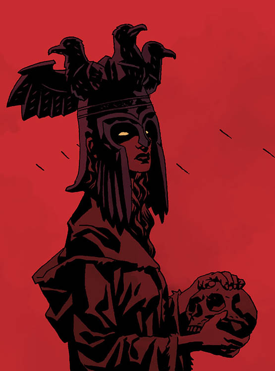

**宁薇**（Nimue），也被称作“血之女王（血皇后）”或“湖中仙女”。是不列颠神话中最强大的女巫。

**Nimue**, also known as "the Queen of Blood" or "the Lady of the Lake," was the greatest of all British witches.

## History

**宁薇**生活在亚瑟王统治时期，并且受到痴汉梅林的追求，梅林把他所有的秘密都告诉了她。她用这种知识把他永远关在坟墓里。但由于没有梅林的指引，宁薇对魔法的了解使她变得疯狂，并最终崇拜了[奥古·桀哈](/entry/Ogdru_Jahad)。她的疯狂到了极点，所有的女巫都杀了她，把她切成许多块，撒在地上。然而，这些碎片总是会重新结合在一起，所以女巫们把它们关进一个木箱里，并把它深深地埋在地下。

**Nimue** lived during the reign of [King Arthur](/entry/King%20Arthur), and was beloved by [Merlin](/entry/Merlin), who told her all of his secrets. She used this knowledge to imprison him in a grave for eternity. But without Merlin to guide her, Nimue's knowledge of magic drove her to madness and eventually to worship the [Ogdru Jahad](/entry/Ogdru%20Jahad). Her madness was so great that all the other witches killed her, cut her into many pieces and scattered them all over the earth. However, the pieces would always rejoin, so the witches shut them into a wooden box and buried it deep within the earth.

几个世纪之后，在黑暗召唤事件期间，在地狱男爵驱逐赫卡特之后，英国的女巫试图寻找新的领袖。 他们向地狱男爵致敬，但他完全拒绝了。 相反，Gruagach来到他们的会议并提名Nimue。 尽管他们有所保留，女巫最终同意了，并给了Gruagach一封信，允许他和他的两个同伴进入Nimue的盒子被密封的坟墓。 看到这封信，监督坟墓的巨人别无选择，只能抬起海豹并移走Nimue的盒子。 做完这个之后，尽管Gruagach承诺即将到来的辉煌的新世界，巨人仍然下到洞里并将封印拖到自己身上。 这位巨人表示，他更喜欢孤独的流亡者，看看发布Nimue会带来什么。

Centuries later, during the events of *[Darkness Calls](/entry/Darkness%20Calls)*, the witches of Britain tried to find a new leader, after [Hellboy](/entry/Hellboy%20%28character%29) had banished [Hecate](/entry/Hecate). They offered the honor to Hellboy, but he refused outright. Instead, [Gruagach](/entry/Gruagach) arrived at their meeting and nominated Nimue. The witches eventually agreed despite their reservations, and gave Gruagach a letter, allowing him and his two companions access to the tomb where Nimue's box was sealed. Seeing the letter, the giant overseeing the tomb had no choice but to lift the seal and remove Nimue's box. Having done this, the giant descended into the hole and dragged the seal over himself, in spite of the glorious new world Gruagach promised was coming. The giant said he preferred a lonely exile to seeing what would come from releasing Nimue.

<!-- missing image: Nimue.JPG --> During the events of the *[The Wild Hunt](/entry/The%20Wild%20Hunt)*, Gruagach was still in possession of the box, but unable to revive Nimue. He was approached by [Astaroth](/entry/Astaroth) in human form, who gave Gruagach a Ciborium containing the blood of all the inhabitants of a nearby human village. When Gruagach poured the blood into the box, the Queen of Blood arose.

After settling her score with the remaining Witches of England (the majority having drowned themselves to escape her wrath and avoid the horror facing the world) Nimue demanded that an army be marshaled for her. While she awaited her army, Gruagach pleaded for only two things: that she restore his powers and give Hellboy to him. She promised she would do so, when the time was right.

Nimue received her first embassy from King Uddsvik of Jutland. The King's ambassador presented her with a golden crown, with promises that he and all the kings of the north would bring their armies to her side. Instead of accepting the crown, she told the ambassador to hammer it into a knife, murder his king with it, then cut out his heart and burn it in a furnace, and use the ashes to forge an iron helmet in the shape of three ravens joined together, bearing the names Badhbh, Macha, and Mor-Rioghain. Nimue said she had no use for a crown, as she was no longer the Queen of Witches, but instead the Goddess of War.

Later, when Hellboy retrieved the sword [Excalibur](/entry/Excalibur), Nimue wondered what [Morgan Le Fey](/entry/Morgan%20Le%20Fey) had planned, but said that it would makes no difference. As she continued to wait for the arrival of her army, Gruagach continued to plead that she fulfill her promise to restore his powers. When he suggested that she was not yet strong enough to do so, she flew into a rage and cast him away before disappearing with her followers.

### [山雨欲来](/entry/The%20Storm) and [怒火燎原](/entry/The%20Fury)

> *"I don't want this..."*- **Nimue**, as her body is transformed by the Ogdru Jahad

Having killed Queen Mab and used her blood to empower a fairy in her service to kill Hellboy, Nimue begins to gather her forces. On the other side, Hellboy uses Excalibur to raise an army of British knights from the grave to oppose her. What Nimue does not realize is that the [Ogdru Jahad](/entry/Ogdru%20Jahad) have chosen her to serve as their vessel for their return to the world, and the revelation causes her body to transform.

By the time Hellboy arrives and knocks her helmet off, Nimue has been completely possessed by the Ogdru Jahad, and transforms into a dragon-like creature, while the two armies battle each other. [Alice Monaghan](/entry/Alice%20Monaghan) has learned from Queen Mab's spirit that this battle will mark the beginning of the end of the world, but Hellboy's role is to ensure that his friends survive to enable humanity to endure the end of the current age.

Receiving a sword from [Vasilisa](/entry/Vasilisa), created from one of the ravens that formed Nimue's helmet, acting on its owner's residual humanity, Hellboy uses it to kill Nimue. Emerging from her body, Nimue's spirit senses that she is being dragged to Hell by the ghosts of England's drowned witches. But Nimue refuses to die alone, and she tears Hellboy's heart from his chest and drags him down to Hell with her.

de:Nimue

**Category:Villains** **Category:Witches** **Category:Female Characters** **Category:Royalty** **Category:The Ogdru Jahad and their Agents**