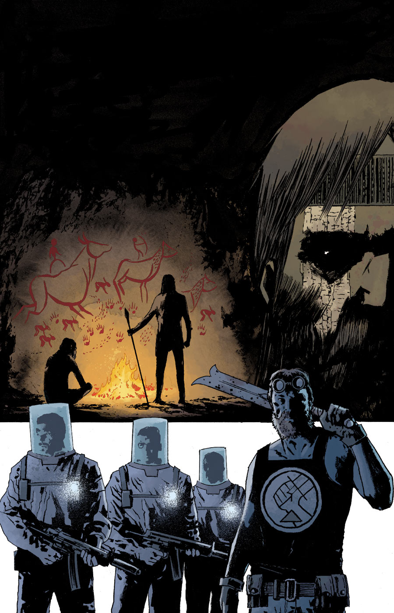
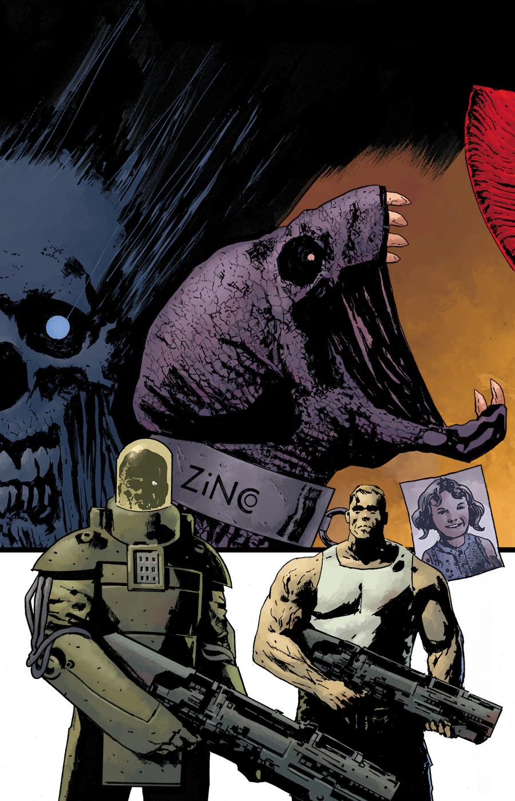
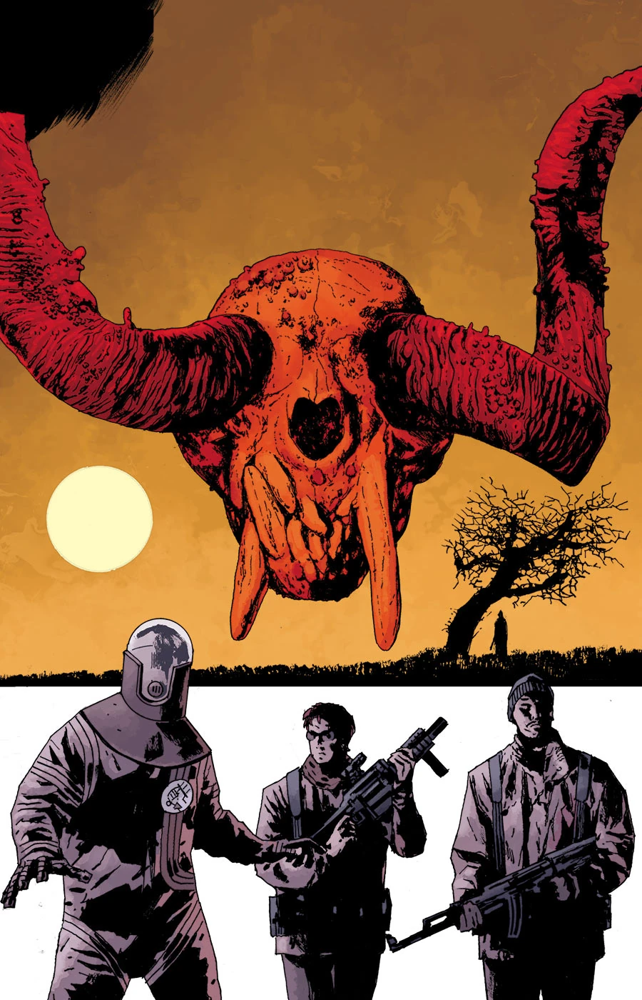
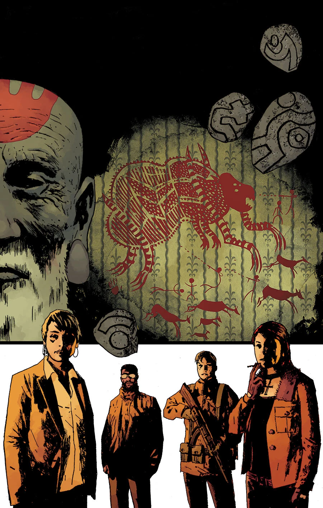
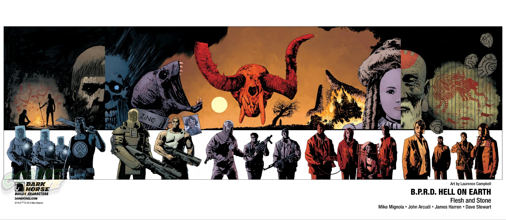

***《血肉磐石》（Flesh and Stone）*** 是一部五期连载故事，由詹姆斯·哈伦（James Harren）作画，封面由劳伦斯·坎贝尔（Laurence Campbell）绘制。

## 剧情简介

### 第一部

[超自然调查防御署](/entry/Bureau_for_Paranormal_Research_and_Defense)（B.P.R.D.）眼下似乎顺风顺水：凭借与军方的同盟，他们如今弹药充足，而在纽约一役之后，还接到一桩看似轻松的任务——清剿一座小镇。可这座小镇却与[霍华德](/entry/Ted_Howards)身为[史前战士](/entry/Gall_Dennar)的过往有着诡异的牵连，而且镇中的怪物之多，也远超寻常。

### 第二部

一头怪物在山中肆虐，霍华德在那里发现了自己身为史前军阀的过往渊源。俄国人正被他们自己的怪物搞得焦头烂额；而在纽约，[金科公司](/entry/Zinco_Corporation)则在[黑焰](/entry/The_Black_Flame_%28character%29)的神秘指令下行事。

### 第三部

霍华德探员身为史前军阀的过往，为 B.P.R.D. 指明了杀死那头穷追不舍的怪物的线索。可霍华德能否在整支小队覆灭之前，把这些知识派上用场？

### 第四部

B.P.R.D. 试图杀死那头在皑皑雪坡上肆虐的怪物，却屡屡失败。正当全队拼命逃生之际，有一个人挺身挡在怪物面前……正是神秘的霍华德探员。这位来自远古的战士究竟能斩杀巨兽，还是会被它踏成齑粉？

### 第五部

霍华德借助自己与远古的联结，从雪山上那头狂暴怪物的手中救下了 B.P.R.D.。可他所领悟的秘密，是否足以力挽狂澜？

## 画廊

\#1

\#2

\#3

\#5

纽约漫展（NYCC）独家海报

**Category:Story** **Category:B.P.R.D. story** **Category:B.P.R.D.: Hell on Earth story**
