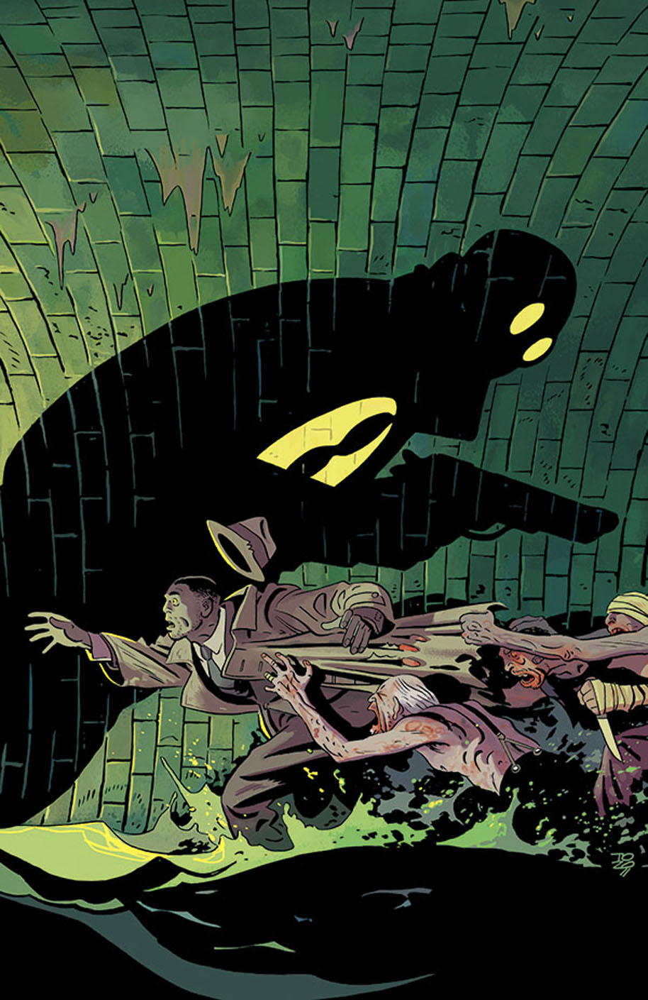

The story takes place in the middle of [the Lobster's](/entry/The%20Lobster) career as a crime fighter in the 1930s.

## Publication History

This one-shot was originally scheduled for March publication, but was pushed back to April.

## Synopsis

After a transient goes missing, Lobster Johnson is called in to investigate a priest who practices more than just religion. What he’s got cooking in his stew pot is nothing compared to what he has hiding in the sewers below...

## Gallery

<File:LobsterJohnson-TheForgottenMan.jpg%7CCover>

! colspan = 3 | [ Vol. 6 A Chain Forged in Life](/entry/TPB)

**Forgotten Man, The** **Forgotten Man, The**