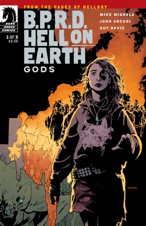
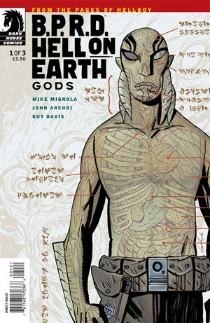
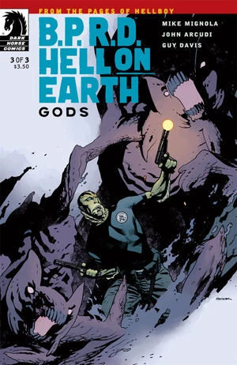

***《诸神》***（Gods）是一部三期完结的迷你系列，于 2011 年 1 月至 3 月间出版。

## 出版历史

这是[*人间炼狱*](/entry/Hell_on_Earth_(story_cycle)))系列的第二个故事篇章，接续《[新世界](/entry/New_World_%28B.P.R.D._story_arc%29)》。各期封面均由[瑞安·苏克](/entry/Ryan_Sook)（Ryan Sook）绘制。第一期另有一版由[盖·戴维斯](/entry/Guy_Davis)（Guy Davis）绘制的变体封面。

本故事与《[众兽](/entry/Monsters)》一同收录于《B.P.R.D.：人间炼狱——诸神与众兽》（*[B.P.R.D.: Hell on Earth—Gods and Monsters](/entry/Trade_Collections)*）平装合订本中。

## 剧情简介

### 第一部

得克萨斯州正坠入地狱，一群无家可归的流浪者——为首的是一名似乎拥有预知能力的年轻女子——在火山喷发、集体癫狂和食人怪物之间东躲西藏。当超自然调查防御署注意到他们时，等待众人的却是致命的后果。

### 第二部

怪物在美国西南部肆虐，休斯敦的一座火山在夜空中燃烧，再加上一群由先知带领的流浪者——对苦苦支撑的调查署而言，这些都是巨大的威胁。

### 第三部

巨耳巨兽向调查署开战，亚伯终于与那位神秘先知正面对峙，而德文的疑虑也得到了证实。

## 画廊

\#1

\#1 变体封面

\#2

\#3

**Category:Story** **Category:B.P.R.D. story** **Category:B.P.R.D.: Hell on Earth story**