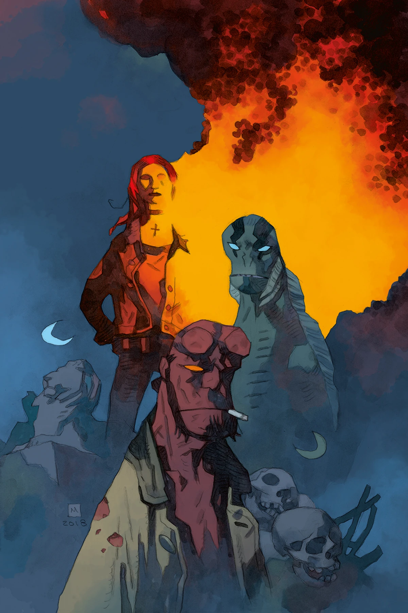
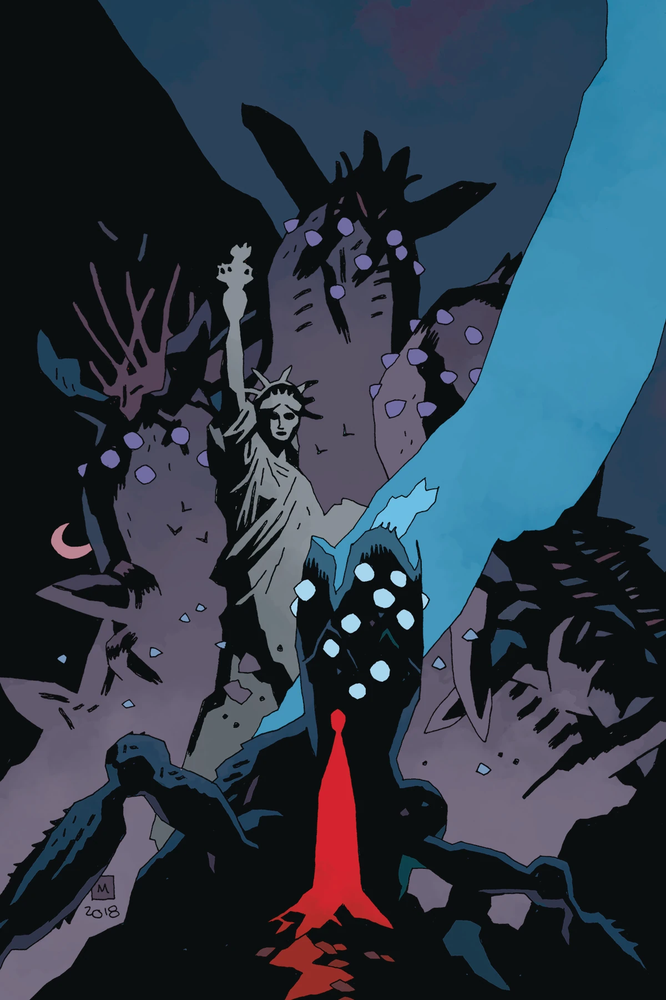
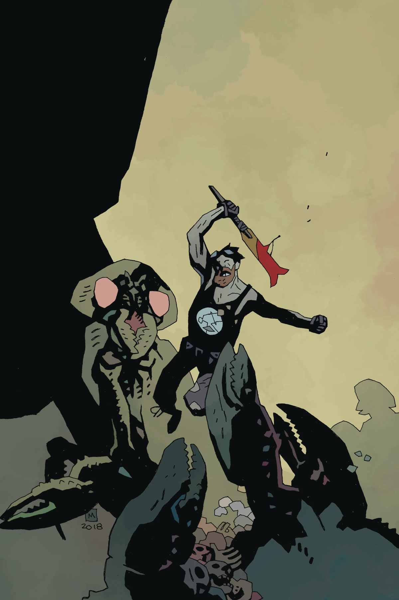
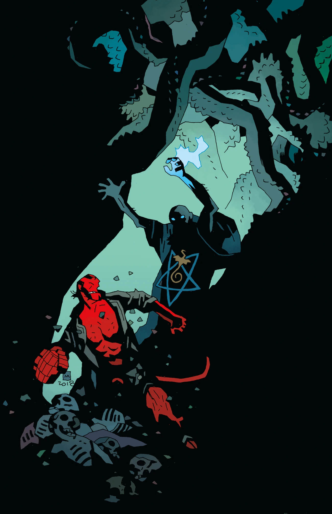
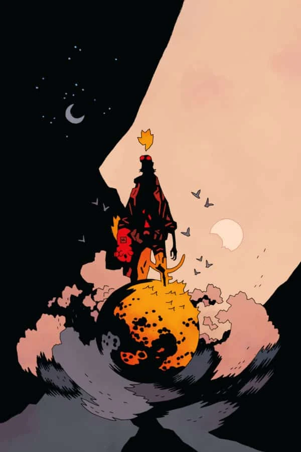

***诸神的黄昏***（*Ragna Rok*）是[《魔鬼旧相识》故事环](/entry/The_Devil_You_Know_(story_cycle))的第三个、也是最后一个故事篇章，同时也是 [B.P.R.D.](/entry/B.P.R.D._(series)) 漫画的最终故事。

## 剧情简介

### 第一部

一个敌人引出另一个敌人——B.P.R.D. 发现他们所面对的，是比原先以为的更加险恶的事物（与人物）；克里斯托弗·米滕（Christopher Mitten）以画笔讲述了 B.P.R.D. 最神秘的敌人之一的起源故事。

### 第二部

B.P.R.D. 拼命筹谋，想把人类从一场根深蒂固的危机中拯救出来；与此同时，一位旧相识造访地狱男爵，带来了新的情报。

### 第三部

地狱男爵、丽兹与亚伯重返纽约，为拯救人类做最后一搏；局里其余成员则竭力引导幸存者撤离到安全之地。

### 第四部

拯救人类的最终决战拉开序幕。

### 第五部

历经十五年的《B.P.R.D.》漫画，整个系列在此迎来爆炸性的终章！

## 画廊

除特别注明外，封面均由[迈克·米格诺拉](/entry/Mike_Mignola)绘制。

\#1 变体封面

\#2

\#3

\#4

\#5

**Category:B.P.R.D.: The Devil You Know story**
