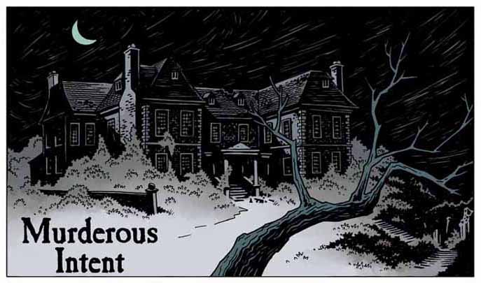

## Publication History

*Murderous Intent* was first published in *MySpace Dark Horse Presents* \#16, November 2008. It was written as a brief introduction to Sir Edward Grey before the miniseries *[In the Service of Angels](/entry/In%20the%20Service%20of%20Angels)*.

The story was collected together with *[In the Service of Angels](/entry/In%20the%20Service%20of%20Angels)* in trade paperback.

## Synopsis

On February 6th, 1879, the witches of Farnham, Mary and Elizabeth Washbrook and Sara Webb, invoke an evil spirit to kill Queen Victoria using a picture as an image of the queen. As a hand an arm emerge from their cauldron, [Edward Grey](/entry/Edward%20Grey) arrives.

He opens fire killing two of the witches, even after one turns into a bird. In the fight the cauldron is kicked over and the picture of Victoria flutters toward the hand which now has a mouth full of sharp teeth. Grey is able to grab the picture before the hand can consume it, but receives a bite from the hand as it grabs his wrist. He kills the final witch, now transformed into a harpy, which breaks the spell.

As a reward, Edward Grey was knighted by Victoria and was appointed her agent in concerning the occult. To the rest of the people, he has gained the title of "witchfinder".

**Category:Story** **Category:Witchfinder story**