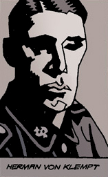
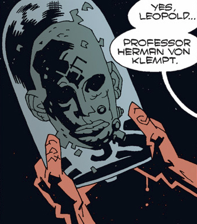

赫尔曼·冯·卡朗普特 **Herman von Klempt** is a Nazi 'mad scientist' who has worked on numerous schemes to control or destroy the world. Though his body was destroyed, von Klempt survived as a head in a jar, often assisted in his work by mechanical apes.

## History

Herman von Klempt was born in 1885, in Frankfurt, Germany. Around ten years old, von Klempt was keenly interested in cybernetics in which he killed the family cat and tried to improve its design by integrating clock parts into its body. His behavior deeply frightened his family in which they were glad to be rid of him when attended medical school in Berlin. At Berlin, von Klempt earned a reputation for his obessive behavior among his peers, and became attached to his colleague [Karl Ruprecht Kroenen](/entry/Karl%20Ruprecht%20Kroenen). Although the two men apparently shared similar ideas, von Klempt regarded Kroenen as little more than a resource as his wealth and social connections provided him the economic backing for research von Klempt could never otherwise have performed.

In 1935, von Klempt along with Kroenen were invited by Heinrich Himmler to join the [Sonnenrad Society](/entry/Sonnenrad%20Society). Shortly after joining the Sonnenrad Society, von Klempt made use of the organization's resources to develop his own projects such as the [Kriegaffe](/entry/Kriegaffe) project. In 1936, von Klempt was nearly killed in a laboratory explosion in which most of his body was destroyed. His life was saved by Kroenen, who managed to keep von Klempt's head alive in a bell jar.

In 1937, [Grigori Rasputin](/entry/Grigori%20Rasputin) recruited several members of the Sonnenrad Society, including Kroenen, as his disciples in [Project Ragna Rok](/entry/Project%20Ragna%20Rok). Von Klempt strongly and distatefully refused of joining Rasputin, whom von Klempt viewed him as a fraud and his ideals meaningless.

### Hunte Castle

 In 1939, Von Klempt participated in the Nazi Space Program in which to make contact with non-corporeal beings in outer space. These beings promised that, if a human shell was sent into space to provide a host for them, it would return to Earth powerful enough to destroy the Nazis' enemies. The Nazis prepared to launch into space the remains of Dr. [Ernst Oeming](/entry/Ernst%20Oeming), a German physicist often referred to as the "Nazi Einstein," who had been assassinated by a car bomb earlier that year, from their base in Hunte Castle in Austria.

On the night of March 20, 1939, the date Oeming's body was to be launched, the American hero [The Lobster](/entry/The%20Lobster) led a group of American troops in an attack on Hunte Castle. In a state of panic, the Nazis launched Oeming's vessel before the castle roof's doors could open. Although the rocket cleared the castle and made it into space, the explosion resulted in the immediate incineration of everyone inside the castle save von Klempt.

### 1946

When Nazi Germany fell to the Allies, von Klempt retreated to a secret base hidden under Berlin. Taking the vampires from Project Vampir Sturm, von Klempt hoped to destroy America with a plague of vampires. In 1946, [Trevor Bruttenholm](/entry/Trevor%20Bruttenholm) and the B.P.R.D. discovered his lair. Von Klempt quickly launched a rocket full of vampires at America before Bruttenholm could stop him. With some help Bruttenholm was able to destroy the rocket taking with it the vampires and von Klempt. Though Bruttenholm thought von Kelmpt had been destroyed, he would resurface some six years later.

### Brazil Experiments

At some point, von Klempt created a secret laboratory beneath an old Portuguese prisoner in Terroso, Brazil. In 1952, during Hellboy's first mission for the B.P.R.D., von Klempt built an undead army and tried to resurrect the Third Reich. His plans came to an end thanks to Hellboy, a small group of B.P.R.D. agents, and a reanimated corpse mutated by an Ogdru Hem spirit. Von Klempt evaded capture when his head was snatched away by one of his ape experiments.

In 1959, von Klempt showed up again in Brazil, this time in the jungles near Macapa. It was Hellboy that found him while investigating the disappearance of peasant girls in the area (as seen in [World's Greatest Paranormal Investigator (CBG)](/entry/World%27s%20Greatest%20Paranormal%20Investigator%20%28CBG%29)). In the fight that ensued, Hellboy defeated von Klempt and his [Kriegaffe](/entry/Kriegaffe), whom von Klempt called "Brutus". Von Klempt was not be seen for decades.

### Wake the Devil

 Von Klempt's old friend and colleague, [Karl Ruprecht Kroenen](/entry/Karl%20Ruprecht%20Kroenen), had placed himself in Suspended animation with [Ilsa Haupstein](/entry/Ilsa%20Haupstein) and [Leopold Kurtz](/entry/Leopold%20Kurtz), two other members of the Ragna Rok Project. After being awakened, Kroenen sent [Roderick Zinco](/entry/Roderick%20Zinco) of the [Zinco Corporation](/entry/Zinco%20Corporation) to retrieve von Klempt's head. After reanimating the mad scientist, Kroenen informed von Klempt of Grigori Rasputin, and the army of the apocalypse. Von Klempt then tried to convince Kroenen to abandon Rasputin's plan, and use the army of the apocalypse to conquer the world, rather than destroy it. After overhearing von Klempt's scheming, Kurtz brutally attacked the madman's disembodied head with a wrench. In von Klempt's defense, Kroenen stabbed Kurtz with a scalpel. Kroenen then turns on von Klempt claiming it was all his fault. Then suddenly, Rasputin appears furious with Kroenen and Zinco for resurrecting von Klempt, and killing Kurtz. Rasputin then strikes Zinco sightless. Blind, Zinco accidentally destroys the base in a raging inferno.

### Conqueror Worm

Luckily surviving the castle's detonation, von Klempt retreated to a secret laboratory under a graveyard in Germany. There he began work on Kriegaffe \#10 along with various other projects when he was suddenly stricken with despair over the seeming endless failure and lack of purpose his life had become. In this moment of weakness, he was contacted by the ghost of Rasputin. Mistakenly believed by von Klempt to be the Angel of Death, Rasputin showed the Nazi scientist the destruction that would result from releasing the worm they had planted within Oeming's body. Once the world had been overtaken, the Ogdru Hem would be released from their prisons, and they would, in turn, release the [Ogdru Jahad](/entry/Ogdru%20Jahad), who will reduce the world to ashes. Von Klempt, finally given purpose - to watch the destruction of the world - returned after sixty years to Hunte Castle.

Von Klempt succeeded in drawing Oeming's capsule back to Earth. A gigantic creature called the '[Conqueror Worm](/entry/Conqueror%20Worm)' surged forth from the capsule. Spewing forth a noxious gas, the worm turned von Klempt's human agents into frog-men, then devoured them immediately to feed its insatiable hunger. Only quick intervention by [Hellboy](/entry/Hellboy%20%28character%29) and [Roger](/entry/Roger), aided by the ghost of The Lobster, managed to halt the worm's march. Von Klempt was pulled off of a cliff by Roger; the madman's jar was smashed and his life came to an end.

### Hell on Earth

Von Klempt's head was somehow recovered by [Landis Pope](/entry/Landis%20Pope) of the Zinco Corporation and placed among Pope's collection of Nazi memorabilia in his office. Following the intense battle between the Black Flame and [Liz Sherman](/entry/Liz%20Sherman), the head of von Klempt was recovered and carried out of the ruins of Manhattan by Kroenen.

### The Devil You Know

Von Klempt is once again revived and is seen sitting and chatting with Varvara laughing about Kroenen who seems to be exhausted and broken.

## Trivia

- Herman von Klempt's head came with the Kriegaffe \#10 Action figure released in 2005 by Mezco Toyz. A Variant of von Klempt's head (with the Nazi swastika on his forehead) was released with a limited-edition Hellboy figure.[1](http://mezco.net/products.asp?pline=hbc2005)

<!-- -->

- Herman von Klempt and several of his Kriegaffen are featured in the *[Hellboy: The Science of Evil](/entry/Hellboy%3A%20The%20Science%20of%20Evil)* video game, where the Nazi head-in-a-jar is the main antagonist of the game.

**Category:Characters** **Category:Nazi** **Category:Deceased Characters** **Category:Germans** **Category:Male Characters** **Category:Scientists** **Category:Humans**