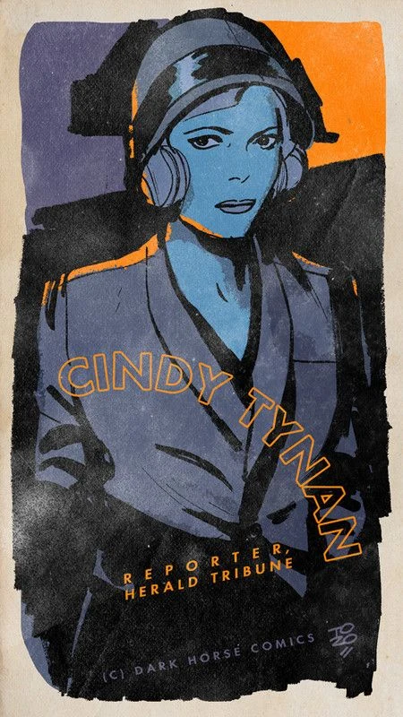

大螯虾强生 系列中的女主角

More commonly known as Cindy Tynan. She was a reporter during the 1930s for New York's *The Herald Tribune*. Her interest in a "ghost indians" ploy by Arnie Wald's henchman [Mr. Isog](/entry/Isog) nearly got her killed. Fortunately [the Lobster](/entry/Lobster%20Johnson%20%28character%29) showed up when he did so she got to live on.

Cindy worked with the Lobster and his crew in stopping one of the earlier incarnations of the villain [The Black Flame](/entry/The%20Black%20Flame%20%28character%29).  It was Cindy who came to their rescue when things looked bleak, driving a car into the Black Flame's wife [Kamala](/entry/Kamala) and killing her.

Cindy would later report the story of the Lobster's exploits against the Black Flame and subsequently reveal his existence to the public.

## Appearances

- *[The Burning Hand](/entry/The%20Burning%20Hand)*
- *[A Scent of Lotus](/entry/A%20Scent%20of%20Lotus)*
- *[Get the Lobster!](/entry/Get_the_Lobster!))*
- *[The Forgotten Man](/entry/The%20Forgotten%20Man)*
- *[Metal Monsters of Midtown](/entry/Metal%20Monsters%20of%20Midtown)*
- *[The Pirate's Ghost](/entry/The%20Pirate%27s%20Ghost)*

**Category:Lobster Johnson Characters** **Category:Characters** **Category:Female Characters** **Category:Lobster's crew**