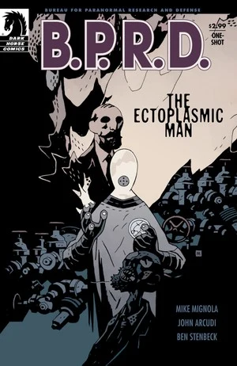

《**通灵师**》（The Ectoplasmic Man）讲述[约翰·克劳斯](/entry/Johann_Kraus)的起源，扩充了 [B.P.R.D. 预告短篇](/entry/Hollow_Earth_Dark_Horse_Extra)中发生的情节，于 2008 年配合《[地狱男爵 2：黄金军团](/entry/Hellboy_II__The_Golden_Army)》上映同期推出。

## 出版历史

这一单行本期号最初于 2008 年出版，后于 2011 年 11 月收录于平装合订本《[B.P.R.D.：生而为人](/entry/Trade_Collections)》中。

## 剧情简介

故事丰满地补全了导致[约翰·克劳斯](/entry/Johann_Kraus)「死亡」、以及他随后加入 B.P.R.D. 的经过——这段经历最早在 [B.P.R.D. 预告短篇](/entry/Hollow_Earth_Dark_Horse_Extra)与《[B.P.R.D.：中空之地](/entry/Hollow_Earth)》中有所交代。

2002 年，德国海德堡。约翰正在主持一场降神会，试图与他的委托人——瓦格纳家族的幸存成员——一同联系上已故的海因里希·瓦格纳。当约翰以灵体形态离体时，他遇见了一个来自中国成都的小男孩的灵魂，男孩请求约翰救救他的父母。与此同时在成都，一个神秘身影被人发现闯入一座戒备森严的建筑，掀开了一具神秘棺椁的盖子。一股巨大的灵能尖峰骤然爆发，席卷整个成都。远在海德堡，成都事件的灵能反噬穿过男孩的灵魂、直贯约翰体内，瞬间摧毁了他的肉身，也摧毁了他的委托人瓦格纳一家的身体。

几小时后，应警方于尔根督察之请，B.P.R.D. 探员[伊扎尔·霍夫曼博士](/entry/Izar_Hoffman)抵达了这场不幸降神会的现场。身为灵能者的霍夫曼能看见约翰的灵体形态。他向约翰解释：成都被放出的恶魔附身了整整一镇的人，并导致全世界范围内的灵体活动骤降。霍夫曼建议约翰「往生上路」，否则他的灵魂将消散于虚无。约翰满心愧疚，把瓦格纳一家和成都男孩之死都归咎于自己。他逃离降神会现场，遁入附近的小镇。

约翰在附近一座墓园驻足，遇见一个刚死不久的男人的鬼魂。他试图安慰这缕亡魂、助其超度，谈话却被一个自称维兰德·洛斯特（Wieland Lorst）的神秘陌生人打断——此人告诉那鬼魂，他能帮他重返阳世。约翰起了疑心，尾随两人来到一座古旧宅邸。等他赶到时，惊骇地发现维兰德已经吞噬了那鬼魂。维兰德显出原形：一头直接来自地狱、以死亡为食的造物。他随即又试图吞噬克劳斯，然而约翰的灵魂太过强大，无法被吞食。维兰德不以为意，随手就把克劳斯打发走了。约翰既怒且惧，发誓要让这怪物受到惩罚。维兰德却带着嘲弄，邀请约翰用一把装填着经教皇格里高利十六世祝圣的银弹的左轮手枪来杀他。可约翰被困在灵体状态、没有肉身，根本无法开枪。维兰德大笑，把他逐出了宅子。

约翰回到自己「死亡」的现场，向霍夫曼博士求助。随后画面里，他第一次穿上封闭防护服，并在 B.P.R.D. 的实验室里用一只死鸟展示了自己的能力。霍夫曼邀请约翰加入 B.P.R.D.、飞往美国。约翰告退，说临行前还有些事要了结。在最后一格画面中，约翰重返维兰德的宅邸，要与那怪物做个了断。

## 故事年表

故事发生在 2002 年 2 月，展现了约翰·克劳斯转变为灵体存在的过程，时间点位于《[地狱男爵：征服之虫](/entry/Conqueror_Worm)》事件与 [B.P.R.D. 预告短篇](/entry/Hollow_Earth_Dark_Horse_Extra)之间。

## 内容

### 角色

- [约翰·克劳斯](/entry/Johann_Kraus)
- 成都事件的受害者
- [B.P.R.D.](/entry/Bureau_for_Paranormal_Research_and_Defense)
  - [伊扎尔·霍夫曼](/entry/Izar_Hoffman)
- 海德堡警察局
  - 于尔根队长
  - 众警官
- 洛斯特的受害者
- 维兰德·洛斯特（Wieland Lorst）

### 地点

- 德国
  - 海德堡
    - 克劳斯宅邸
    - 墓园
    - 洛斯特宅邸
  - [B.P.R.D.](/entry/Bureau_for_Paranormal_Research_and_Defense)设施
- 中国
  - 成都

**Category:Story** **Category:B.P.R.D. story**
