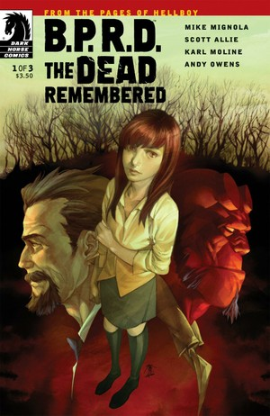
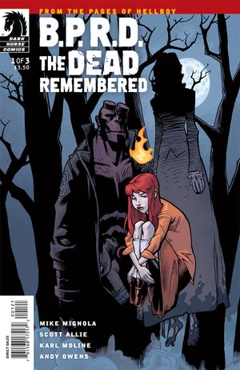
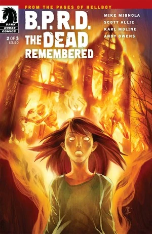
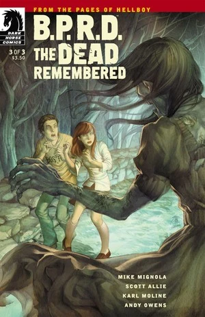

> **读者笔记（原文保留）：**
> 《BPRD13》三个番外短片。
> 《逝者不忘》丽兹刚进 BPRD 时参与的第一个案件。画工差，剧情差。
> 《人员伤亡》，几页纸组成的一个小故事。丽兹和亚伯对待队员伤亡，自己的看法。
> 《生而为人》又是那个画风奇特的画师。讲诉的是罗杰的自我认同问题。
> 《通灵师》就是给约翰的死亡，以及为什么会是现在的样子做一个介绍。和一个合理的安排。
> 总的来看，这 4 个故事都非常的无聊。

《**逝者不忘**》（The Dead Remembered）是一个回溯到 1976 年的故事，讲述[莉兹·谢尔曼](/entry/Elizabeth_Sherman)的第一次「任务」，[特雷弗·布鲁滕霍尔姆](/entry/Trevor_Bruttenholm)也在其中登场。

## 出版历史

这部三期限定迷你系列于 2011 年 4 月至 6 月出版，同年 11 月收录于平装合订本《[B.P.R.D.：生而为人](/entry/Trade_Collections)》中。它是长期担任《地狱男爵》与《B.P.R.D.》编辑的斯科特·阿利（Scott Allie）执笔编剧的第一部迷你系列。

## 剧情简介

### 第一部

在失手把家人活活烧死的三年之后，14 岁的纵火者莉兹·谢尔曼随布鲁姆教授一同前往新英格兰一座小镇调查——那里曾发生过一场残酷的猎巫运动，如今还有一只鬼魂在一位神父的家中作祟。

### 第二部

布鲁姆在神父家中驱鬼时，莉兹探查了宅子周围的树林——当年那场残酷的猎巫运动就发生在此，还有一名女人被杀害！

莉兹失手害死家人的那场事故，终于在此被详细揭晓！

### 第三部

莉兹·谢尔曼重温了三百年前一名受指控、遭酷刑的女人的命运；但她必须克制住自己的火焰之力，否则整座新英格兰小镇都将被迫重演莉兹把自己家人烧死的那一天。

## 与其他故事的关联

故事中穿插了莉兹第一次重大事故的回忆——她在那场事故中失手害死了自己的家人，此事最早在《[毁灭之芽](/entry/Seed_of_Destruction)》第 2 期被提及。

在《[惠蒂尔的遗产](/entry/The_Whittier_Legacy)》中我们得知，来自罗德岛州普罗维登斯（与马萨诸塞州接壤）的惠蒂尔家族曾卷入神秘学仪式。故事里的鬼魂安妮很可能就出自同一家族——她的娘家姓正是惠蒂尔，而且她也是在被指控行巫术之后，从英格兰移居到美国新英格兰地区的。

亚菲德斯神父提到了寻巫人[亨利·胡德](/entry/Henry_Hood)——该角色首次登场于《[黑暗召唤](/entry/Darkness_Calls)》。其中有一页重现了[邓肯·费格雷多](/entry/Duncan_Fegredo)在那个故事里画的一格：描绘胡德绞死一群女人的场景。

## 内容

### 角色

- 安妮·考德威尔（本姓惠蒂尔）；马萨诸塞居民
- [B.P.R.D.](/entry/Bureau_for_Paranormal_Research_and_Defense)
  - [特雷弗·布鲁滕霍尔姆](/entry/Trevor_Bruttenholm)
  - [地狱男爵](/entry/Hellboy_(character))
  - [莉兹·谢尔曼](/entry/Elizabeth_Sherman)
  - 珍妮
- 亚菲德斯神父
- 索蒂罗普洛斯一家
  - 泰德·索蒂罗普洛斯
  - 老泰德·索蒂罗普洛斯
  - 迈克尔·索蒂罗普洛斯
- [亨利·胡德](/entry/Henry_Hood)（回忆）
- 托马斯·考德威尔（回忆）
- 谢尔曼家成员（回忆）

### 地点

- 美国
  - 考德威尔宅邸（马萨诸塞湾殖民地）（回忆）
  - [B.P.R.D.](/entry/Bureau_for_Paranormal_Research_and_Defense)总部（康涅狄格州费尔菲尔德）
  - 皮尔洛空军基地（新墨西哥州）（照片）
  - 无名小镇（马萨诸塞州）
    - 亚菲德斯宅邸
    - 海耶斯旅馆
    - 小餐馆
  - 谢尔曼宅邸（堪萨斯州堪萨斯城）（回忆）
- 英格兰（回忆）

## 画廊

除特别注明外，封面均由 Jo Chen（陈雪珮）绘制。

\#1

\#1 变体封面，Karl Moline 绘

\#2

\#3

## 花絮

- 莉兹与特雷弗驱车前往亚菲德斯神父家时，车里放的歌是保罗·西蒙（Paul Simon）的 [《Loves Me Like A Rock》](https://www.youtube.com/watch?v=CjFzw8AxSBA)。这首歌发行于 1973 年——在故事世界观里，那正是莉兹失手害死家人的年份。

**Category:Story** **Category:B.P.R.D. story**
