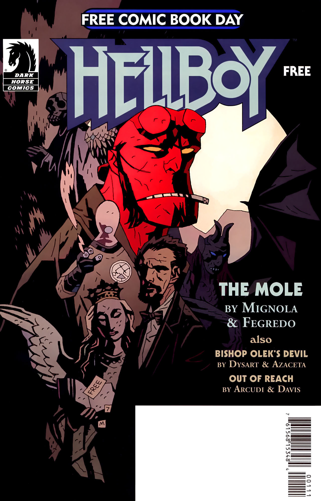

***《遥不可及》***（Out of Reach）是《[厄运之兆](/entry/The_Warning)》（The Warning）以及[《焦土》三部曲](/entry/Scorched_Earth_Trilogy)的一篇序章故事。

## 出版历史

这篇 10 页的故事是 2008 年 5 月"免费漫画日"（Free Comic Book Day）当天发行的三篇故事之一。2009 年 4 月，它与《[厄运之兆](/entry/The_Warning)》一同被收录进平装合订本《B.P.R.D.：厄运之兆》（*B.P.R.D.: The Warning*）。

## 剧情简介

故事紧接《[杀戮地带](/entry/Killing_Ground)》（Killing Ground）的事件展开。[亚伯·塞皮恩](/entry/Abe_Sapien)正准备带队搜寻[本·达米奥](/entry/Ben_Daimio)。[约翰·克劳斯](/entry/Johann_Kraus)提出由他来带队，但亚伯拒绝了，声称自己还有"**一大堆**事情"要处理。

约翰看到查韦斯（Chaves）的遗体、以及他自己先前那具躯体（在《[杀戮地带](/entry/Killing_Ground)》事件中被达米奥摧毁）的遗体，在尸检后被运走。病理学家告诉约翰，他们没能在查韦斯身上找到[凯特·考瑞根](/entry/Katherine_Corrigan)要求他们寻找的那把刀。约翰接过遗物清单，告诉他们这件事由他来处理。

约翰发现，自己试图塑造新形体的努力无法成功；而随后揭示——那把能够杀死豹人（were-jaguar）的刀，其实就在他手中。

## 内容

### 角色

- [超自然调查防御署](/entry/Bureau_for_Paranormal_Research_and_Defense)（B.P.R.D.）
  - [亚伯·塞皮恩](/entry/Abraham_Sapien)
  - [约翰·克劳斯](/entry/Johann_Kraus)
  - [本·达米奥](/entry/Ben_Daimio)（仅被提及）
  - [凯特·考瑞根](/entry/Katherine_Corrigan)（仅被提及）
  - 其他探员与工作人员
- 曼努埃尔·安东尼奥·查韦斯（Manuel Antonio Chaves）

### 地点

- 美国
  - [B.P.R.D.](/entry/Bureau_for_Paranormal_Research_and_Defense)总部（科罗拉多州）

### 重要物品

- [奥安尼斯会社](/entry/Oannes_Society)（Oannes Society）的生化躯体
- 乌亚纳的匕首（Huyana's Dagger）
