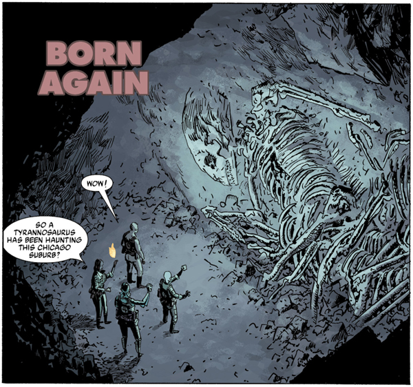

在***《重生》***（Born Again）中，[超自然调查防御署](/entry/Bureau_for_Paranormal_Research_and_Defense)（B.P.R.D.）发掘出一具在很久以前被击败的生物的骨骸。

## 出版历史

《重生》最初于 2004 年 3 月作为《地狱男爵首映版》（*Hellboy Premiere Edition*）的一部分发表。这期由《Wizard》杂志第 148 期独家发行的刊物，还收录了[地狱男爵](/entry/Hellboy_%28series%29)的故事《庞南加兰》（*[The Penanggalan](/entry/The_Penanggalan)*）。这期杂志共推出三种封面：一张由[迈克·米格诺拉](/entry/Mike_Mignola)绘制，画面取自《庞南加兰》；一张由[盖·戴维斯](/entry/Guy_Davis)绘制，描绘 B.P.R.D. 成员与[地狱男爵](/entry/Hellboy_%28character%29)；还有一张（洛杉矶 Wizard World 漫展独家）则是[朗·普尔曼](/entry/Ron_Perlman)饰演地狱男爵的剧照。

《重生》于 2005 年 9 月作为序章收录进平装合订本《B.P.R.D.：斯人已逝》（*[B.P.R.D.: The Dead](/entry/Trade_Collections)*）。

## 剧情简介

[丽兹·舍曼](/entry/Elizabeth_Sherman)、[亚伯·塞皮恩](/entry/Abe_Sapien)、[罗杰](/entry/Roger)与[约翰·克劳斯](/entry/Johann_Kraus)破门进入芝加哥一处郊区地下的洞穴。他们在里面发现一具形似巨型恐龙的庞然骨骸。约翰将自己的一部分灵质（ectoplasm）送入骨骸。那生物开口说，自己是被[尚钦](/entry/Shonchin)（Shonchin）所杀。如今身体与灵魂重新相连，它制伏了约翰。丽兹无力阻止，被迫出手焚毁这具生物。重新掌控自身的约翰得以凝聚形体，回到他的收容防护服中。约翰推测，尚钦必定是一位在久远年代击败此物的萨满。罗杰在洞中找到一根[带刺圆柱](/entry/Spiked_Cylinder)（Spiked Cylinder），把它带在身边。

## 内容

### 角色

- [超自然调查防御署](/entry/Bureau_for_Paranormal_Research_and_Defense)（B.P.R.D.）
  - [罗杰](/entry/Roger)
  - [丽兹·舍曼](/entry/Elizabeth_Sherman)
  - [亚伯·塞皮恩](/entry/Abraham_Sapien)
  - [约翰·克劳斯](/entry/Johann_Kraus)
- 骨骸怪物（Bone Monster）
- [尚钦](/entry/Shonchin)（仅被提及）
- 上校（Colonel）

### 地点

- 美国
  - 建筑工地（伊利诺伊州，芝加哥）

### 重要物品

- [带刺圆柱](/entry/Spiked_Cylinder)（[极北族人](/entry/Hyperboreans)的神器）
