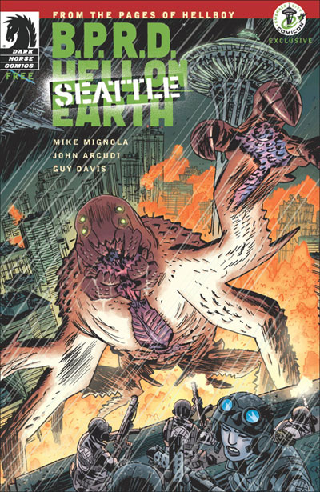

***《鏖战西雅图》***（Seattle）是一则八页短篇故事，背景设定在[派克市场](https://en.wikipedia.org/wiki/Pike_Place_Market)一场大战结束之后。

## 出版历史

这则八页故事最初以黑白形式出版，于 2011 年翡翠城动漫展（Emerald City Comicon，3 月 4 日至 6 日，西雅图举办）免费派发给漫迷。当期还附有五页速写本内容，配有[盖·戴维斯](/entry/Guy_Davis)的评注，以及一页 [Hellmail](/entry/Hellmail) 读者来信栏。

本篇后来以彩色形式收录进平装合订本《[B.P.R.D.：人间炼狱——新世界](/entry/Trade_Collections)》。

## 剧情简介

[卡拉·贾罗科](/entry/Carla_Giarocco)坐在西雅图的废墟中，低头看着一头新近被杀死的怪物的残骸。她联系了[凯特·考瑞根](/entry/Kate_Corrigan)，向她确认那东西已经死透了。一名当地警察走过来和她搭话，问她是否认为人类还能赢得这场战争。贾罗科回答说她也不知道。她又说，她三岁的儿子，是支撑她继续战斗下去的信念之一。

**Category:Story** **Category:B.P.R.D. story** **Category:B.P.R.D.: Hell on Earth story**
