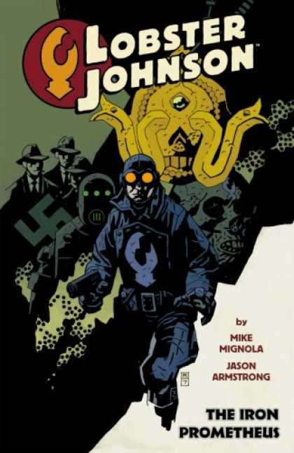

***The Iron Prometheus*** is a five-issue comic series written by [Mike Mignola](/entry/Mike%20Mignola) and illustrated by [Jason Armstrong](/entry/Jason%20Armstrong). It was released in 2007 by Dark Horse Comics.

## Characters

- [Lobster Johnson](/entry/Lobster%20Johnson)
- The Lobster's Crew
  - [Lester](/entry/Lester)
  - [Harry McTell](/entry/Harry%20McTell)
  - Bob
  - Bill
- [Memnan Saa](/entry/Memnan%20Saa)
- [Jim Sacks](/entry/Jim%20Sacks)
- [Dr. Waxman](/entry/Niels%20Waxman)
- [Professor Kyriakos Gallaragas](/entry/Kyriakos%20Gallaragas)
- Helena Gallaragas
- Chutt Warriors

## Plot

### Part One

As America hovers on the brink of World War II, the Lobster and his allies must race against the clock as they fight their way through cannibals, yetis, and the machinations of a mysterious villain bent on fulfilling a deadly prophecy.

### Part Two

The Lobster and Jim delve deeper into the sinister forces behind Professor Gallaragas's mysterious disappearance and discover a conspiracy wilder than they could possibly have imagined, with Nazis, Tibetan cultists, and a prophecy whose fulfillment could mean the end of the world.

### Part Three

Undeterred by his defeat in the jaws of the snake monster, the Lobster springs back into action—but can he find his ally in time? Jim—still in his stolen battle armor—has fallen into the clutches of a mysterious villain who'll stop at nothing to harness the cosmic Vril energy that powers Jim's armor.

### Part Four

With his allies dead, the Lobster must fight his way through a mutated menagerie of mystical and scientific abominations to stop the sinister machinations of his mysterious adversary.

### Part Five

The Lobster returns for the gripping conclusion to The Iron Prometheus, where he battles a fearsome criminal mastermind and Nazis on the Jersey shore, in an attempt to waylay a mysterious prophecy.

## Gallery

文件:The Iron Prometheus 1.jpg|Issue \#1 文件:The Iron Prometheus 2.jpg|Issue \#2 文件:The Iron Prometheus 3.jpg|Issue \#3 文件:The Iron Prometheus 4.jpg|Issue \#4 文件:The Iron Prometheus 5.jpg|Issue \#5

! colspan = 2 | [ Vol. 1 The Iron Prometheus](/entry/TPB) ! colspan = 1 | [ Vol. 2 The Burning Hand](/entry/TPB) **Iron Prometheus, The** **Iron Prometheus, The**