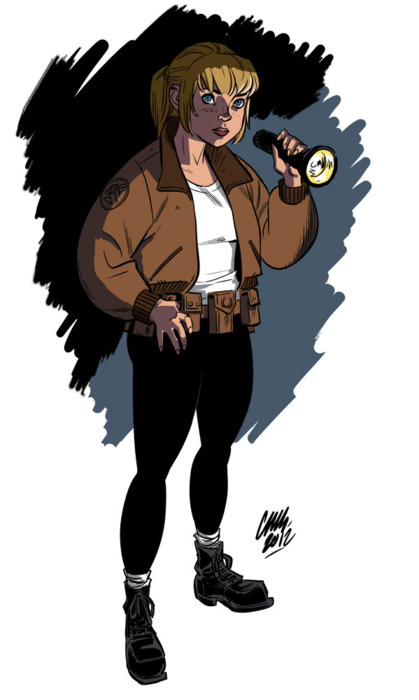

**Ashley Strode** is a [B.P.R.D.](/entry/Bureau%20for%20Paranormal%20Research%20and%20Defense) field agent recruited from the U.S. Navy during the struggle against the Frogs. She first appeared as the viewpoint character in [*B.P.R.D.: War on Frogs* \#3](/entry/War%20on%20Frogs).

Originally created by [John Arcudi](/entry/John%20Arcudi) and [Mike Mignola](/entry/Mike%20Mignola), Ashley's character was meant to be handled primarily by writer/artist [Cameron Stewart](/entry/Cameron%20Stewart). The character has since returned to the main B.P.R.D. writing team in *[B.P.R.D. The Devil You Know](/entry/The%20Devil%20You%20Know%20%28story%20cycle%29)*.

## History

Ashley first appears as a new recruit to the B.P.R.D. Through her interactions with [Liz Sherman](/entry/Liz%20Sherman), Ashley is given an insight into Liz's current state of mind and role in the war on the frog monsters.

### *Exorcism*

  
*see also:*[B.P.R.D. Hell on Earth: Exorcism](/entry/Exorcism)

Ashley took on an assignment to exorcise a demon from a little boy in Indiana with a priest. The exorcism however, merely agitated the demon and manifests itself. Sybacco, the demon, knew Ashley's name and orders her to find Ota Benga and have him release its demon brother. Otherwise, it will never leave the child. She reports to Kate Corrigan and asks to be removed from the assignment, but Kate was able to reassure her that she can do it. Kate informs her that Ota Benga was a Bureau consultant that retired in the 40s. Kate finds out that he is living in retirement in Mexico and orders Ashley to find him.

When she arrived at his house, Ota looked unnaturally old and decrepit. When she informed him on what happened at Indiana, Ota confesses that he is actually a hundred and fifty four. He lived for so long, because he sealed a powerful demon general named Andras back in 1890 inside himself. Ota swiftly agreed to release the demon, only to exorcise it back to Hell. Once he and Ashley bought a goat, they began a ritual to go into the Spiritual Plane. A realm that exists in every person's soul.

Once they both find Andras, Ota releases the demon, telling it that it is free. Almost immediately, Andras attacked Ota. Furious for the years of imprisonment, Andras sought to kill Ota. The demon overpowered Ota, but Ashley injured the demon and saved Ota's life. She then told the demon to quickly leave the Spiritual Plane. Once it did, Ashley awakened in the real world. Andras however, did not go anywhere. Instead, it possessed the goat and transforms it into a monster to kill Ashley. Luckily, she was able to slay the demon. While checking on Oda, he informs her that killing a demon's host will send it back to Hell. Without Andras keeping him alive, the death of old age can finally come to him. Before he died, he gave Ashley his prayer beads, telling her that she knows what to do.

Ashley rode a B.P.R.D carrier back home with Ota's beads and a book possibly containing all information on exorcisms. While flying, she studied up exorcisms and immediately heads back to Indiana to exorcise Sybacco herself. The demon however, immediately left the boy out of fear of Ashley and her newfound abilities.

Afterwords, Ashley decided to officially become the B.P.R.D's official exorcist. Overtime, her abilities grew. Enough to even rival that of Ota's. From this point on, she continued to take all assignments that required an exorcist.

**Category:Female Characters** **Category:B.P.R.D. agent** **Category:Living Characters** **Category:Americans** **Category:Humans**