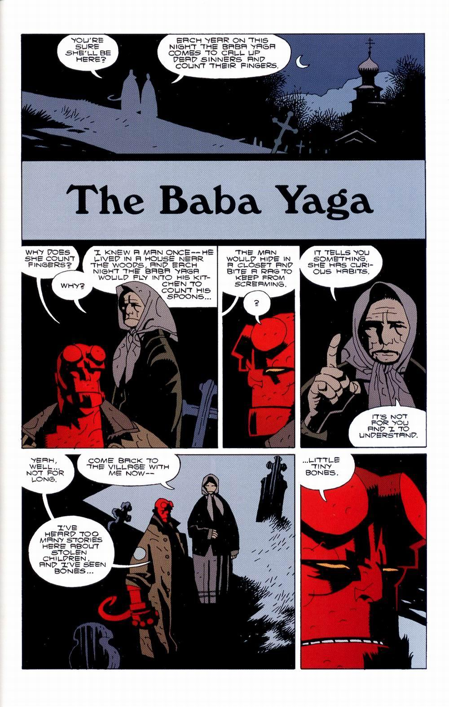

***The Baba Yaga*** tells [Hellboy's](/entry/Hellboy%20%28character%29) first confrontation with the witch [Baba Yaga](/entry/Baba%20Yaga%20%28character%29). While these events were previously mentioned in *[Wake the Devil](/entry/Wake%20the%20Devil)* \#4, they are presented here in full.

## Publication History

The story was planned as early as 1994, and is mentioned in *["Hi, My Name's Hellboy"]("Hi,_My_Name's_Hellboy" "wikilink")* (Oct 1994), though *The Baba Yaga* did not appear as planned.

Four years later, *The Baba Yaga* was drawn specifically for [*Hellboy – Volume 3: The Chained Coffin and Others*](/entry/TPB), published in August 1998.

## Synopsis

Hellboy travels to Russia in 1964, to put a stop to a series of child abductions. He goes to a cemetery where every year [the Baba Yaga](/entry/Baba%20Yaga%20%28character%29) comes to count dead men's fingers. Hellboy fights Baba Yaga and shoot out her left eye. Baba Yaga is forced to leave our world, but she "can never die so long as Russia endures."

## Story Chronology

This story takes place in March of 1964.[1] *[The Troll-Witch](/entry/The%20Troll%20Witch)* occurred one year earlier, and *[Heads](/entry/Heads)* three years later.

## Notes

<references/>
! colspan = 3 | [Vol. 3 The Chained Coffin and Others](/entry/TPB)

sv:Baba Yaga (serie)

**Baba Yaga, The** **Baba Yaga, The**

[1] The year is noted in the story itself, March is stated in *[Darkness Calls](/entry/Darkness%20Calls)* \#2