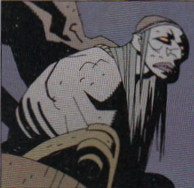

**Baba Yaga** was a legendary witch of Russian folklore that lived inside a chicken leg house, and counted dead men's fingers.

## History

In *[Koshchei the Deathless](/entry/Koshchei%20the%20Deathless%20%28story%29)*, ages ago Baba Yaga took advantage of [Koshchei](/entry/Koshchei)'s fear of losing his soul. She told him that even though the path he took was dark and bloody, but he could still be redeemed. The witch sent him on a quest to slay the last breeding pair of dragons and their hatchlings in Russia so that the mankind may be spared. However in doing so he murdered the family of his adoptive father.

In 1895 prior to the downfall of the Romanov's rule in Russia, Baba Yaga contacted a young [Grigori Rasputin](/entry/Grigori%20Rasputin). She told the monk that the fates had chosen him to be their agent of change, father of the new millennium. To ensure that Rasputin's spirit always be safe, the Baba Yaga placed half of it within the roots of Yggdrasil, the world tree. Baba Yaga and Rasputin gained a strong bond after this, with Rasputin going so far as to call Baba Yaga "grandmother" afterwards.

### Conflict with Hellboy

In March 1964, [Hellboy](/entry/Hellboy) first encountered Baba Yaga while investigating a string of children disappearing. The disappearances were Baba Yaga's doing as she kidnapped the children to satisfy her cannibalistic hunger. When Baba Yaga was counting the fingers of the dead in a cemetery, she attempted to use a skull (that once belonged to someone called Katayev) to lead her to the Sabbath. Then she was ambushed by Hellboy who leaped onto her in a sudden attack. During the scuffle, Baba Yaga's left eye was shot out and she retaliated by attacking Hellboy with the graveyard's tombstones. As a result of her defeat at Hellboy's hands, placing a curse the village of Bereznik with no spring for that year while every child in born would be blind in one eye, Baba Yaga's diminished power causes her to disappear from the world and reside in a pocket dimension created in the image of her Russia as it appeared long ago. But on occasion, if needed to, Baba Yaga can briefly return to the real world.

During the events of *[Wake the Devil](/entry/Wake%20the%20Devil)*, after having her servant [Koku](/entry/Koku) present an iron maiden to Rasputin in his failed attempt to ensure [Ilsa Haupstein](/entry/Ilsa%20Haupstein)'s survival in the coming apocalypse, Baba Yuga observed Hellboy being cast into the darkness by Hecate alongside [Dagda](/entry/Dagda) and [Edward Grey](/entry/Edward%20Grey). During Hellboy's struggles Baba Yaga believed that he would eventually succumb and destroy the world, and later faced disbelief when he did not. Soon after, Baba Yaga meets with Rasputin at Yggdrasil where she tries to convince him to stay with her in her realm to no avail. Though Rasputin turned down her offer, Baba Yuga collected what remained of his soul after he was dispatched by Hecate in the aftermath of the *[Conqueror Worm](/entry/Conqueror%20Worm%20%28story%29)*.

In the events of *[Darkness Calls](/entry/Darkness%20Calls)*, after refusing to be their king after Hecate was disposed of, Baba Yaga offers the witches to give her Hellboy so she can exact her revenge within her world. After the intervention of the [Leshii](/entry/Leshii), who offered Hellboy a one night sanctum in his woods, Baba Yaga summoned her greatest servant [Koshchei the Deathless](/entry/Koshchei) to hunt down Hellboy and bring her his head, or eye, with the promise to release Koschei from his cursed immortality. After killing [Perun](/entry/Perun) for his interference in impeding Koschei's progress, after [Vasilisa the Beautiful](/entry/Vasilisa) showed Hellboy the way back to his world while providing him gifts to hinder Koschei, Baba Yuga resorts to infusing her champion with the thousands of souls from her collection of skulls and then a fragment of her own soul to take control of Koschei's body.

Drained of almost all her power as Koschei is defeated, Baba Yaga attempted to use Rasputin's soul before a fearful Koku snatched the acorn that contained the evil monk away from her and cast it through the roots of the World Tree into Hell. In a last ditch effort, Baba Yaga ordered Koschei to throw his dagger into Hellboy's back as he ascended to the exit of her world. But the last attempt on Hellboy's life failed as a weakened Baba Yaga is calmly derided by the ghost in black as she is told that Hellboy must give her his eye willingly.

## Powers and Abilities

The Baba Yaga is one of the most powerful magic users, let alone witches, in the Hellboy universe. She is well known across the Russian lands and is feared by many who dwell there, especially those who live in the wilderness she often roams. Before the loss of her eye and depowering, she was often seen in the graves of the dead, counting the fingers of the corpses before sucking in their souls and breathing them into empty skulls to create ghostly lanterns. These lanterns are shown to hang from the branches of the world tree and completely fill the interior of her chicken legged house.

Baba Yaga's magical expertise appears to lie in spiritual magic, or magic that involves the control or manipulation of souls. Her lanterns are a chief example of this; it has been stated that she had thousands in her collection. A vast army of the undead is under her control, one that uses to dominate her faux Russia with little resistance, save by the hands of the Leshii, who delights in getting in her way. She also controls Koschei the deathless and owns his soul, which she keeps in an egg inside a duck inside a rabbit inside a goat. Her ghostly lanterns appear to be the source of her power; she has demonstrated the ability to use them to amplify the powers of other beings. She can also remove portions of a soul and place those portions elsewhere to grant the soul's owner extended life, as demonstrated with Rasputin.

Baba Yaga also uses other forms of magic to aid her. She is often seen traveling great distances inside a giant wooden mortar, in a manner similar to a witch's broom. She also possesses a set of prosthetic wooden legs and a wooden lower torso, both of which are likely powered by magic. She has demonstrated on more than one occasion the ability to see great distances, going so far as to even see outside of her faux Russia and into the normal world. She also has the ability to communicate with witches in the normal world should she deem it necessary.

Within her dimension, the Baba Yaga is easily the dominant power. Her army of undead reinforces her power there to an nth degree, and her personal abilities are, or at least were, unrivaled. Several other deities and Russian folklore figures exist in the faux Russia with her, but she is shown to be extremely oppressive to them and will kill any who get in her way without hesitation.

After the draining of her lamps and a portion of her own soul however, the Baba Yaga's power appears to have been permanently crippled. Following Hellboy's escape, she is shown to be weak and trembling, losing even her ability to talk. "Her" Russia is shown to continue existing even after her power is gone, hinting that its existence may not depend on her and might simply be an alternate world that she managed to conquer. No longer possessing the ability to travel into the normal world to collect more souls, it seems unlikely that her power will ever recover.

After losing her eye, it is stated that the Baba Yaga lost her ability to exist in the normal world, yet she is shown doing just that in "Wake the Devil," standing alongside Dagda and Edward Grey, suggesting that she still has the ability to make quick trips outside of her world. It is unknown if she can still do this after the loss of her lanterns.

sv:Baba Yaga

**Category:Characters** **Category:The Ogdru Jahad and their Agents** **Category:Witches** **Category:Villains** **Category:Female Characters**