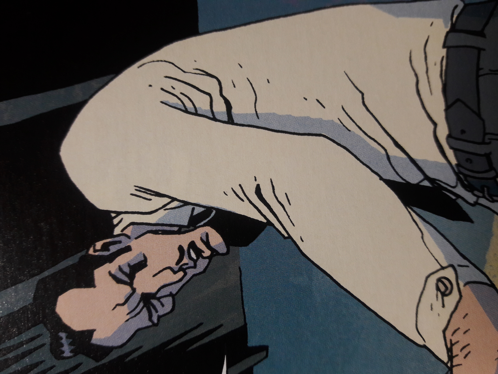

雅各布·斯特格纳

**Jacob Stegner** was an American soldier and [B.P.R.D.](/entry/B.P.R.D.) field agent in 1947 and frequent character in the [Hellboy and the B.P.R.D.](/entry/Hellboy%20and%20the%20B.P.R.D.) storyline.

## History

Jacob Stegner was a survivor of the Normandy Invasion and fought throughout the European Theater of the Second World War in the 4th Infantry Division as Corporal. At the end of the war in Europe, Stegner participated in the liberation of the Auschwitz concentration camp. After the war, Stegner was declined for intelligence service due to his poor psychological evaluation, instead, he joined the [B.P.R.D.](/entry/B.P.R.D.) in 1947.

A year later, he accompanied Professor Broom to the Utah desert, alongside Agent [Anders](/entry/Simon%20Anders), due to sightings of monsters near a nuclear missile base. During the mission Stegner and Anders fought several bearlike creatures believed to be from another dimension, the two agents soon fell out over Anders putting other agents lives at risk.

Five years later, Stegner traveled to Pasadena, California to investigate the disseverance of six children and the murder of one adult. Agent [Susan Xiang](/entry/Susan%20Xiang) and a young [Hellboy](/entry/Hellboy) joined him in fighting a large dog-like monster that had killed several local police officers. During the investigation, Xiang encountered a mineral that was created by the missile testing in Utah five years ago. Due to her psychic abilities when she touched the mineral she had a flashback of Stegner in the desert, causing him to recognize the owner of the mineral as a scientist from the missile project; unfortunately, the scientist was killed before the relationship between the dog monster and the mineral could be explained.

**Category:Characters** **Category:Male Characters** **Category:B.P.R.D. agent** **Category:Humans** **Category:Americans**