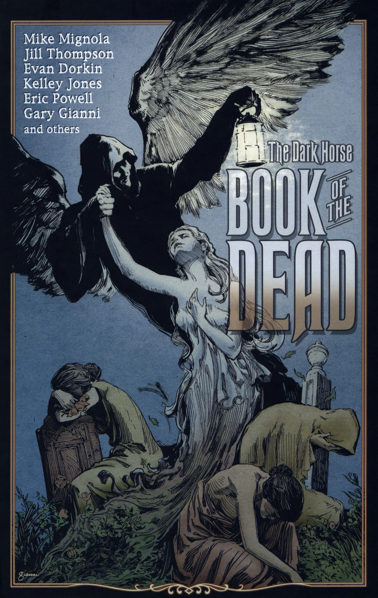

[Hellboy](/entry/Hellboy) confronts a poetry spouting Ghoul.

## Publication History

别名:食尸鬼/死亡倒影/蠕虫之歌

*The Ghoul* (or *Reflections on Death and The Poetry of Worms*) was first published as part of the anthology *The Dark Horse Book of the Dead* in June 2005. The volume is part of the \[<https://en.wikipedia.org/wiki/The_Dark_Horse_Book_of>... *Dark Horse Book of...*\] series of horror anthologies. The story was later reprinted in the *[Hellboy 20th Anniversary Sampler](/entry/Hellboy%2020th%20Anniversary%20Sampler)*.

## Synopsis

One night in 1992, an old woman, Mrs. Stokes sits watching a puppet show of Shakespeare's Hamlet. The [B.P.R.D.](/entry/B.P.R.D.) sends agent [Pauline Raskin](/entry/Pauline%20Raskin) to speak with an old woman, Mrs. Stokes. Her husband Edward is out late that night, and Raskin shows her a number of photographs taken in a cemetery. Mrs. Stokes identifies her husband in the picture, but is confused by it.

The action cuts to Hammersmith Cemetery where Edward Stokes is reciting poetry, as he walks around. [Hellboy](/entry/Hellboy) startles Stokes and asks if he will come in quietly. Stokes runs and Hellboy follows. Stokes begins to reveal his true form, and bears his large inhuman teeth. Stokes continues to recite his poem as Hellboy beats him around the cemetery. Stokes rips off his shirt and dives down into a tomb. Images of Stokes being devoured my maggots are interspersed with scenes of Hamlet talking about the fact that in the end maggots eat all people, king and beggar alike.

! colspan = 3 | [*Hellboy – Volume 7: The Troll Witch and Others*](/entry/TPB)

**Ghoul, The** **Ghoul, The**