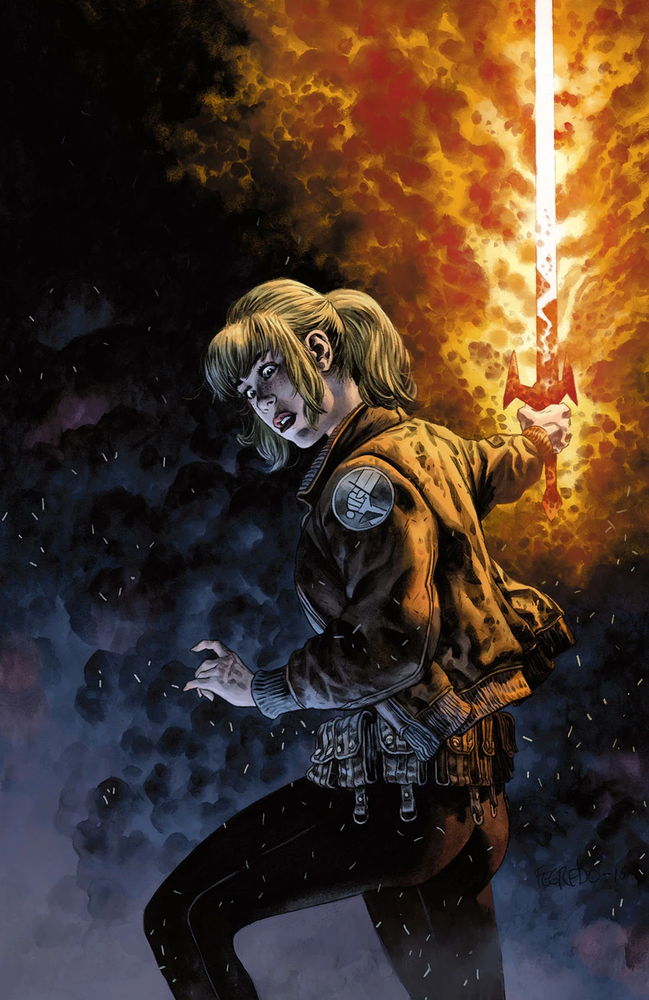
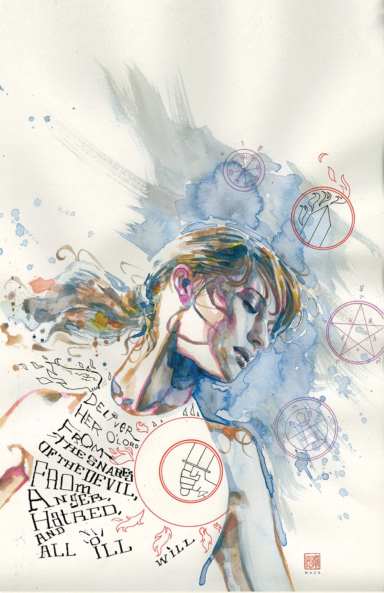
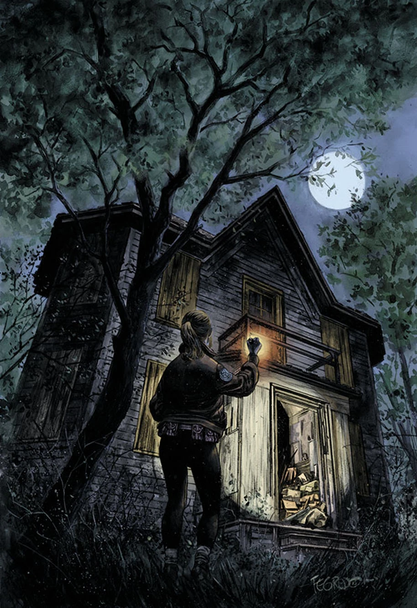
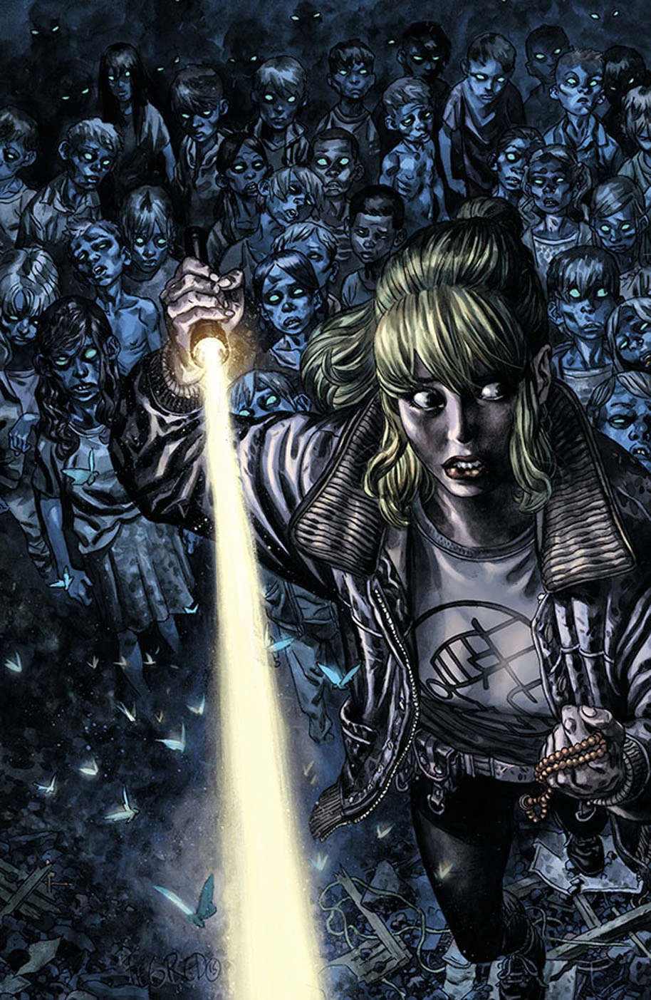

***《驱魔人》***（The Exorcist）是[卡梅伦·斯图尔特](/entry/Cameron_Stewart)（Cameron Stewart）创作的一对[阿什利·斯托德](/entry/Ashley_Strode)故事中的第二篇。

## 出版历史

这部三期故事最初原定由卡梅伦·斯图尔特亲自编剧兼作画，并于 2016 年 2 月开始推出。然而，当故事延期至 2016 年 4 月时，创作团队发生了变动：依据卡梅伦·斯图尔特的故事大纲，《驱魔人》的剧本由[克里斯·罗伯森](/entry/Chris_Roberson)（Chris Roberson）撰写，[迈克·诺顿](/entry/Mike_Norton)（Mike Norton）接手绘稿，[戴夫·斯托克斯](/entry/Dave_Stokes)（Dave Stokes）在缩略草图方面提供了部分协助。

斯图尔特表示，由于《搏击俱乐部 2》（Fight Club 2）与《蝙蝠女》（Batgirl）的创作合约缠身，他无法独自完成这个故事。他还说这很可能是他最后一部阿什利·斯托德故事，此后他将专注于自己的独立项目。[1]

## 剧情简介

### 第一部

卡梅伦·斯图尔特（《搏击俱乐部 2》《蝙蝠女》）再度回归他在[《B.P.R.D. 人间炼狱：驱魔记》](/entry/Exorcism)中塑造的这个角色。上一次见到阿什利·斯托德时，世界刚开始在她周围分崩离析，而她只学到了驱魔最基础的皮毛。如今地狱之门已然关闭，文明在末日面前彻底停摆，阿什利正凭借自己所知的一切拖延终局的到来。一座小镇上一栋摇摇欲坠的老宅藏着诡异的秘密，让阿什利恨不得自己一直留在[丽兹](/entry/Elizabeth_Sherman)和[凯特](/entry/Katherine_Corrigan)身边——因为要应付眼前这桩事，恐怕得出动整个[超自然调查防御署](/entry/B.P.R.D.)。

### 第二部

接连失踪的儿童与崇拜魔鬼的传闻，将超自然调查防御署的驱魔人阿什利·斯托德引向了一座近乎荒弃的乡村小镇，而镇上并非人人都愿意驱除本镇的恶魔。

### 第三部

阿什利循一个恶魔符号的线索追查到乡村小镇上一栋废弃老宅，她必须直面全镇的恶魔，以免再有更多孩子失踪。

## 画廊

\#140

\#140 大卫·麦克（David Mack）变体封面

\#141

\#142

## 注释

[1] <http://www.comicbookresources.com/article/roberson-norton-team-with-stewart-for-ghostly-bprd-story>

**Category:Story** **Category:B.P.R.D. story** **Category:B.P.R.D.: Hell on Earth story**
