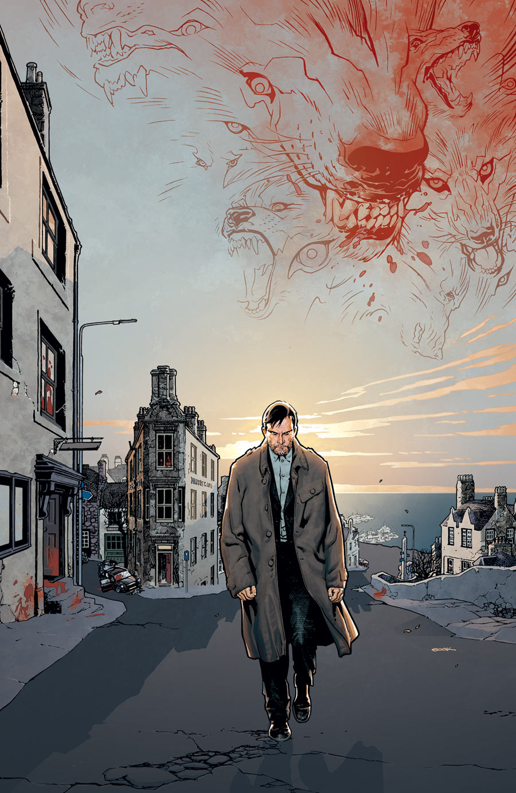
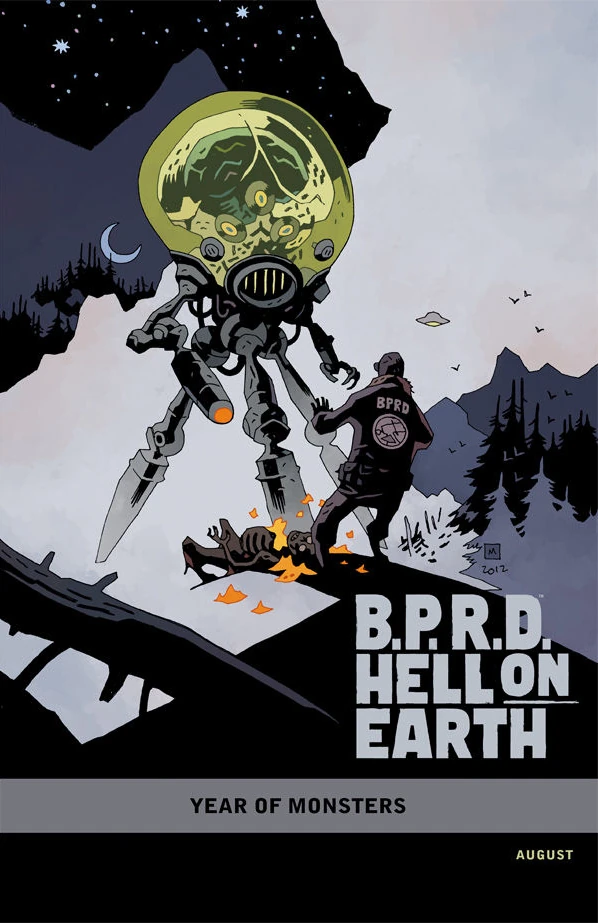
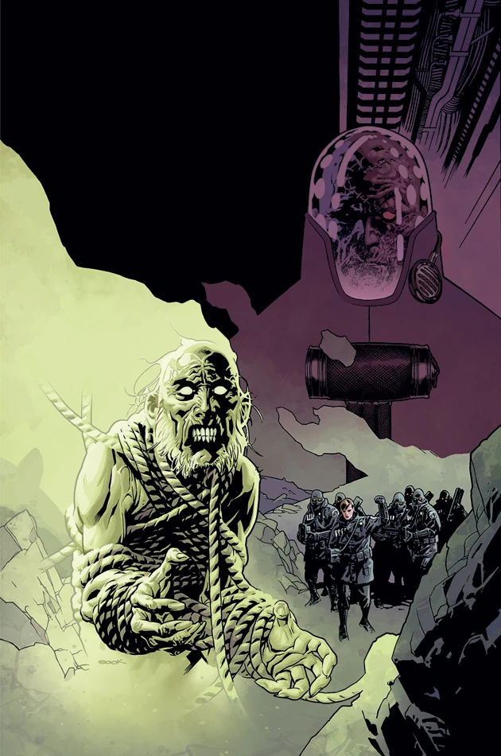
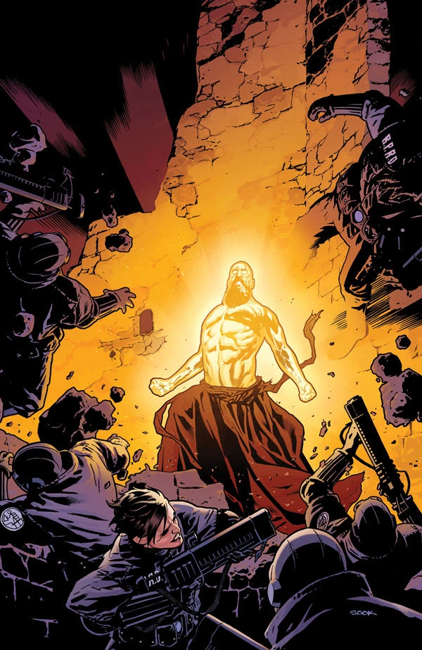
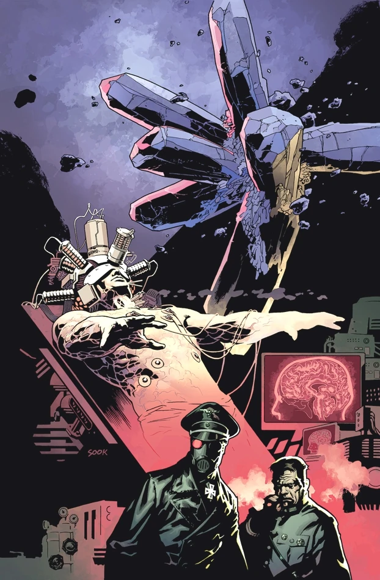
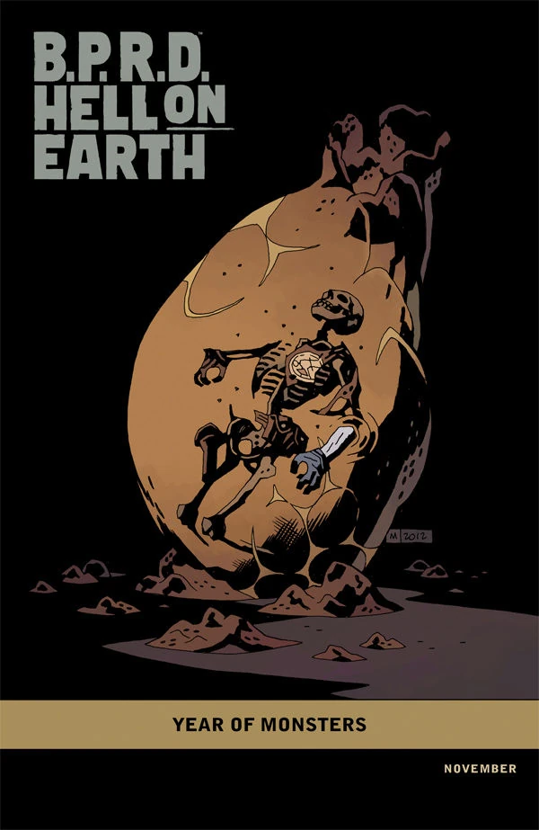
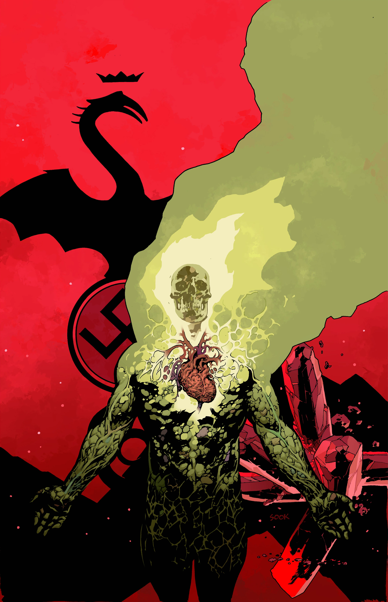
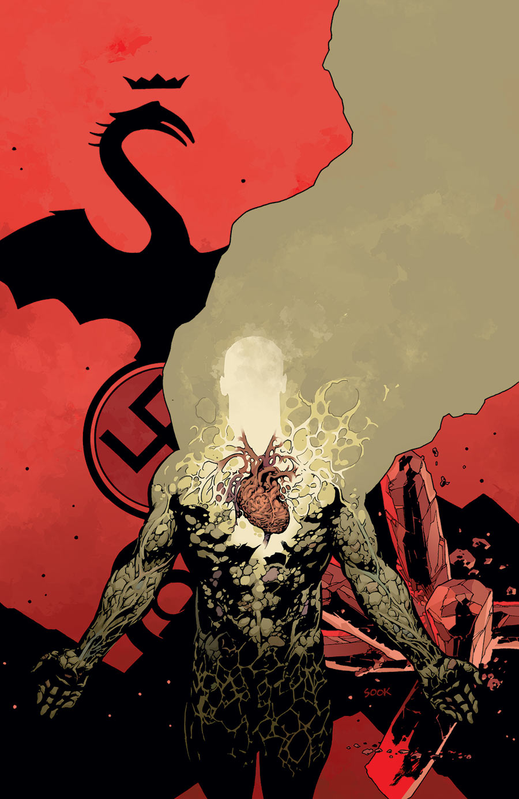

***《魔主再临》***（The Return of the Master）是一部五期限定连载，于 2012 年 8 月至 12 月间出版。其中第 \#3 期也是[《超自然调查防御署》](/entry/B.P.R.D._%28series%29)系列的第 100 期。

## 剧情简介

### 第一部

在苏格兰高地，一名从[《B.P.R.D.：人间炼狱——俄罗斯》](/entry/Russia)那场血腥屠杀中逃脱的叛逃科学家，纠集起一个一心要毁灭世界的超自然邪教。超自然调查防御署能否及时追查到这个团伙？还是说，恶魔将被释放到这个本已摇摇欲坠、濒临末日的世界中？

### 第二部

一支超自然调查防御署精英小队深入苏格兰高地追捕那名疯狂的俄罗斯科学家，却遭到一头凶残骇人的厉鬼伏击。与此同时，金科（Zinco）公司与防御署会面，筹划针对约翰的特殊实验。

### 第三部

一支超自然调查防御署特遣队抵达疯狂俄罗斯科学家及其邪教信徒的据点，却发现自己被困进了一座充斥着可怖黑魔法的致命要塞。

### 第四部

疯狂的俄罗斯科学家及其邪教信徒令防御署兵力大损，局势陷入一片混乱。与此同时，在防御署总部进行的金科实验迎来了一个危险而意外的结局。

### 第五部

恐怖的巨兽自地底喷涌而出，毁灭性的浩劫席卷全球——人间炼狱至此达到顶峰。

## 画廊

除特别注明外，全部封面均由瑞安·苏克（Ryan Sook）绘制。

\#1

\#1 「[怪兽之年](/entry/Year_of_Monsters)」变体封面，由[迈克·米格诺拉](/entry/Mike_Mignola)绘制

\#2

\#3

\#4

\#4 「[怪兽之年](/entry/Year_of_Monsters)」变体封面，由[迈克·米格诺拉](/entry/Mike_Mignola)绘制

\#5

### 第 \#5 期备选封面

在前期征订宣传中，第 \#5 期封面曾经过修改，以免提前泄露第 \#4 期的重大转折。第 \#4 期出版后不久，真正的封面才公之于世。

**Category:Story** **Category:B.P.R.D. story** **Category:B.P.R.D.: Hell on Earth story**
