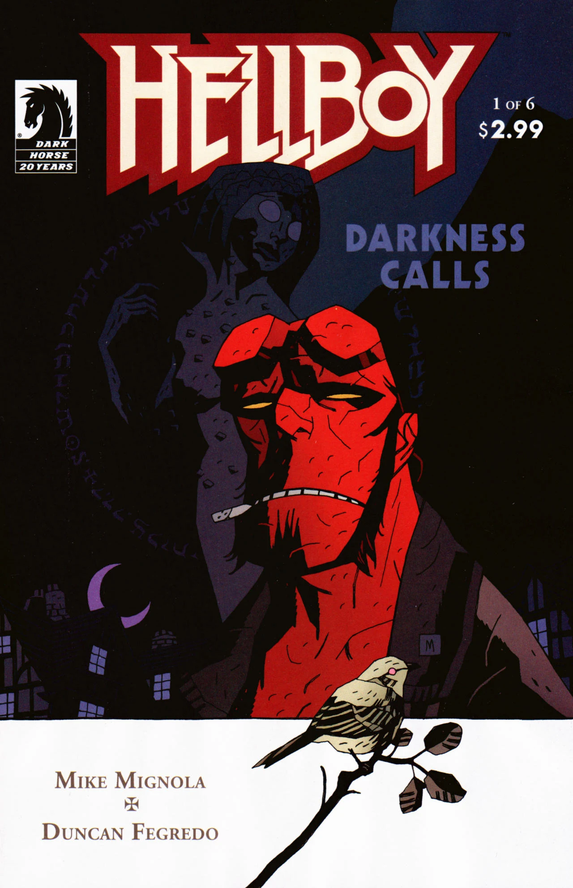

[Hecate](/entry/Hecate) is trapped, and the witches look for a new ruler, and they want [Hellboy](/entry/Hellboy%20%28character%29) as their king. Hellboy refuses, and is trapped in a world of Russian myth controlled by [the Baba Yaga](/entry/Baba%20Yaga%20%28character%29). He is forced to confront her servants before he can escape. Meanwhile the witches continue their search for a new ruler, setting the stage for what is to come.

## Publication History

*Darkness Calls* was published as a six issue mini-series between May and November 2007. Issues \#1 and \#2 were both published in May, though \#1 was cover dated April. The series was supposed to be released monthly, but issue \#6 was released late, on November 7th. [1]

The story was collected with two new epilogues in *[Hellboy: vol. 8 Darkness Calls](/entry/TPB)* in May 2008. The first is drawn by [Duncan Fegredo](/entry/Duncan%20Fegredo), the second by [Mike Mignola](/entry/Mike%20Mignola).

Originally *Darkness Calls* was going to be drawn by Lee Bermejo. Although the first issue was drawn,[2] in the end it was decided to not use Bermejo for the story. A number of images were released, including a colored page in the [Hellmail](/entry/Hellmail) of [*The Island* \#1](/entry/The%20Island).

## Synopsis

### Part One

In a crypt in Italy, [Igor Bromhead](/entry/Igor%20Bromhead) chants around a vat of blood, summoning the goddess [Hecate](/entry/Hecate). Hecate appears and Bromhead proceeds to curse and bind her using her secret name, [Ilsa Haupstein](/entry/Ilsa%20Haupstein). Hecate is shocked that he knows this name. Bromhead reveals that she was betrayed by her lover [Vladimir Giurescu](/entry/Vladimir%20Giurescu), who's skeleton lies in the crypt.

In England three witches stand in a circle of standing stones. One of the witches just returned from Castle Giurescu where she retrieved two of [Hellboy](/entry/Hellboy)'s broken horns (as seen in *[Wake the Devil](/entry/Wake%20the%20Devil)*). They carved one into an image of Hellboy and use it to summon him.

Also in England, Hellboy has been staying with his old friend [Harry Middleton](/entry/Harry%20Middleton) for the past month. Hellboy decides to take a short walk. Cats follow him as he enters a wood.

Three people, two men and a woman, approach Hellboy. They tell Hellboy that in this place [Henry Hood](/entry/Henry%20Hood), a Witchfinder in the 1640's, hanged three women. Hood met a bad end, his eyes burnt out with copper coins and buried alive in an unmarked grave.

The story flashes back to hanging of the women. One woman curses Hood with her last breath, that he should find no peace in this life or the next.

The three travelers go to the grave of the women and pour a potion on them, animating the witches. They tell Hellboy that there will be a gathering of witches unlike any other, all for Hellboy.

### Part Two

The Witches in England continue their ritual to bind [Hellboy](/entry/Hellboy) and resurrect the three hanged witches.

The hanged witches rise from their grave. The ghost of [Henry Hood](/entry/Henry%20Hood) appears and attacks the witches. Hellboy tells Hood that they are on the same side, but Hood refuses to side with a Demon and attacks him. The risen witch repeats her curse on Hood, and the witches fly off carrying Hellboy along with them.

All manner of witches join them in the sky, all heading to the Sabbath at Leeds. Hellboy tells them to let him go, but they respond that they have assembled for him. Hellboy shoots the witch carrying him and falls to the ground through the roof of an old church.

Hellboy wakes up surrounded by witches. They tell him that [Igor Bromhead](/entry/Igor%20Bromhead) trapped [Hecate](/entry/Hecate). He tried to make himself king and called down the moon, but no man could contain those powers. With Hecate gone, the witches ask Hellboy to be king over them. Hellboy refuses. The witches accept this, and ask that there be peace between them. Hellboy says he will allow them to meet in the night, but will continue to fight them come morning. The witches cower in fear as Hellboy leaves.

[Koku](/entry/Koku), servant of [the Baba Yaga](/entry/Baba%20Yaga%20%28character%29), appears and offers to take Hellboy away forever. The witches agree, and Hellboy steps out of the Church and into a snow covered world. The Baba Yaga says she will have revenge, as a group of dead warriors approach Hellboy.

### Part Three

In England the witches ponder who should be the next queen of their kind. [Gruagach](/entry/Gruagach) appears and tells them that they know who should be their queen. The witches fear his idea, but he responds that she is their only hope to not fade away.

Hellboy finds himself "beyond the thrice-nine lands in the thrice-tenth kingdom, a land controlled by the Baba Yaga. At her command, an army of skeletons attack Hellboy. Hellboy is outmatched by the horde, and runs for the treeline. A pack of giant wolves run past him and attack the army. A white wolf beckons for Hellboy to follow him deeper into the woods. The wolf leads him to an old man's campfire. He says that, to spite the Baba Yaga, he will let Hellboy stay in his woods for one night. The man, who calls himself the Leshii, bores of Hellboy and walks away, transforming into a large horned creature. As he leaves he calls on Perun, father of the world, to aid him against the Baba Yaga.

Hellboy wakes as the sun rises, and runs clear of the wood, only to see the skeleton army lie in ruins.

The Baba Yaga flies across her world to the castle of [Koshchei](/entry/Koshchei) the deathless. She tells him to kill Hellboy, and in return she will grant him the one thing he wants; death.

Hellboy enters a house and speaks with the Domovoi, a Russian house spirit, inside. The Domovoi tells him that Koshchei is hunting him. The Domovoi also tells him that the Baba Yaga has hidden Koshchei's soul so that he cannot be killed.

The Baba Yaga approaches the storm god Perun. She tells him that she will be the only god in her Russia, and her skeleton warriors kill him.

### Part Four

[Gruagach](/entry/Gruagach) along with two other fey, travel down into a cavern under an English church. Deep underground he awakens a giant and shows him a letter from the witches of Britain. The Giant is reluctant, but follows the letter and travels into a pit to release his prisoner.

Hellboy sits in the house as Koshchei breaks down the door. The two proceed to fight all over the house. Hellboy manages to get Koshchei's sword and cuts off his head, but Koshchei picks up his head and puts it back on his shoulders. A small girl enters the house and in a flash of light forces Koshchei back. Hellboy takes the opportunity to pin him to the ground with the sword. Hellboy and the girl flee.

The girl explains that her name is [Vasilisa](/entry/Vasilisa), and that her mother gave her a doll that helped her with her chores. This angered her step-mother, who sent her to borrow fire from the Baba Yaga. With her doll's help Vasilisa was able to survive, and was given a skull full of fire. With the light of the skull, Vasilisa shows Hellboy a door high on a cliff that will allow him to escape.

At that moment Koshchei shoots an arrow through the girl and others into Hellboy. Hellboy holds the dying girl in his arms. She tells him that now he can go home, and that when she was an old woman her doll gave her two presents, a handkerchief and a comb. Now as she dies, Vasilisa gives these items to Hellboy. Hellboy looks down to where the girl had been and sees only a small doll with an arrow through its chest.

Koshchei rides up to continue his attack on Hellboy.

### Part Five

Koshchei tells Hellboy that he cannot die, and asks Hellboy to allow himself to be killed cleanly and quickly. Hellboy throws Vasilisa's comb at Koshchei. Koshchei drops it and it grows into a stand of trees, trapping him. The Baba Yaga, watching from afar, is angered by this turn of events, but says that Hellboy is hers now.

Back in England, Gruagach watches as the giant retrieves the box containing "her" body, cut into pieces by the witches. His task complete, the giant climbs back into his hole saying that he wants nothing to do with what is going to happen. Gruagach leaves the church and sees a small bird, he tells the bird that its mistress should chose which side she is on because his new queen is coming. King [Dagda](/entry/Dagda) looks on from afar and states that the fairy will not survive what is coming.

The Baba Yaga has Koshchei's soul, hidden in a goat, brought to her. She breaths her power into it causing Koshchei to glow red with power and bids him kill Hellboy. Koshchei has no option but to attach Hellboy, but he asks the Baba Yaga to release him. She says that he is hers to control, and imbues him with even more power, turning Koshchei into a mighty giant.

### Part Six

The Baba Yaga pours even more power into Koshchei. Koshchei continues to fight Hellboy. While Koshchei is weak for a moment, Hellboy tries to get to the opening back to the real world, but still the Baba Yaga gives Koshchei more power. Baba Yaga tries to give him even more, but she used up all of her power. She takes the acorn off her neck with what is left of Rasputin's soul, but Koku grabs the acorn and throws it in a fire. Koshchei makes one final strike throwing his sword into Hellboy's back. Struck, Hellboy drops Vasilisa's handkerchief. The handkerchief falls to the ground and turns into a flood of water washing Koshchei away. The Baba Yaga wallows in her failure, as Hellboy enters the gateway back to the church in England.

Hellboy looks back, sees the ghost of Vasilisa, and exits the church. Henry Hood stands waiting in the cemetery near the church. He tells Hellboy to “finish it” and crumbles to dust. Hellboy looks down at Hood's sword and sees the name Igor Bromhead carved into it.

Hellboy travels to Italy and finds Bromhead, monstrous and bloated. Bromhead says that he swallowed the moon, but could not contain its power. He asks Hellboy to kill him, and as he dies sees a vision of Hellboy at the head of the army of Hell.

Back in England Gruagach drags the box past King Dagda. Dagda tells him that the box will only bring evil into the world, but Gruagach will not head his warning. In the head of argument, one of the fay with Gruagach stabs and kills Dagda. Realizing what he has done, the fairy takes his own life. The assembled fay are struck silent. Gruagach takes the moment, he says that Dagda will be mourned, but that now is the time for “a Queen of Blood.”

### Epilogue One

[Kate Corrigan](/entry/Kate%20Corrigan), [Abe Sapien](/entry/Abe%20Sapien) and [Liz Sherman](/entry/Liz%20Sherman) receive a letter from Hellboy. Liz comments that Hellboy doesn't know about many of the recent happenings with the [B.P.R.D.](/entry/Bureau%20for%20Paranormal%20Research%20and%20Defense) including [Ben Daimio](/entry/Ben%20Daimio), the Frogs, and what happened to [Roger](/entry/Roger). Kate says that Hellboy has been gone for six years. The letter says Hellboy is staying with Harry Middleton. Abe says that is odd, since he died in 1984. Kate comments that she does not like the sound of that.

### Epilogue Two

Sir [Edward Grey](/entry/Edward%20Grey), robed and masked, enters Hecate's tomb. Grey asks Hecate to tell her own version of her story. At first Hecate looked like a beautiful woman. She went to Gorinium the capitol of Hyperborea. King [Thoth](/entry/Thoth) learned the secrets of the universe from three angels, but kept it hidden from his people. Hecate killed the angels and told the people all of their secrets. Grey comments that the men used this knowledge for evil, but Hecate says she let the people make their own choices. King Thoth found out and cursed her, changing half her body into a snake, and forcing her to live in the dark.

Hecate says she will wait until Hellboy calls to her. Hellboy will be lost during the war to come. She tells Grey that he will find Hellboy and that Hellboy will both save and destroy him. She says that Grey will suffer before he eventually dies, and that he will do evil to accomplish good. Hecate wishes Grey well and says goodbye.

## Story Chronology

Though not explicit, this story takes place sometime in 2006. In epilogue one, Kate Corrigan says Hellboy has been gone six years. Hellboy left in 2001 after the events of *[Conqueror Worm](/entry/Conqueror%20Worm%20%28story%29)*.

## Gallery

文件:Darkness Calls 1.jpg|Issue \#1 文件:Darkness Calls 2.jpg|Issue \#2 文件:Darkness Calls 3.jpg|Issue \#3 文件:Darkness Calls 4.jpg|Issue \#4 文件:Darkness Calls 5.jpg|Issue \#5 文件:Darkness Calls 6.jpg|Issue \#6

## Layouts

In 2012, Duncan Fegredo began posting the layouts for *Darkness Calls*. These have been archived on the Storify website, along with his notes.

:\*[About Art Tools](http://storify.com/DuncanFegredo/duncan-fegredo-process-0)

:\*[Issue 1](http://storify.com/DuncanFegredo/duncan-fegredo-process)

:\*[Issue 2](http://storify.com/DuncanFegredo/duncan-fegredo-process-2)

:\*[Issue 3](http://storify.com/DuncanFegredo/duncan-fegredo-process-3)

:\*[Issue 4](http://storify.com/DuncanFegredo/duncan-fegredo-process-4)

:\*[Issue 5](http://storify.com/DuncanFegredo/duncan-fegredo-process-5)

:\*[Issue 6](http://storify.com/DuncanFegredo/duncan-fegredo-process-6-7)

## Notes

<references />
! colspan = 1 | [Vol. 7 The Troll Witch and Others](/entry/TPB) ! colspan = 1 | [Vol. 8 Darkness Calls](/entry/TPB) ! colspan = 1 | [Vol. 9 The Wild Hunt](/entry/TPB)

**Category:Story** **Category:Hellboy story**

[1] In the '[Hellmail](/entry/Hellmail)' of issue \#6 [Mike Mignola](/entry/Mike%20Mignola) apologizes about the issue's delay.

[2] "He \[Lee Bermejo\] completed the first issue the following year \[2005\], but we eventually parted ways with Lee, and brought Duncan Fegredo on board." from [There's a Storm A-Brewin!](http://www.darkhorse.com/Zones/Hellboy/596) 05/05/2010