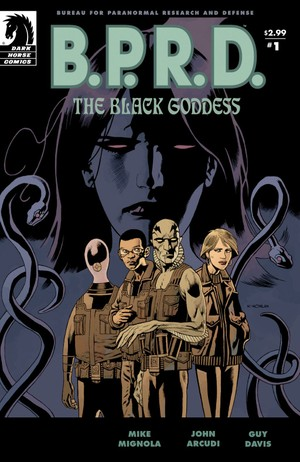
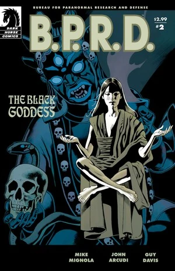
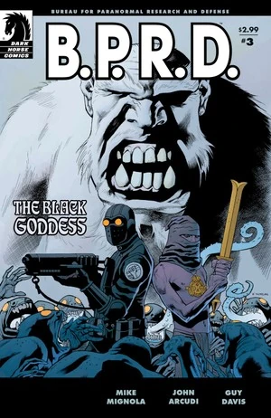
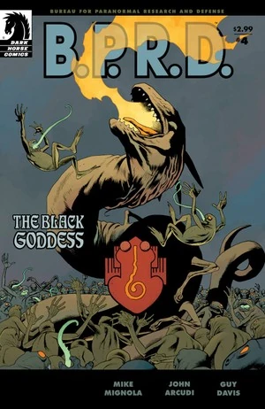
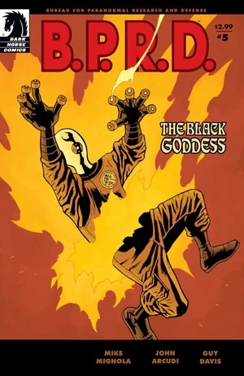

***《黑暗女神》***（The Black Goddess）是一部五期限定连载，也是《[焦土三部曲](/entry/Scorched_Earth_Trilogy)》的第二部。

## 出版历史

这部五期限定连载于 2009 年 1 月至 5 月出版，2009 年 10 月收录进平装合订本《B.P.R.D.：黑暗女神》（*[B.P.R.D.: The Black Goddess](/entry/Trade_Collections)*）。

## 剧情简介

### 第一部

二十世纪之交，一位醉心神秘学的英国博物馆策展人东行求索力量与永生，从此杳无音讯。

1937 年，戴面具的犯罪斗士大螯虾强生遭遇了一个擅使魔法、一心要促成末日预言的狂人。阴谋被挫败、世界得以拯救，但那个反派本人却消失无踪……

七十年后，B.P.R.D. 探员丽兹·舍曼开始看到一位神秘绅士的幻象，他警告着接踵而至的灾难。当防御署追踪到他时，他消失了——并绑架了丽兹。

如今，丽兹的朋友们争分夺秒地寻找她，而他们的宿敌们则纠集在一起，准备发动最后一场灾难性的袭击。

### 第二部

借助大螯虾强生最后一位幸存盟友的帮助，B.P.R.D. 追踪梅姆南·萨，来到了他囚禁丽兹的山中避难所。但即便超自然调查防御署，也对眼前这场末日之战毫无准备。

### 第三部

就在约翰面临生死之战时，亚伯和凯特得知了维多利亚时代神秘学者马丁·吉尔弗瑞德如何蜕变为梅姆南·萨——那位预言中将"驯服烈火、孕育巨龙"的极北族之王——的故事。

### 第四部

梅姆南·萨的圣所之外，两支怪物大军为世界的命运展开厮杀；圣所之内，B.P.R.D. 只能眼睁睁看着萨的图谋在身边持续展开，一切都在走向一场以丽兹为核心的末日高潮。

### 第五部

被夹在疯狂先知与末日之战之间，亚伯、凯特和约翰必须掂量自己灵魂的代价：他们要抉择忠诚究竟归于何处——以及一位朋友的生命，是否比整个世界的命运更重要。

## 内容

### 角色

#### [超自然调查防御署](/entry/Bureau_for_Paranormal_Research_and_Defense)（B.P.R.D.）

- [约翰·克劳斯](/entry/Johann_Kraus)
- [安德鲁·德文](/entry/Andrew_Devon)
- [亚伯拉罕·塞皮恩](/entry/Abraham_Sapien)
- [凯瑟琳·考瑞根](/entry/Kate_Corrigan)
- [潘雅](/entry/Panya_%28character%29)
  - 奥利（Olly）
  - 变异动物
- 多丽丝（Doris，潘雅的看护人）
- [丽兹·舍曼](/entry/Elizabeth_Sherman)
- 其他探员与职员

#### [哈里](/entry/Harold_McTell)讲述的故事

- [大螯虾强生的小队](/entry/%3ACategory%3ALobster%27s%20crew)
  - [哈罗德·麦克泰尔](/entry/Harold_McTell)
  - [大螯虾强生](/entry/The_Lobster)
  - [罗伯特·伊舍伍德](/entry/Robert_Isherwood)（回忆）
  - 比尔（Bill）（回忆）
  - 莱斯特（Lester）（回忆）
- [鲁道夫·贝尔根（钢鹰）](/entry/Rudolf_Bergen)（回忆）
- 非洲主题的龙虾反派（回忆）
- [海伦娜·加拉拉加斯](/entry/Helena_Gallaragas)（回忆）

#### 其他

- [梅姆南·萨 / 马丁·吉尔弗瑞德](/entry/Martin_Gilfryd)
- 撒德雷提斯僧侣（Thadrethes Monks）
  - 化熊雪人（Were-Yetis）
- 美军士兵
  - 将军
- [纳粹](/entry/%3ACategory%3ANazi)
  - [拉斯普京](/entry/Rasputin)（幻象）
  - [阿道夫·希特勒](/entry/Adolf_Hitler)（幻象）
  - 士兵与科学家（回忆）
- [蛙怪](/entry/Frog_monster)
- [兰迪斯·波普](/entry/Landis_Pope)（[黑焰](/entry/The_Black_Flame_%28character%29)）（幻象）
- [左手之仆](/entry/Servants_of_the_Left_Hand)
- 阿加尔塔僧侣（Agartha Monks）（回忆）
- [维里尔](/entry/Vril)巨龙
- [守望者](/entry/Watchers)（回忆）
- [极北族人](/entry/Hyperboreans)（回忆）
  - [赫卡忒](/entry/Hecate)（回忆）
  - 托特（Thoth）（回忆）
  - 其他（回忆）
- 特舍图安萨满（T'shethuan Shamans）（回忆）
  - [尚钦](/entry/Shonchin)（回忆）
  - 其他（回忆）
- 尼蒙-古拉（Nimung-Gula）（回忆）
- [奥格德鲁·赫姆](/entry/Ogdru_Hem)（幻象）

### 地点

- 美国
  - [大螯虾强生](/entry/The_Lobster)的总部（纽约州纽约市）
  - [哈罗德·麦克泰尔](/entry/Harold_McTell)居住的疗养院
  - [梅姆南·萨](/entry/Memnan_Saa)的仓库（新泽西州）（回忆）
  - [B.P.R.D.](/entry/Bureau_for_Paranormal_Research_and_Defense) 总部（科罗拉多州）
- 英国（回忆）
  - 贝德兰姆（Bedlam，伦敦）（回忆）
  - 伦敦街头 / 码头（回忆）
- 俄罗斯
  - 撒德雷提斯（Thadrethes）
  - 阿加尔塔（Agartha）（回忆）
- 奥地利（回忆）
  - 洪特城堡（Hunte Castle）（回忆）
- 中国（回忆）
  - 颐和园（北京）（回忆）

### 重要物品

- 玉蛙
- [厄恩斯特·厄明](/entry/Ernst_Oeming)的太空舱（回忆）
- [梅姆南·萨](/entry/Memnan_Saa)的护身符
- [极北族](/entry/Hyperboreans)的战争机器
- [尖刺圆柱](/entry/Spiked_Cylinder)（[极北族](/entry/Hyperboreans)器物）（回忆）
- [维里尔能量服](/entry/Vril_Energy_Suit)（普罗米修斯型号）（回忆）

## 趣闻

- 美军将军的外形以演员 [Ernest Borgnine](https://en.wikipedia.org/wiki/Ernest_Borgnine) 为原型。

## 画廊

封面作者：[Kevin Nowlan](/entry/Kevin_Nowlan)。

 \#1

 \#2

 \#3

 \#4

 \#5

**Category:Story** **Category:B.P.R.D. story** **Category:B.P.R.D.: Plague of Frogs story**
