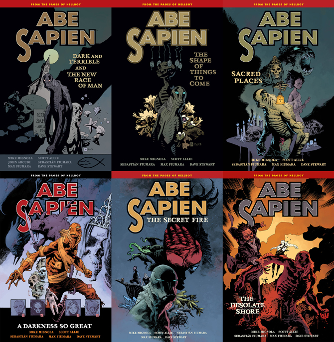
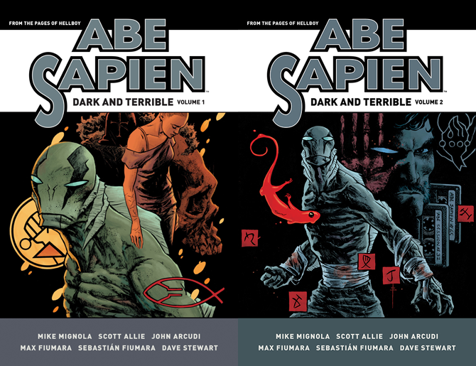

*Dark and Terrible* is an *[Abe Sapien](/entry/Abe%20Sapien%20%28series%29)* story cycle running parallel to the events of *[B.P.R.D. Hell on Earth](/entry/Hell_on_Earth_(story_cycle)))*. It's an ongoing series written by [Mike Mignola](/entry/Mike%20Mignola) and [Scott Allie](/entry/Scott%20Allie) with [Max Fiumara](/entry/Max%20Fiumara) and [Sebastián Fiumara](/entry/Sebasti%C3%A1n%20Fiumara) handling art duties. Occasionally there are flashback stories in the ongoing series, but these are not a part of *Dark and Terrible*.

## Stories Published

- *[Dark and Terrible](/entry/Dark%20and%20Terrible%20%28story%29)* \#1–3 (April – June 2013)
- *[The New Race of Man](/entry/The%20New%20Race%20of%20Man)* \#1–2 (July – August 2013)
- *[The Shape of Things to Come](/entry/The%20Shape%20of%20Things%20to%20Come)* \#1–2 (October – November 2013)
- *[To the Last Man](/entry/To%20the%20Last%20Man)* \#1–3 (January – March 2014)
- *[The Garden (I)](/entry/The%20Garden%20%28I%29)* (May 2014)
- *[The Healer](/entry/The%20Healer)* (June 2014)
- *[Visions, Dreams, and Fishin'](/entry/Visions%2C%20Dreams%2C%20and%20Fishin%27)* (July 2014)
- *[Sacred Places](/entry/Sacred%20Places)* \#1–2 (September – October 2014)
- *[A Darkness so Great](/entry/A%20Darkness%20so%20Great)* \#1–5 (December 2014 – April 2015)
- *[The Shadow Over Suwanee](/entry/The%20Shadow%20Over%20Suwanee)* \#1–3 (July – September 2015)
- *[The Garden (II)](/entry/The%20Garden%20%28II%29)* (November – December 2015)
- *[The Black School](/entry/The%20Black%20School)* (February 2016)
- *[Regressions](/entry/Regressions)* (April – May 2016)
- *[Dark and Terrible Deep](/entry/Dark%20and%20Terrible%20Deep)* (June 2016)
- *[The Garden (III)](/entry/The%20Garden%20%28III%29)* (July 2016)
- *[The Desolate Shore](/entry/The%20Desolate%20Shore)* (August 2016)

## Collections

*Dark and Terrible* is collected in the regular line of [*Abe Sapien* trade paperbacks](/entry/TPB) from Volume 3 to 8.

670 px|center|All six <em>Abe Sapien</em> trade paperbacks collecting the stories from the <em>Dark and Terrible</em> cycle.

The *Dark and Terrible* cycle will be collected in [omnibus editions](/entry/Omnibus%20Editions) beginning November 2017. These feature expanded sketchbooks.

670 px|center|The two volumes of the <em>Abe Sapien: Dark and Terrible</em> omnibuses.

**Category:Comics**