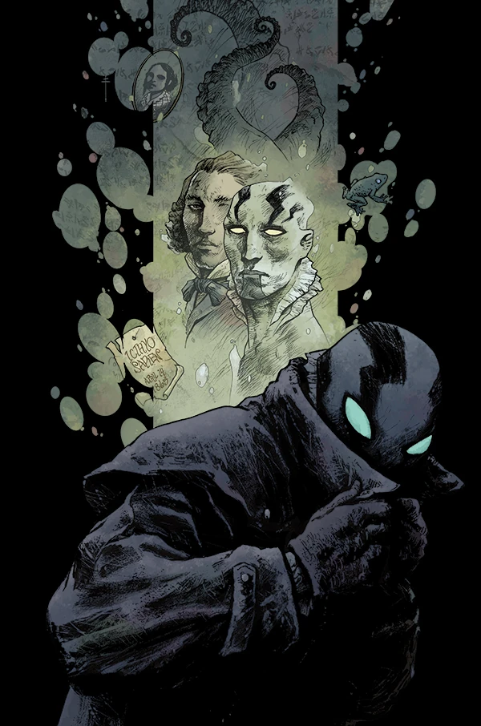
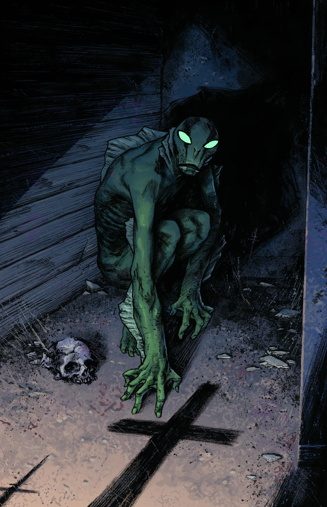
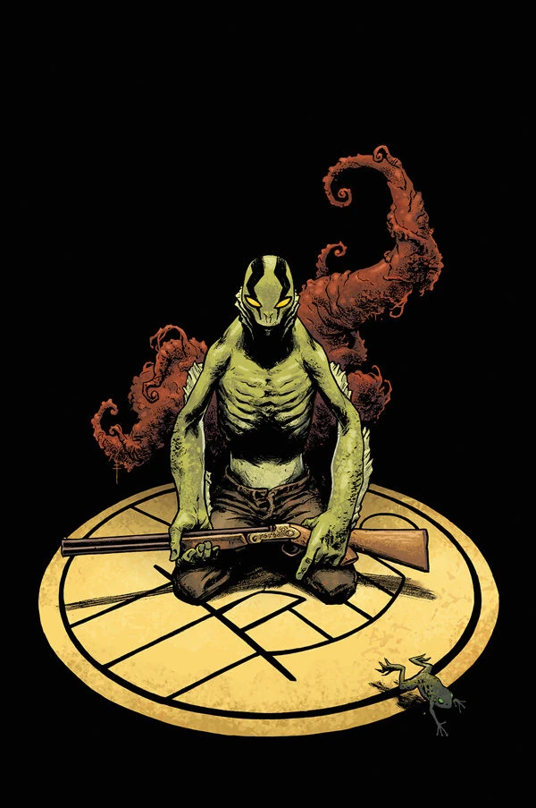

《**黑暗恐怖之处**》（Dark and Terrible）是连载漫画《亚伯·赛皮恩》（*Abe Sapien*）的第一个故事线，也是[《黑暗恐怖之处》故事周期](/entry/Dark_and_Terrible_%28story_cycle%29)的开端。故事承接《[B.P.R.D.：人间地狱——地狱寒日](/entry/A_Cold_Day_in_Hell)》（B.P.R.D.: Hell on Earth—A Cold Day in Hell）的剧情，亚伯踏上了逃离 B.P.R.D. 的亡命之旅。

## 出版历史

《黑暗恐怖之处》是一个共三话的故事线，于 2013 年 4 月出版，作画为[塞瓦斯蒂安·菲乌马拉](/entry/Sebasti%C3%A1n_Fiumara)（Sebastián Fiumara）。

“Dark and Terrible”原本是[迈克·米格诺拉](/entry/Mike_Mignola)（Mike Mignola）于 1996 年创作的一个中途搁置的地狱男爵与亚伯·赛皮恩故事的名字。[1] 那个故事的一些元素最终被并入《[蛙疫](/entry/Plague_of_Frogs_%28story%29)》（Plague of Frogs）。由于亚伯·赛皮恩的背景故事自那时起已发生重大变化，旧故事与这个新版本之间不太可能有什么关联。

## 剧情简介

### 第一部

变异后的[亚伯·赛皮恩](/entry/Abraham_Sapien)在逃离 [B.P.R.D.](/entry/Bureau_for_Paranormal_Research_and_Defense)（超自然现象研究与防御局）的途中，穿行于满目疮痍的美国——怪物的尸体四处散落，城市沦为废墟。

### 第二部

世界在亚伯周围崩塌，他一路血战，对抗可怖的奥格德鲁·赫姆（Ogdru Hem）与沦为怪物的人类，追寻自己在世界末日中所扮演的角色。

### 第三部

一座被肆虐怪物与外界隔绝的小镇必须做出抉择：出现在他们中间的神秘鱼人，究竟意味着救赎，还是末日降临。

## 画廊

\#1 变体封面

\#2

\#3

## 注释

[1] 《地狱男爵的艺术》（The Art of Hellboy）（The Art of Hellboy）
