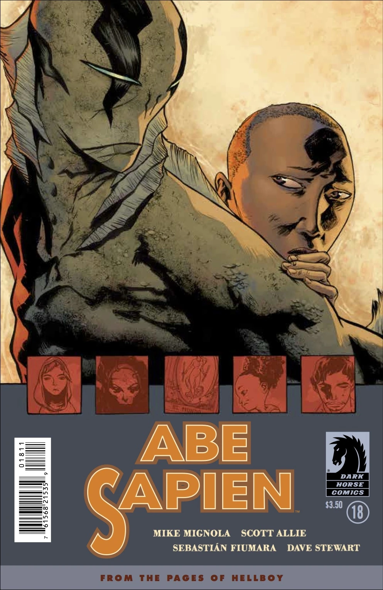
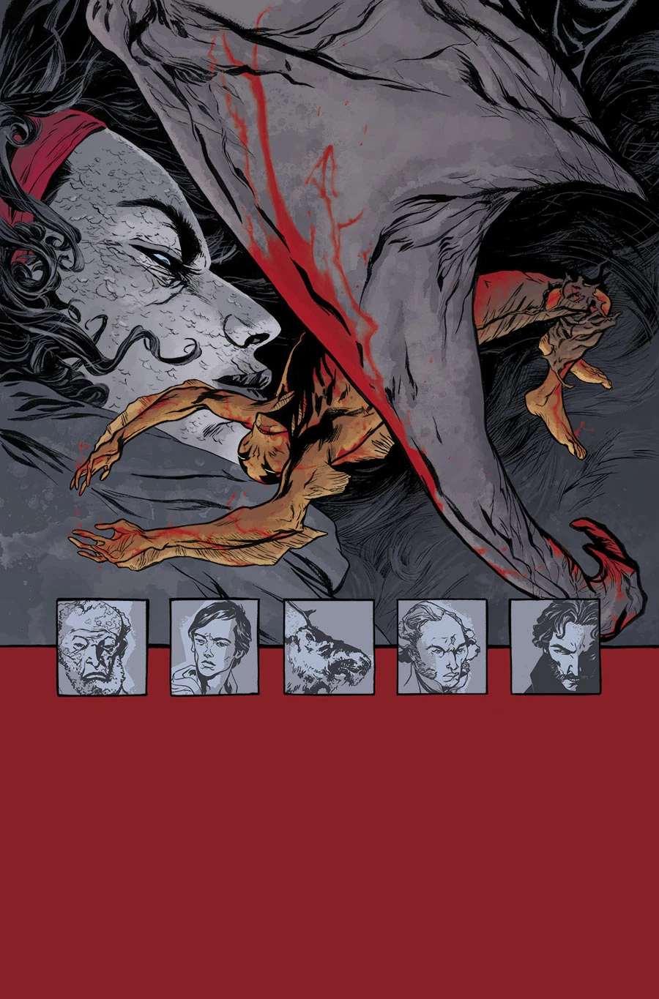
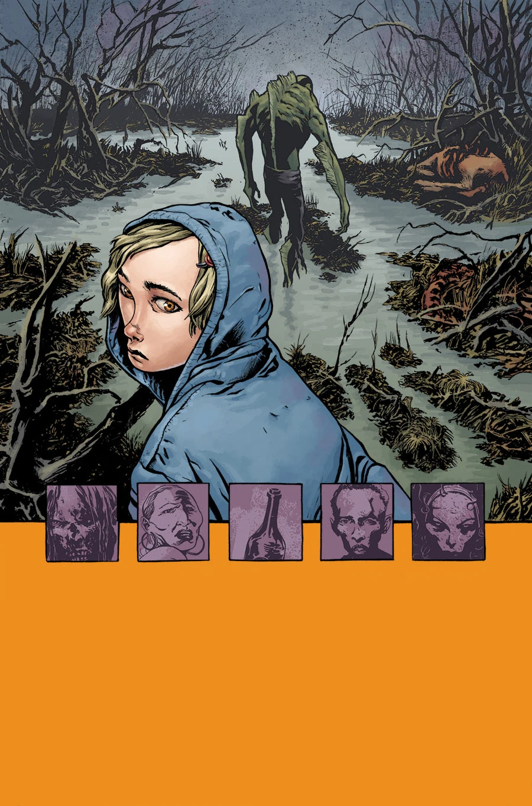
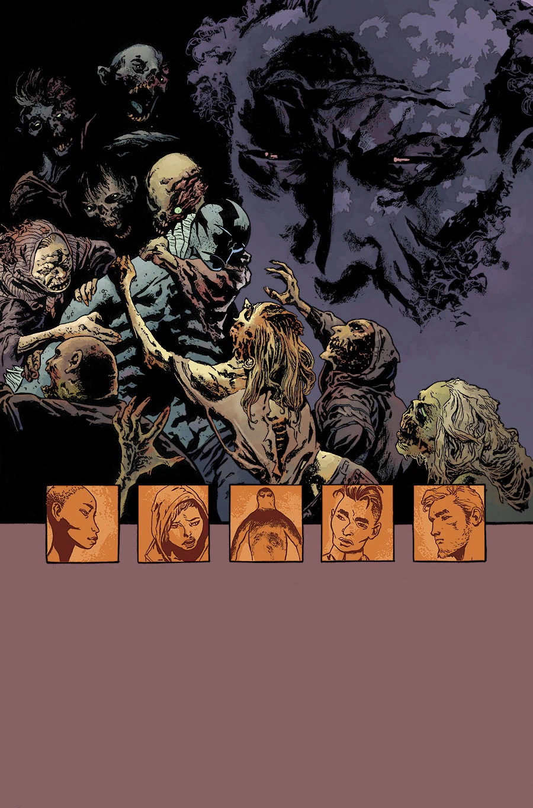
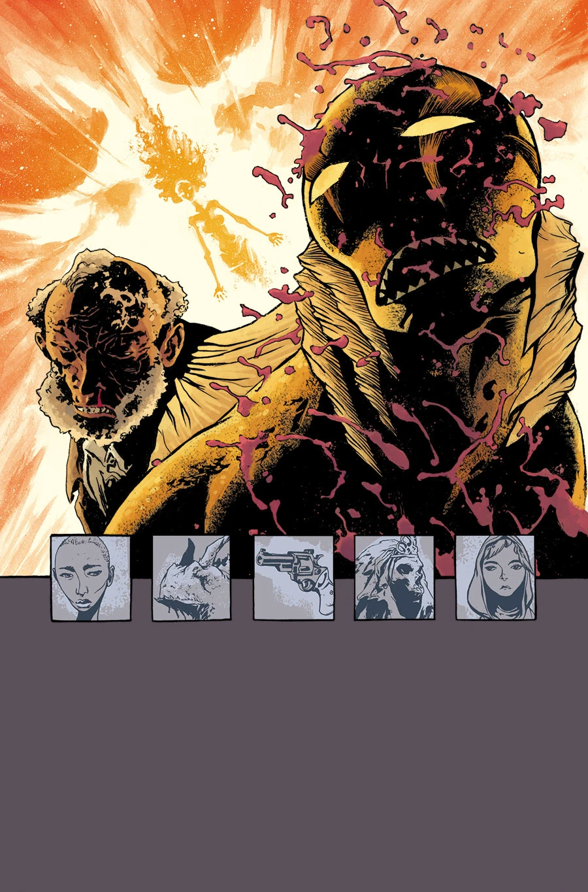

《**黑暗无边**》（A Darkness so Great）是一个共五话的故事线，于 2014 年 12 月开篇。该系列每一话的作画由不同画师轮流担任。

## 剧情简介

### 第一部：格蕾丝

亚伯·赛皮恩前往得克萨斯，希望在经历变异、并遭 BPRD 追捕之后寻得片刻安宁。

### 第二部：达雅娜

在得克萨斯墨西哥湾沿岸一座异常宁静的小镇里，亚伯找到了些许平静。然而，亚伯隐约预感到这座小镇与他不久前遭遇的一场致命威胁之间存在某种联系，这份平静因此岌岌可危……

### 第三部：梅根

一个小女孩为躲避世界末日，与一个神秘的墨西哥死亡教派一同避难，她转而求助于亚伯，请求他的保护。

### 第四部：阿博加斯特

反派登场成为焦点，得克萨斯南部的死灵法术问题随之揭开；塞瓦斯蒂安·菲乌马拉（Sebastián Fiumara）的画功足以与杰夫·达罗（Geof Darrow）一较高下。

### 第五部：亚伯

得克萨斯一座宁静的小镇——美国最后的安全之地——爆发了超自然暴乱。亚伯·赛皮恩真正尝到了“人间地狱”的滋味，而他离开调查局后独行的那条孤寂之路，也变得更加孤独。

## 画廊

