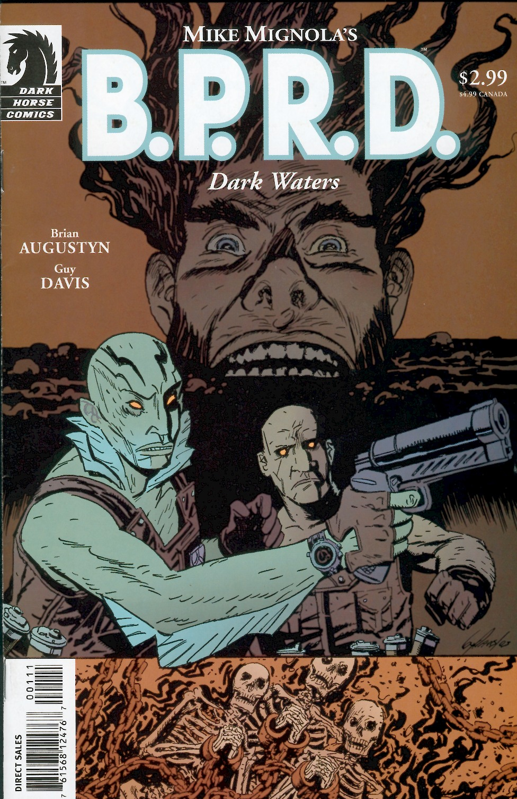

在***《黑水之域》***（Dark Waters）中，[亚伯·塞皮恩](/entry/Abe_Sapien)与[罗杰](/entry/Roger)前往马萨诸塞州，调查三具出土的 18 世纪少女遗骸。

## 出版历史

《[空心地球](/entry/Hollow_Earth)》之后，B.P.R.D. 漫画将走向何方一度并不明朗。2003 年 5 月至 11 月间，每隔一个月推出一篇单篇故事，共四篇：《[威尼斯之魂](/entry/The_Soul_of_Venice)》、《黑水之域》、《[午夜列车](/entry/Night_Train)》和《[床下有鬼](/entry/There%27s_Something_Under_My_Bed)》。与此同时，在"休刊"月份，黑马漫画出版了[脱离正传时间线](/entry/Hellboy_Comics)的选集《地狱男爵：怪谈》（*Hellboy: Weird Tales*）。

《黑水之域》于 2003 年 7 月出版，2004 年 8 月被收录进合订本《B.P.R.D.：威尼斯之魂及其他故事》（*[B.P.R.D.: The Soul of Venice & Other Stories](/entry/Trade_Collections)*）。

这篇故事是[盖·戴维斯](/entry/Guy_Davis)第一次参与[地狱男爵](/entry/Hellboy)相关漫画的创作。此后，盖·戴维斯成为 [B.P.R.D.](/entry/B.P.R.D.) 系列的常驻主力画师。

## 剧情简介

马萨诸塞州夏伊洛镇（Shiloh）抽干了镇中心池塘的水，镇民在塘底发现了三具被锁链拴在一起的少女尸体。当查明这些尸体已有 300 年历史却保存完好时，[B.P.R.D.](/entry/B.P.R.D.) 被召来调查。

[亚伯·塞皮恩](/entry/Abe_Sapien)和[罗杰](/entry/Roger)前来调查。除了少女们的尸体，镇上还发现了与女巫审判有关的器物。当地历史记载着特拉斯克三姐妹——*普里西拉、普鲁登斯和波莉安娜·特拉斯克*（Priscilla, Prudence, and Pollyanna Trask）——的故事：1693 年，她们被控施行巫术，并在"审判"中被处死——所谓审判，就是把她们锁在一起扔进池塘，看她们会不会像真正的女巫那样浮起来。

当年定罪女巫的牧师尤赖亚·布莱克伍德（Uriah Blackwood）的后裔——*布莱克伍德牧师*（Pastor Blackwood）出于对小镇灵魂的担忧，前来看望遗体。他试图为少女们驱魔，房间里却涌满了黑色淤泥。淤泥退去后，布莱克伍德企图盗走尸体；被发现时，他竟以淤泥为武器，驱使它攻击任何挡路的人。亚伯和罗杰奋力抵挡泥人时，布莱克伍德带着尸体来到海边，要把女孩们再次"淹死"。

亚伯推断：少女们对冤死的愤怒，加上镇民对这桩罪行历久不散的愧疚，二者凝结成了一股邪恶力量；布莱克伍德自以为在替天行道，实际上却在操纵这股力量。要了结此事，最快的办法是为女孩们举行一场正式而神圣的海葬。

亚伯和罗杰引开布莱克伍德，让夏伊洛镇更开明的卢卡斯·肖牧师（Reverend Lucas Shaw）诵读祷文，祈求上帝接纳特拉斯克三姐妹进入祂的怀抱。循环就此打破，女孩们沉入大海，得到了宽恕。布莱克伍德却已癫狂，坚称三姐妹不配基督教葬礼，他游出去想夺回尸体，却被三个被害少女的幽魂拖入水下。

危机过后，夏伊洛镇决定拥抱自己多姿多彩的历史（包括女巫审判）来重振旅游业。没有人哀悼布莱克伍德牧师的消失——在最后一格画面中，他被当年用来对付女巫嫌疑人的同一条锁链捆在湖底：他承袭了先祖的仇恨与偏狭，也替先祖的罪孽受到了惩罚。

## 内容

### 角色

- 夏伊洛居民
  - 安妮·拉克姆（Annie Rackham）
  - 阿彻镇长（Mayor Archer）
  - 特拉斯克姐妹
    - 普里西拉（Priscilla）
    - 普鲁登斯（Prudence）
    - 波莉安娜（Pollyanna）
  - 哈尔（Hal）
  - 卢卡斯·肖（Lucas Shaw）
  - 尤赖亚·布莱克伍德（Uriah Blackwood，回忆出场）
  - 布莱克伍德牧师（Pastor Blackwood）
  - 尤厄尔（Ewell）
  - 其他居民
- [超自然调查防御署](/entry/Bureau_for_Paranormal_Research_and_Defense)（B.P.R.D.）
  - [亚伯拉罕·塞皮恩](/entry/Abraham_Sapien)
  - [罗杰](/entry/Roger)

### 地点

- 美国
  - 马萨诸塞州夏伊洛（Shiloh）
    - 池塘
    - 市政厅
    - 第一圣教会
    - 海滩
