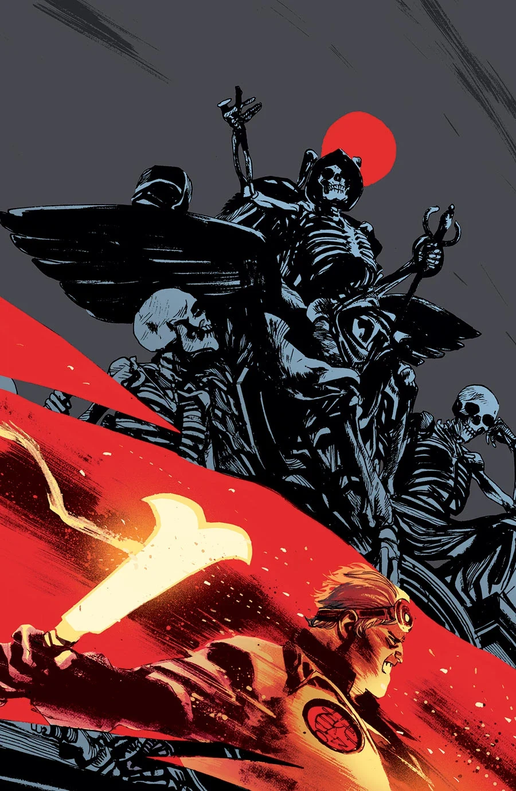
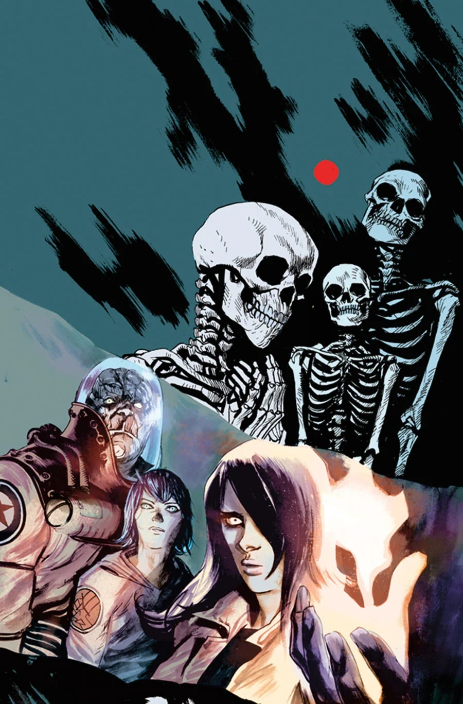
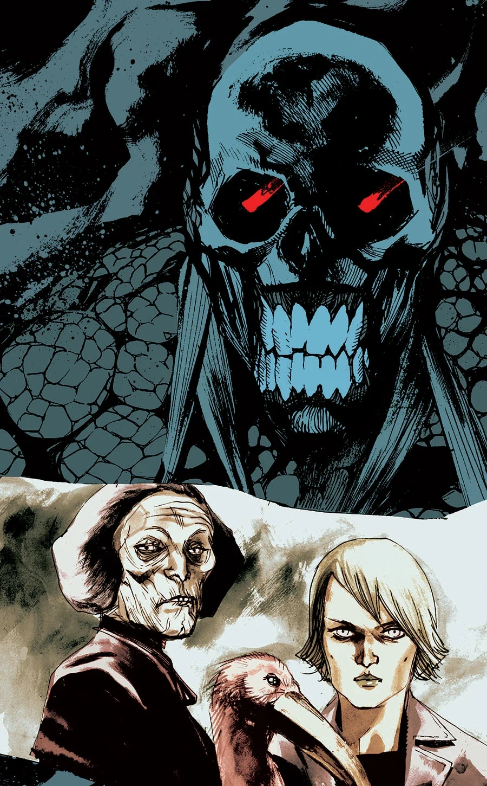
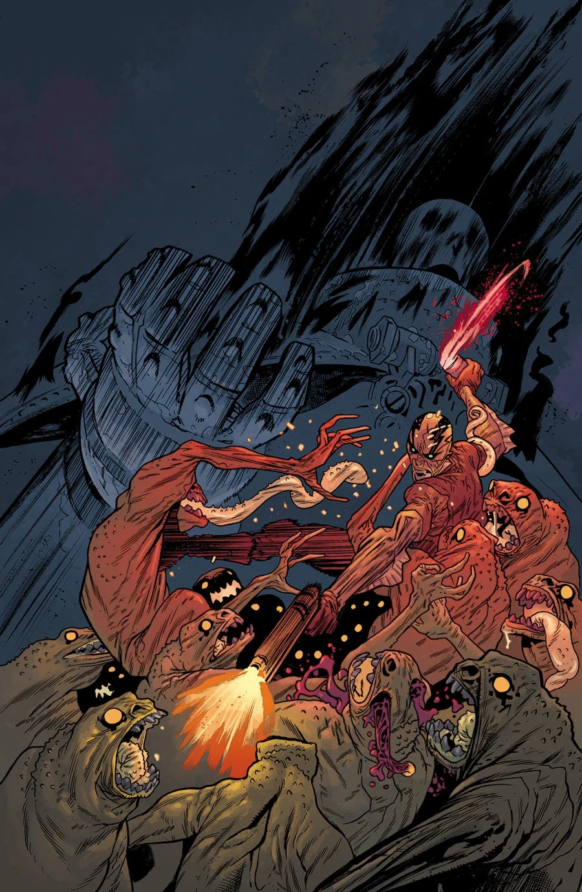
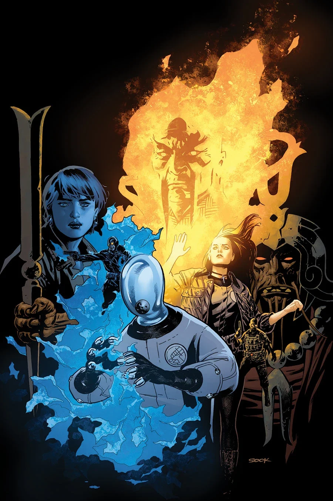

***《黑焰王朝》（The Reign of the Black Flame）*** 是一部自 2014 年 1 月起出版的五期连载故事，直接承接[《烈焰之湖》](/entry/Lake_of_Fire)。

## 剧情简介

### 第一部

两支[超自然调查防御署](/entry/Bureau_for_Paranormal_Research_and_Defense)（B.P.R.D.）小队穿行在怪物横行、已成废土的曼哈顿街头，目标是突入[黑焰](/entry/Black_Flame)的要塞、剿灭他的大军。

### 第二部

在曼哈顿的废墟中，B.P.R.D. 与一支抵抗武装并肩作战，对抗黑焰及其由[金科](/entry/Zinco_Corporation)部队与怪物组成的邪恶政权！

### 第三部

绝不屈服的[约瑟夫](/entry/Iosif_Nichayko)向金科大厦发动全面强攻，深信自己的部队能迅速解决楼内的怪物守军。与此同时，[丽兹](/entry/Liz_Sherman)前去追杀黑焰。可惜对她不利的是，黑焰清楚当初杀死自己的人正是丽兹——而这一次，掌控局面的是他。

### 第四部

这位俄国分局局长命悬一线，B.P.R.D. 却仍苦苦支撑、顶住金科部队的攻势；丽兹·舍曼与黑焰则在纽约上空以火攻火，宛如《阿基拉》式的对决。

### 第五部

当曼哈顿被洛夫克拉夫特式的群魔席卷，一名年轻的灵能者必须带领幸存的 B.P.R.D. 队员穿过怪物密布的纽约街道撤回总部求生；与此同时，丽兹·舍曼的力量如超新星般彻底爆发。

## 画廊

### 常规封面

\#1

\#3

\#4

### 20 周年纪念变体封面

第 1 期变体封面

第 2 期变体封面

第 3 期变体封面

第 4 期变体封面

第 5 期变体封面

**Category:Story** **Category:B.P.R.D. story** **Category:B.P.R.D.: Hell on Earth story**
