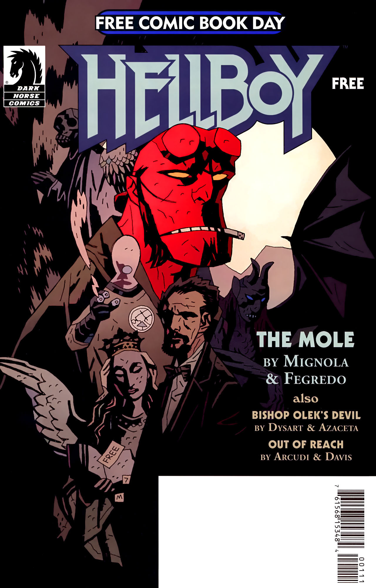

While staying with [Harry Middleton](/entry/Harry%20Middleton), Hellboy has a strange dream.

## Publication History

*The Mole* was originally published together with *[Out of Reach](/entry/Out%20of%20Reach)* and *[Bishop Olek's Devil](/entry/Bishop%20Olek%27s%20Devil)* in *Hellboy: Free Comic Book Day* in 2008.[1] This was the first comic produced for FCBD that was a part of the Hellboy Universe.

The entire issue was published with a different cover in *The Mole and Other Stories*, for "Hellboy Day 2008" on July 2, 2008. "Hellboy Day" celebrated the upcoming release of *[Hellboy II: The Golden Army](/entry/Hellboy_II__The_Golden_Army)*.

The eight-page story was collectied in [*Hellboy – Volume 10: The Crooked Man and Others*](/entry/TPB) in June 2010.

## Synopsis

Two weeks before *[Darkness Calls](/entry/Darkness%20Calls)*, [Hellboy](/entry/Hellboy) sits with three ghosts; Lady Celia Radford, Sir Albert Lindsey, and [Harry Middleton](/entry/Harry%20Middleton), playing poker. Harry asks Hellboy about a large mole on his left hand, while the other two comment.

Hellboy falls asleep. Suddenly the mole grows to enormous size and a full size black demon breaks out of the mole. Hellboy's body is left an empty husk. His right hand rips off, and his body floats away in the wind. The black demon picks up the stone hand, and begins chanting.

Hellboy wakes up in a cold sweat, and while convincing himself it was just a dream, pours himself a drink.

## Connections to Other Stories

Hellboy mentions playing poker with *[The Vampire of Prague](/entry/The%20Vampire%20of%20Prague)*.

## Notes

<references/>
! colspan = 2 | [Vol. 10 The Crooked Man and Others](/entry/TPB) ! colspan = 1 | [Vol. 11 The Bride of Hell Others](/entry/TPB)

**Mole, The** **Mole, The**

[1] Free Comic Book Day is held the first weekend in May. Perticipating Comic vendors give away comics including book specifically written for the day. See <http://www.freecomicbookday.com/> for details