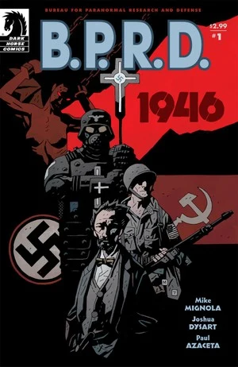
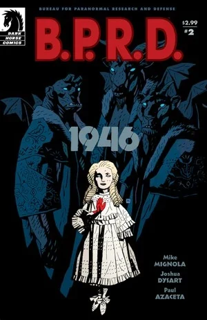
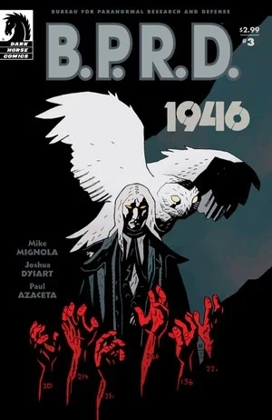
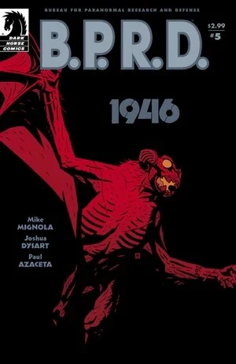

In ***1946***, [Trevor Bruttenholm](/entry/Trevor_Bruttenholm) travels to post-war Berlin to investigate Nazi occult activity. He meets his Russian counterparts, and uncovers a Nazi plot to create an army of vampires.

## Publication History

*1946* was first published as a five-issue miniseries from January to May 2008. The story was later collected together with *[Bishop Olek's Devil](/entry/Bishop_Olek%27s_Devil)* in the trade paperback *[B.P.R.D.: 1946](/entry/Trade_Collections)* in November of 2008.

## Synopsis

### Part One

**December 1944**:, a woman lies chained to a table. She asks what has happened to her family. Men in lab coats and Nazi troops stand above her. The woman reveals her fangs, breaks free and attacks, but is subdued by the Nazi guards.

**Berlin 1946**: [Trevor Bruttenholm](/entry/Trevor_Bruttenholm) and Dr. [Howard Eaton](/entry/Howard_Eaton) drive through the American sector. The pair arrive and are introduced to the local commander of American forces. They tell him their job is to catalog the Nazi obsession with the occult. He responds that a Soviet team has already been working on a captured occultist. To assist with his work, Trevor Bruttenholm is given what is left of an infantry unit, five jaded men ready to go home. One of the five happened to have been in East Bromwich in December of 1944, when [Hellboy](/entry/Hellboy) arrived on earth,[1] and agreed to help.

After working for weeks, Trevor Bruttenholm travels across Berlin to meet with the Russian team. Bruttenholm is led through a large warehouse full of antiquities and strange objects. In a back room he meets with [Varvara](/entry/Varvara), head of the Soviet occult team. Varvara looks like a small pale girl, but speaks and acts with authority. Bruttenholm asks her to share documents. She responds that he only wants to know more about the "Hellboy Incident," but agrees to share information about Hellboy with him.

After going through the records, Trevor Bruttenholm learns that a large amount of liquid nitrogen was delivered to an asylum in 1945 even though officially the asylum closed in 1939. Bruttenholm and Howard Eaton travel to the asylum to investigate. The pair find a dirty surgical room and an old blueprint. They discover a basement and go to investigate. The pair enter the dark room, not noticing the twisted forms crawling above them.

### Part Two

[Trevor Bruttenholm](/entry/Trevor_Bruttenholm) and [Howard Eaton](/entry/Howard_Eaton) continue to explore the abandoned asylum. The infantrymen assigned to them find them and tell them not to travel alone.

The group stop for a beer at the local bar. While there the owner tells them that one of the inmates escaped and went back to his family farm. The owner agrees to take the man to the farm. Bruttenholm is eventually let into a barn where he meets the undead child. Upon seeing the soldiers that child attacks killing one of the men. Just as they manage to close the boy back into the barn the Russians along with Varvara show up. Varvara goes in to see the boy and learns about a secret basement in the asylum, killing the child in the process. After talking to her, Bruttenholm realizes that the liquid nitrogen must have been used to keep the creatures frozen, and that they must be thawing.

Together the American and Russian teams return to the asylum. On the drive, Varvara tells Trevor Bruttenholm about the Nazi project [Vampir Sturm](/entry/Vampir_Sturm). After meeting with [Vladimir Giurescu](/entry/Vladimir_Giurescu), Hitler had the Vampire and his brides killed, but he had one of the brides, [Anna Giurescu](/entry/Anna_Giurescu), drained of blood before being killed.

Bruttenholm asks Varvara who she is. She responds with a story of Tsar Peter I "the Great. He summoned three demons for aid in Russia's great war against Sweden. Two of the three took a price from Peter (the lives of all his future sons, and his heart), but the third decided to stay and travel the earth, wearing the face of humanity.

The group arrives at the asylum under a full moon.

### Part Three

**1945**: A Nazi officer kills the last person from the Asylum not sent to "the vats." The man falls into an open pit full of bodies.

**1946**: [Trevor Bruttenholm](/entry/Trevor_Bruttenholm), [Varvara](/entry/Varvara) and the American and Russian teams, arrive back at the asylum. Based on a blueprint, the group goes to investigate a basement they missed before. The vampires slowly grab men from the teams. The monsters attack and in the confusion, Trevor Bruttenholm and Varvara slip into the hidden basement as the troops frantically try to escape the asylum.

Trevor Bruttenholm and Varvara enter a room with rows of large glass containers. Each container holds a hibernating vampire. Varvara finds hidden records and learns that in the end 120 subjects were selected and injected with vampire blood, while the rest were killed. Only 20 containers are still in the room, meaning 100 have been taken.

A vampire, calling himself [Baron Konig](/entry/Baron_Konig), appears and tells them that the vampires in the containers are [Giurescu](/entry/Vladimir_Giurescu)'s children. If freed they would teach mankind a terrible lesson. He says that Giurescu got what he deserved for being a fool but that his wives, especially [Anna](/entry/Anna_Giurescu), should not have suffered. Baron Konig continues to threaten Trevor Bruttenholm, but Varvara tells him to stop. She reveals her demon self and forces the vampire to submit. He says that the 100 vampires were gone before he came to the asylum and does not know where they were taken. He then flies away in the form of a white owl.

The pair leave the asylum and rejoin the surviving men, though many were killed including [Howard Eaton](/entry/Howard_Eaton).

### Part Four

Back at the Soviet headquarters, [Trevor Bruttenholm](/entry/Trevor_Bruttenholm) and [Varvara](/entry/Varvara) question a man held by the Soviets connected to the asylum. Trevor convinces Varvara to let him talk to the man alone. The man, Infantry General [Friedrich Manstein](/entry/Friedrich_Manstein), tells Bruttenholm his story.

He was there when 120 inmates were injected with vampire blood and frozen. Contrary to what Bruttenholm feared, [Vampir Sturm](/entry/Vampir_Sturm) was not the nucleus of a new army - since even [Hitler](/entry/Adolf_Hitler) was not mad enough to believe he could control an army of vampires - but rather a weapon of last resort. If Germany lost the war he would unleash the vampires on the world. On April 30th, 1945 (the day of his suicide) Hitler gave Manstein the order to release the vampires. But instead of obeying, Manstein arrived back at the asylum killed his fellow officer, and bricked up the room.

Bruttenholm asked Manstein about the 100 missing containers. Manstein replies that only a hidden bunker under Berlin would have the space and constant power needed to keep the vampires frozen. The American and Russian teams rush to the hidden bunker. Inside they find a wide variety of strange machines.

Back at the Russian headquarters, a large white owl, the vampire [Baron Konig](/entry/Baron_Konig), flies in and kills Manstein.

As the teams explore the bunker, [Herman von Klempt](/entry/Herman_von_Klempt) finds them and sends his [Kreigaffen](/entry/Kriegaffe) to kill them all.

### Part Five

The American and Soviet teams shoot wildly at the two [Kriegaffen](/entry/Kriegaffe), while [Herman von Klempt](/entry/Herman_von_Klempt) scuttles away. [Trevor Bruttenholm](/entry/Trevor_Bruttenholm) follows him, and finds the missing vampires, attached to the inside of a circular room. Bruttenholm gets spotted and a Kriegaffe restrains him.

von Klempt tells Bruttenholm that he took the vampires so that he could release them on the world. Meanwhile another of the Kriegaffe is tricked into breaking a generator, powering down the base. Klempt reveals that they are inside a rocket and launches himself, Bruttenholm, the American Sergeant, and the vampires, on a course for America. Neither Bruttenholm nor the Sergeant can hear each other over the roar of the engines, but they still try. The Sergeant gives Bruttenholm the only parachute and tells him to jump, while he stays behind to ensure the rocket crashes. Bruttenholm pleads that there must be another way, but the Sergeant pushes him out an open hatch, saying there isn't time to argue, and if Vampir Sturm is any indication of the battles to come, America will need Bruttenholm alive much more than the Sergeant.

As Bruttenholm opens the parachute and glides safely back to Earth, the rocket explodes over his head, killing all of the vampires.

Bruttenholm lands in Southern France and recovers in a hospital. Varvara visits him. She asks about von Klempt, and Bruttenholm says that he must have died in the explosion. He asks what she knows about [Project Ragna Rok](/entry/Project_Ragna_Rok), and she tells him that [Grigori Rasputin](/entry/Grigori_Rasputin) was responsible. She warns him that [Hellboy](/entry/Hellboy) is dangerous, but Trevor says he sees good in the child.

Varvara leaves, telling Bruttenholm that he is her favorite member of humanity. Under his breath, he mutters, *"lucky me."*

## Gallery

Covers by [Mike Mignola](/entry/Mike_Mignola).

 \#1

 \#2

 \#3

 \#4

 \#5

## Notes

<references />

[1] as seen in *[Seed of Destruction](/entry/Seed_of_Destruction)* \#1
