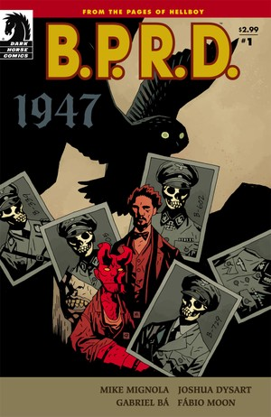
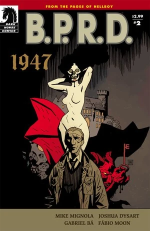
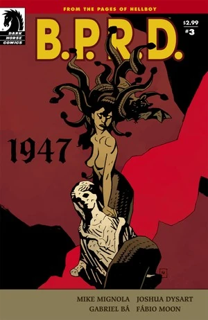
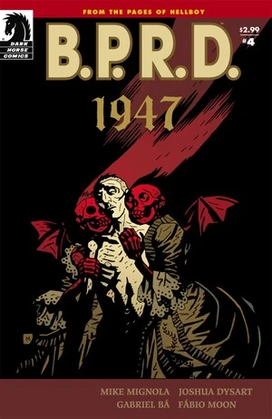
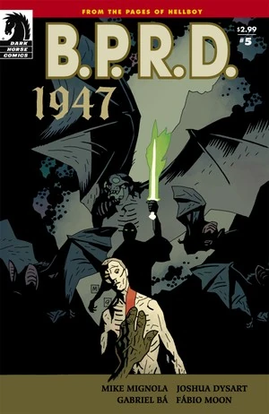

***1947*** was first published as a five-issue miniseries from July to November 2009. It was the debut of artists [Gabriel Bá](/entry/Gabriel_B%C3%A1) and [Fábio Moon](/entry/F%C3%A1bio_Moon) in the Hellboy Universe.

## Synopsis

### Part One

In 1946, the Nazi Occult Bureau's Project Vampir Sturm threatened to destroy the fragile peace following the end of the Second World War. A year later, the B.P.R.D. learns that there are creatures far older—and far more dangerous—than the Nazis' creations, as a lone vampire nobleman ruthlessly hunts the survivors of the Third Reich.

### Part Two

As the rest of the team hunts for their missing man, a lone agent follows his mysterious benefactor further into the dark recesses of her world.

### Part Three

The newest B.P.R.D. members are thrust into the jaws of a group of unsavory vampires as they search for a missing comrade in the bowels of a dilapidated old chateau.

### Part Four

The Bureau’s search for a vengeful vampire reaches its climax! In a strange Austrian village a terrifying party took place hundreds of years ago, and the last of the partygoers remain. Meanwhile, back in America, the young Hellboy dreams of adventure.

### Part Five

With lots of casualties on both sides, the battle with the vampires is over. Now Broom has to enlist an old friend in a bizarre exorcism to save the soul of one of the soldiers. But the exorcist himself isn't happy about the little demon Broom has adopted and has a lesson to teach Broom about battling the forces of darkness.

## Gallery

Covers by [Mike Mignola](/entry/Mike_Mignola).

 \#1

 \#2

 \#3

 \#4

 \#5
