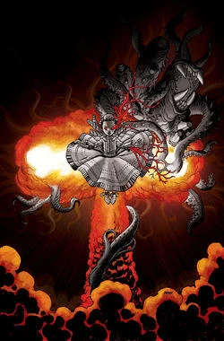
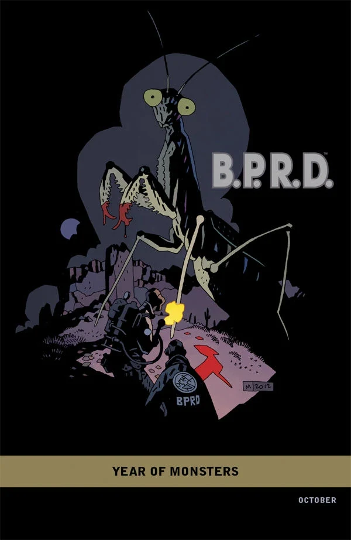
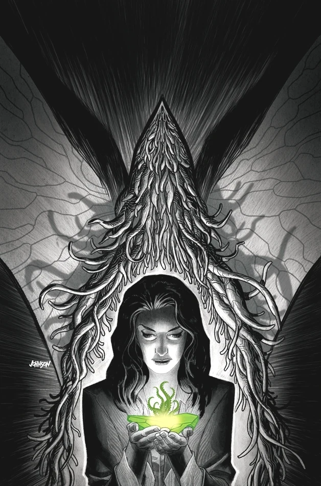
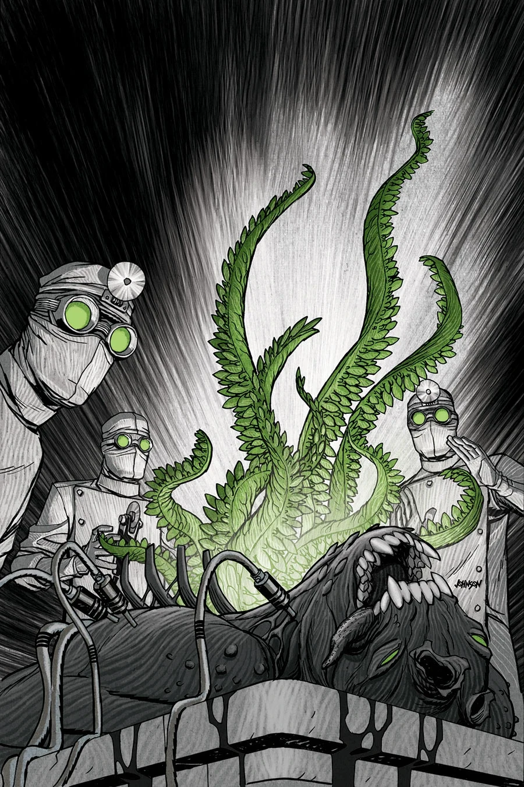
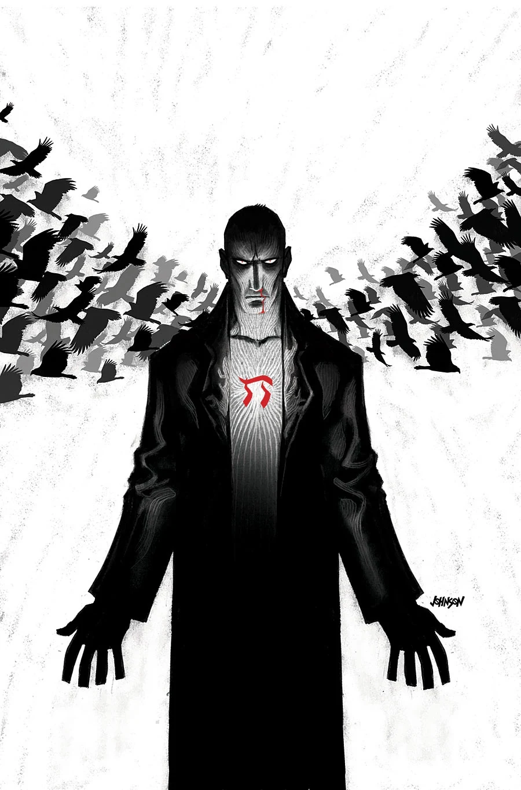

***1948*** is a five-issue miniseries published from October 2012 with art by [Max Fiumara](/entry/Max_Fiumara).

## Publication History

The issues feature covers from Dave Johnson with a "[Year of Monsters](/entry/Year_of_Monsters)" variant cover by [Mike Mignola](/entry/Mike_Mignola) for the first issue. This was the first *[B.P.R.D.](/entry/B.P.R.D._%28series%29)* miniseries to be excluded from the [internal numbering](/entry/B.P.R.D._%28series%29).

## Synopsis

### Part One

The [Nazi occult bureau](/entry/Sonnenrad_Society) threatened to destroy the peace that followed the end of World War II. One year after the war, Professor [Bruttenholm](/entry/Trevor_Bruttenholm), guardian of the child [Hellboy](/entry/Hellboy_%28character%29), enlisted a special task force to connect the dots between a series of massacres and a mad vampire nobleman. Now the [B.P.R.D.](/entry/Bureau_for_Paranormal_Research_and_Defense) launches an investigation of an atomic-fueled space-travel experiment that's apparently unleashed horrific monsters in the Utah desert.

### Part Two

As the battle between the atomic-bred monsters and the B.P.R.D. rages in the Utah desert, Professor Bruttenholm and the agents successfully kill one of the beasts and conduct an autopsy with horrifying results.

### Part Three

Monsters are killing civilians in the Utah desert, leading Professor Bruttenholm to recall the last time a government operation cracked open reality to unleash something from another world: [Project Ragna Rok](/entry/Project_Ragna_Rok).

### Part Four

All signs point to the mysterious element discovered in the desert as the source of the horrific monsters entering our world as Bureau agents hunt down the creature that started this chaos.

### Part Five

Paranoia plagues members of the team as one scientist begins to suspect Bureau members are being replaced by beings from another universe.

## Gallery

Covers by [Dave Johnson](/entry/Dave_Johnson) unless otherwise stated.

 \#1

 \#1 "[Year of Monsters](/entry/Year_of_Monsters)" variant
by [Mike Mignola](/entry/Mike_Mignola)

 \#2

 \#3

 \#4

 \#5
