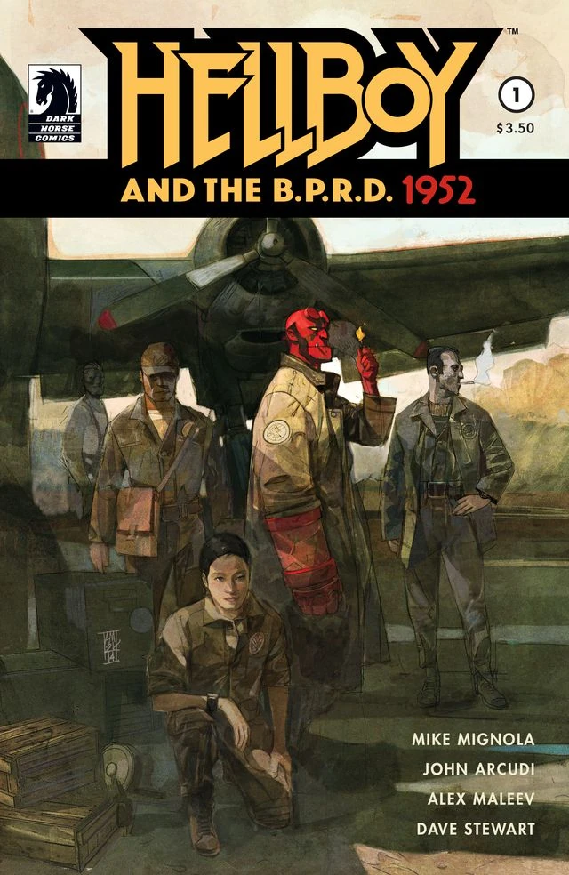
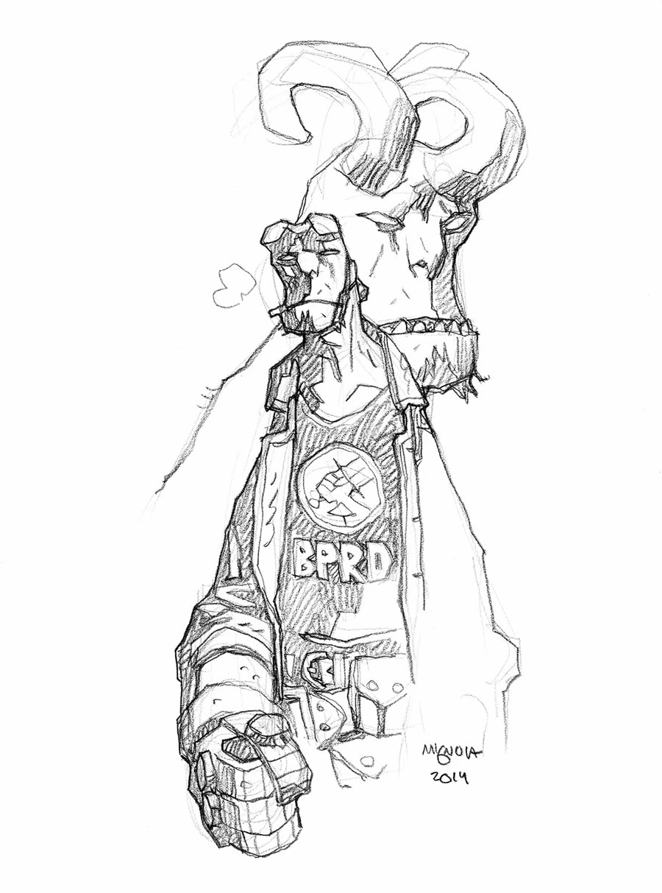
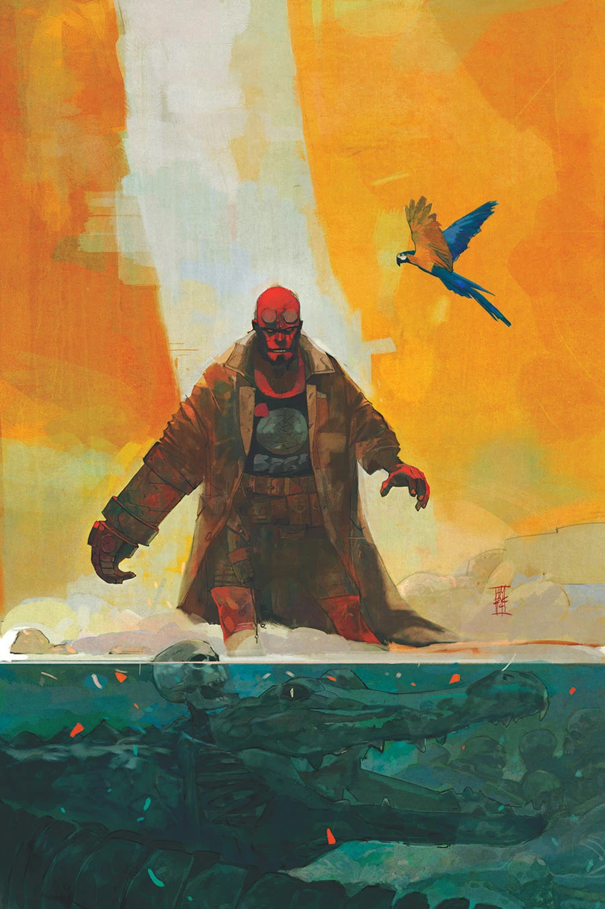
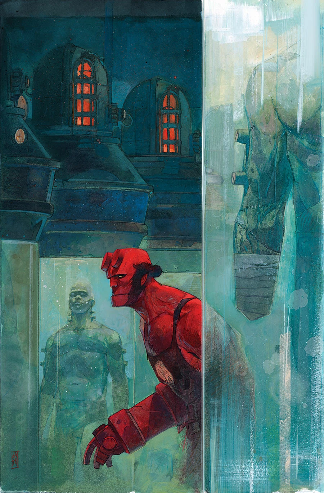
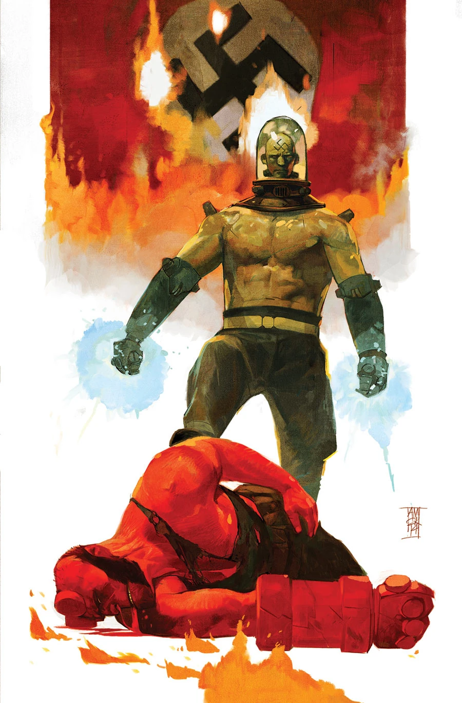

***Hellboy and the B.P.R.D.: 1952*** is a five-issue miniseries illustrated by Alexander Maleev set in 1952 on [Hellboy's](/entry/Hellboy_%28character%29) first mission.

## Publication History

The project was announced just a few weeks prior to the San Diego Comic Con 2014. Alexander Maleev also illustrated the series' covers.

## Synopsis

### Part One

A bizarre series of murders and rumors of something worse lead [Professor Bruttenholm](/entry/Trevor_Bruttenholm) to send a young [Hellboy](/entry/Hellboy_%28character%29) to a Brazilian village on his first mission. Hellboy and a small group of agents uncover something terrible in the shadows of a sixteenth-century Portuguese fortress...

### Part Two

In Brazil, Hellboy and a small group of [B.P.R.D.](/entry/B.P.R.D.) agents investigate gruesome and bizarre murders happening in the shadows of a sixteenth-century Portuguese fortress, but what they uncover is more terrifying than they imagined.

### Part Three

Hellboy’s first mission takes an ugly turn when one of his team members turns against him. Will Hellboy be able to survive the assault from within the B.P.R.D. and the onslaught of terrors hiding in the ancient fortress above?

### Part Four

After an explosion sends Hellboy into the sewers, he finds himself lost below a Portuguese fortress. But when he finds the way out, he stumbles into something even more ominous.

### Part Five

Hellboy discovers the terrible truth of the Portuguese fortress, the murders in the village, and the man behind it all. But will he be able to save his fellow agents from the monsters and madmen?

## Gallery

Covers by [Alex Maleev](/entry/Alex_Maleev) unless otherwise stated.

 \#1

 \#1 sketch variant
by [Mike Mignola](/entry/Mike_Mignola)

 \#2

 \#3

 \#4

 \#5
