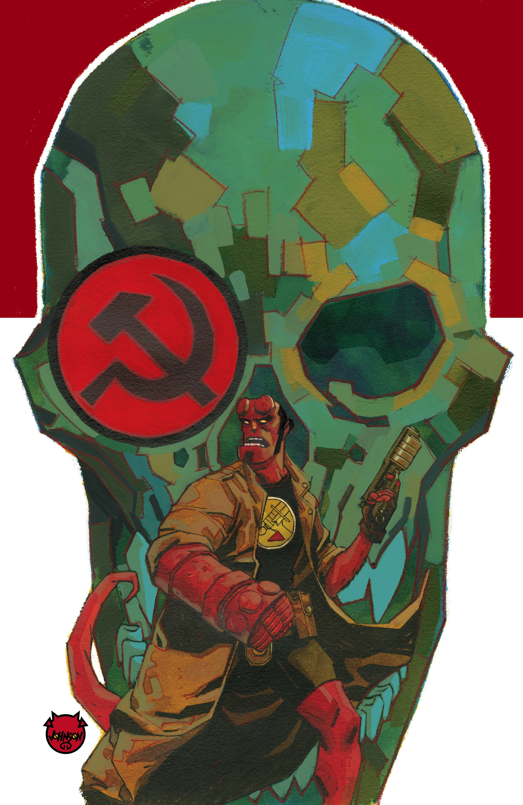
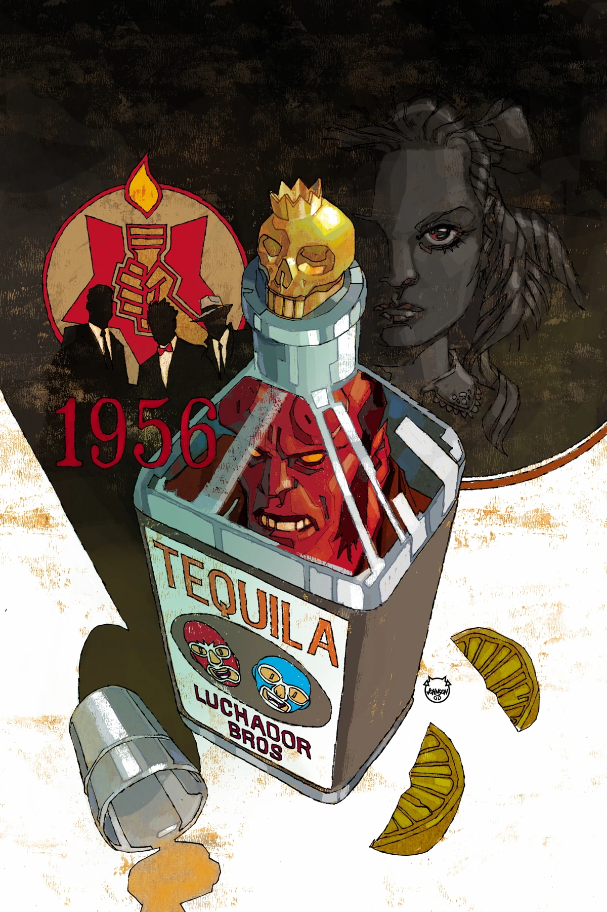
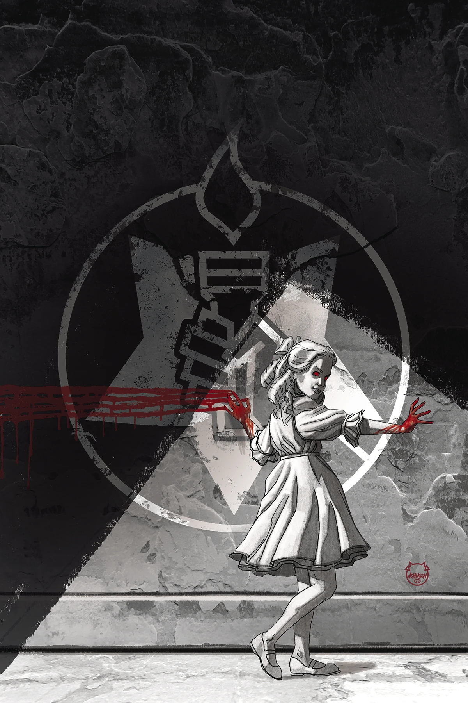
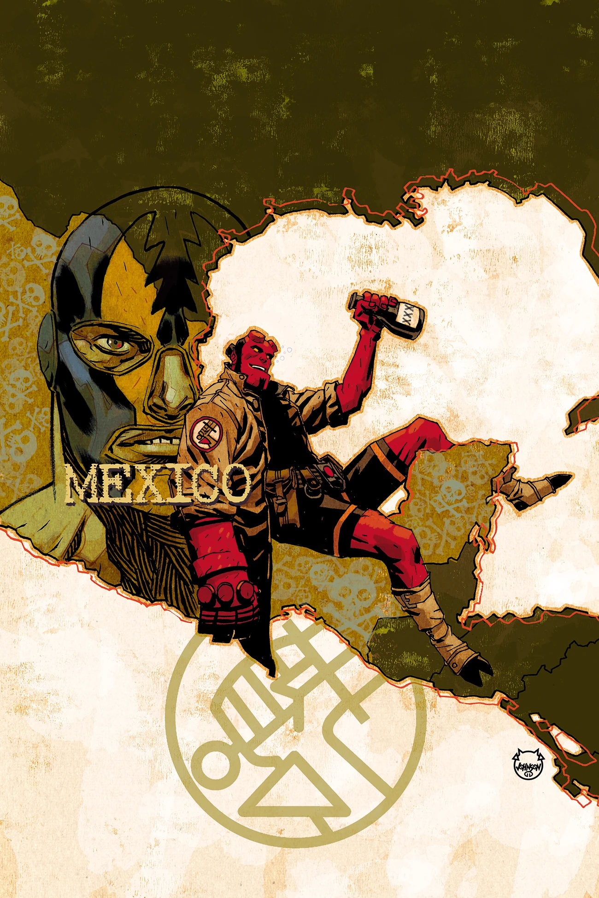

***Hellboy and the B.P.R.D.: 1956*** is a five-issue miniseries illustrated by multiple artists.

## Publication History

*1956* was officially announced for San Diego Comic-Con 2018.

## Synopsis

### Part One

Pressure is mounting within the bureau to uncover the Soviets’ secret plans, but a suspicious cover-up leads one agent off the radar in search of answers. Meanwhile, demonic Soviet occult leader Varvara pushes her team to follow her own whims, and Hellboy is sent on the mission that would lead to his infamous misadventures in Mexico. But even more clandestine plots are at work—both inside the B.P.R.D. and out. Three different storylines are interwoven in this espionage saga.

### Part Two

Professor Bruttenholm sends two agents in opposite directions on off-the-books missions, while the B.P.R.D. loses sight of Hellboy as he wanders through Mexico, and Varvara’s pet projects stir up discontent among her team of occult scientists.

### Part Three

Dr. Trevor Bruttenholm is drawn deeper into his off-the-books investigations, leaving the B.P.R.D. struggling to stay one step ahead of their Soviet counterparts. Meanwhile, conflict within the Soviet occult team flares as the tension between team leader Varvara and her subordinates comes to a head.

### Part Four

Bruttenholm’s secret investigation comes to an abrupt and tragic end, and Hellboy’s absence forces him to send B.P.R.D agents to search for him in Mexico. Meanwhile, the conflict between Soviet occult team leader Varvara and her subordinates comes to a head!

### Part Five

Mexico has not been kind to Hellboy, but can the B.P.R.D. convince him to return to headquarters and the painful reunion that awaits him there? Meanwhile, Bruttenholm is confronted with the truth about himself and the future of the Bureau.

## Gallery

Covers by [Dave Johnson](/entry/Dave_Johnson).

