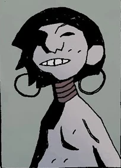
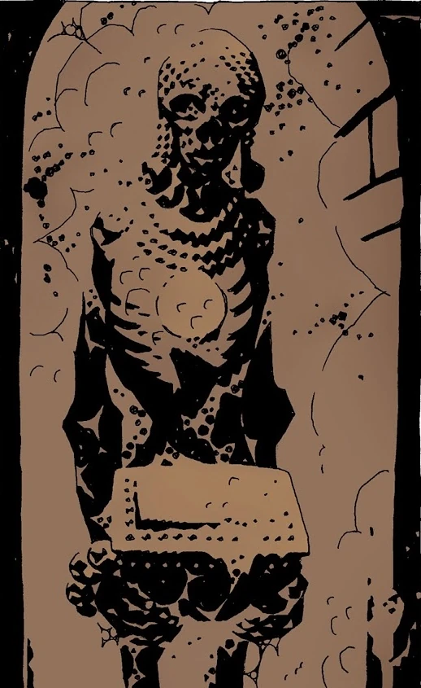
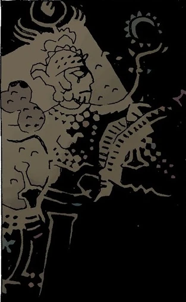

*This article is a stub. You can help Hellboy Wiki by expanding it.*

**Abu Gung**, also known as "Gung the Magnificent", is the name of the hero and protagonist of the short story *[Abu Gung and the Beanstalk](/entry/Abu_Gung_and_the_Beanstalk)*. He is supposedly a native of Gung Valley, located in the land of Mu.

## History

### *[The Amazing Screw-On Head](/entry/The_Amazing_Screw-On_Head)*

Abu Gung briefly appears as a speaking corpse inside a temple in the Aswan valley. He carries in his hands the Kalakistan Fragment, which supposedly details his life and the ways in which he almost conquered the entirety of the world in the 9632 BCE. Emperor Zombie, who was seeking to learn how Gung acheived his conquest, refused to listen to Gung's posthumous warning and steals the Kalakistan Fragment from his desecrated corpse.
