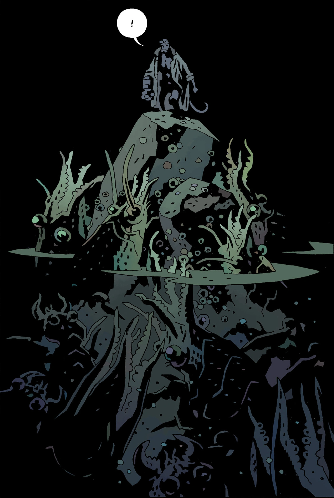
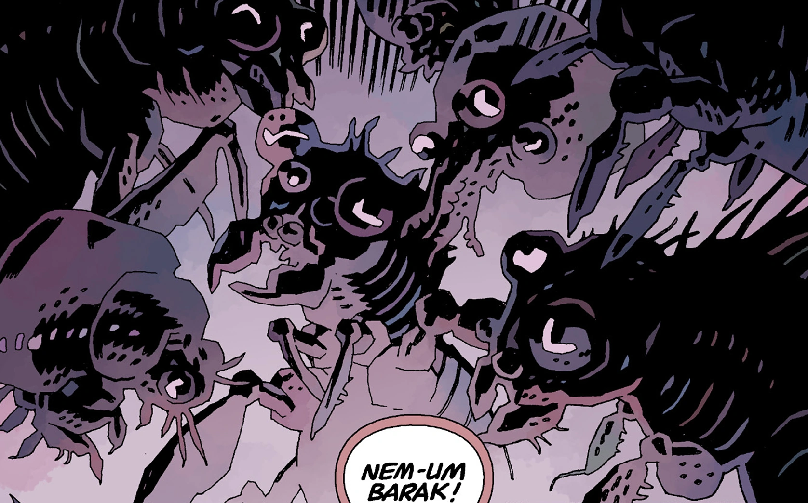

The **Abyss** is a realm bordering to [Hell](/entry/Hell).

## Description

Sir Edward Grey described that the Abyss as an outer edge, that is bordered by the bottomless depths of chaos.

Many strange creatures inhabit this realm that resemble jellyfish and cephalopods. [Pluto](/entry/Pluto), the first ruler of [Hell](/entry/Hell), also resides here after he and his [Watchers](/entry/Watchers) were defeated by [Satan](/entry/Satan) and his followers.

Edward Grey referred to it as **Tartarus**, saying it was as far below Hell as Heaven was above Earth.

Although the [Ogdru Jahad](/entry/Ogdru_Jahad) were often spoken of as residing in the Abyss, this was in fact a poetic description of deep space and not a reference to the regions bordering Hell.

## Inhabitants

- [Pluto](/entry/Pluto)
- Unnamed strange creatures

## Gallery

Pluto residing in the Abyss.

|Creatures in the Abyss.

|Ditto.
