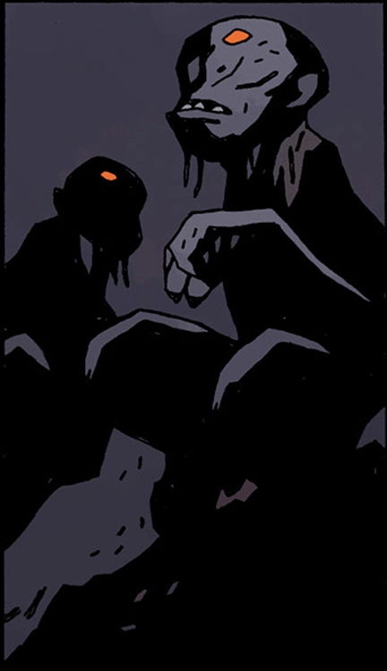

**Acheron** is one of the rivers of [Hell](/entry/Hell), described as "*Sad Acheron of Sorrow, Black and Deep*". Sir [Edward Grey](/entry/Edward_Grey) landed on the shores of the river, after being dragged down by the [demon](/entry/Demon) [Amdusias](/entry/Amdusias).

Unknown creatures lived here in the past, they collected and stitched together the parts of Sir Edward Grey.

After [Ragna Rok](/entry/Ragna_Rok_(event)), Grey fought against [Eligos](/entry/Eligos) who was empowered by [Pluto](/entry/Pluto). Using his magic, Grey teleported them to Acheron. There at the place of his death and rebirth, the river was the source of his power, Grey shed away his humanity to fully embrace himself as a creature of Hell to destroy Eligos in order to prevent the demon knight from undoing Hellboy's new world. Edward Grey then became the personification of the river Acheron and was joined by his siblings the other four Rivers of Hell.

