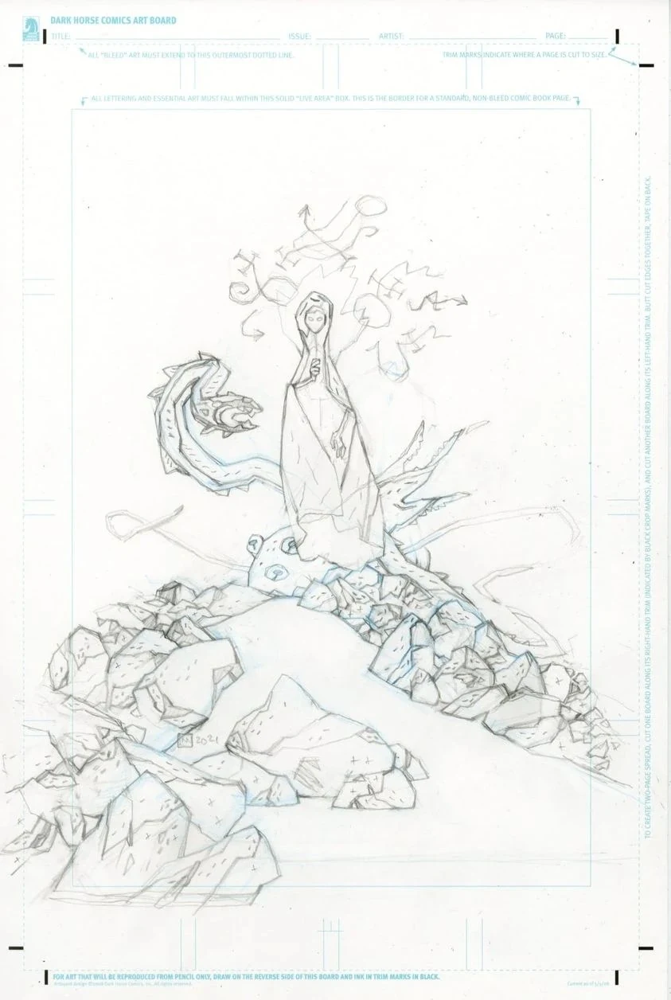
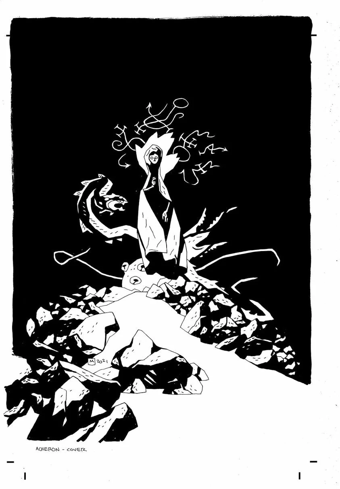
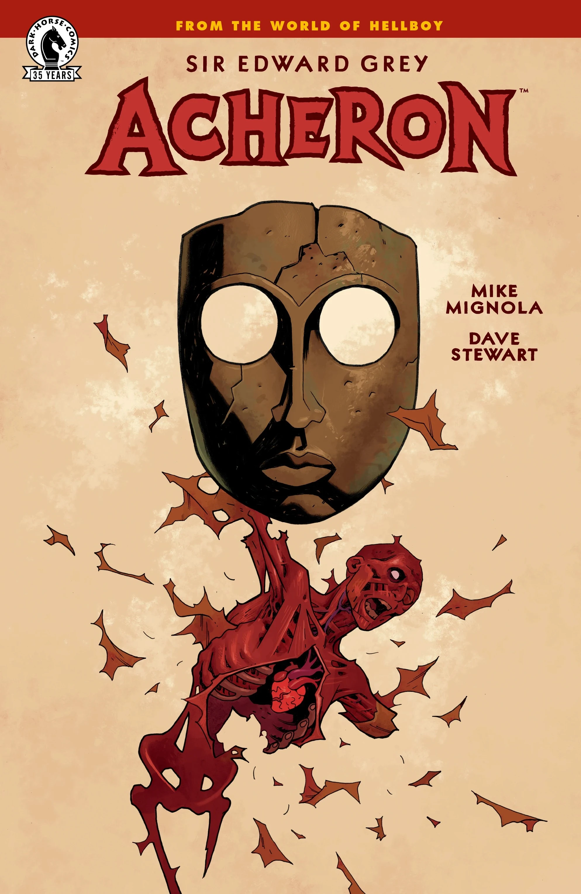

***Sir Edward Grey: Acheron*** is a 2021 one-shot written and drawn by [Mike Mignola](/entry/Mike_Mignola), his first full comic since 2016's [*Hellboy in Hell* \#10](/entry/For_Whom_the_Bell_Tolls). It is set after the events of *[B.P.R.D.: The Devil You Know―Ragna Rok](/entry/Ragna_Rok_(story_arc))*.

## Synopsis

[Hellboy](/entry/Hellboy_(character)) is gone, and the [B.P.R.D.](/entry/Bureau_for_Paranormal_Research_and_Defense) managed to fight off the monsters on earth long enough for humanity to just barely escape underground, but [Edward Grey](/entry/Edward_Grey) must return to [Hell](/entry/Hell) to confront a familiar foe and finish what needs to be done to truly save the world.

## Gallery

*Sir Edward Grey: Acheron*  
cover by Mike Mignola with Dave Stewart

*Sir Edward Grey: Acheron*  
Mike Mignola's pencils

*Sir Edward Grey: Acheron*  
Mike Mignola's inks

*Sir Edward Grey: Acheron*  
cover by [Ben Stenbeck](/entry/Ben_Stenbeck)

|Sir Edward Grey: Acheron Mike Mignola's pencils

|Sir Edward Grey: Acheron Mike Mignola's inks

|Sir Edward Grey: Acheron cover by Ben Stenbeck
## Content

### Characters

- Humans
  - [Edward Grey](/entry/Edward_Grey)
  - Mr. Dean
  - Mr. Jenks
  - Amelia Dunn
  - [Angus Weir](/entry/Angus_Weir) (flashback)
  - [Mohlomi](/entry/Mohlomi) (flashback)
  - [Izar Hoffman](/entry/Izar_Hoffman) (flashback)
  - [Grigori Rasputin](/entry/Grigori_Rasputin) (flashback)
- Demons
  - [Eligos](/entry/Eligos)
  - [Hellboy](/entry/Hellboy_(character)) (flashback)
  - [Beelzebub](/entry/Beelzebub) (flashback)
  - [Satan](/entry/Satan) (flashback)
- [Ogdru Jahad](/entry/Ogdru_Jahad)
- [Pluto](/entry/Pluto)
- Personified rivers of Hell
  - [Styx](/entry/Styx)
  - [Cocytus](/entry/Cocytus)
  - [Lethe](/entry/Lethe)
  - [Phlegethon](/entry/Phlegethon)

### Locations

- [Hell](/entry/Hell)
  - [Abyss](/entry/Abyss)
  - [Tartarus](/entry/Tartarus)
