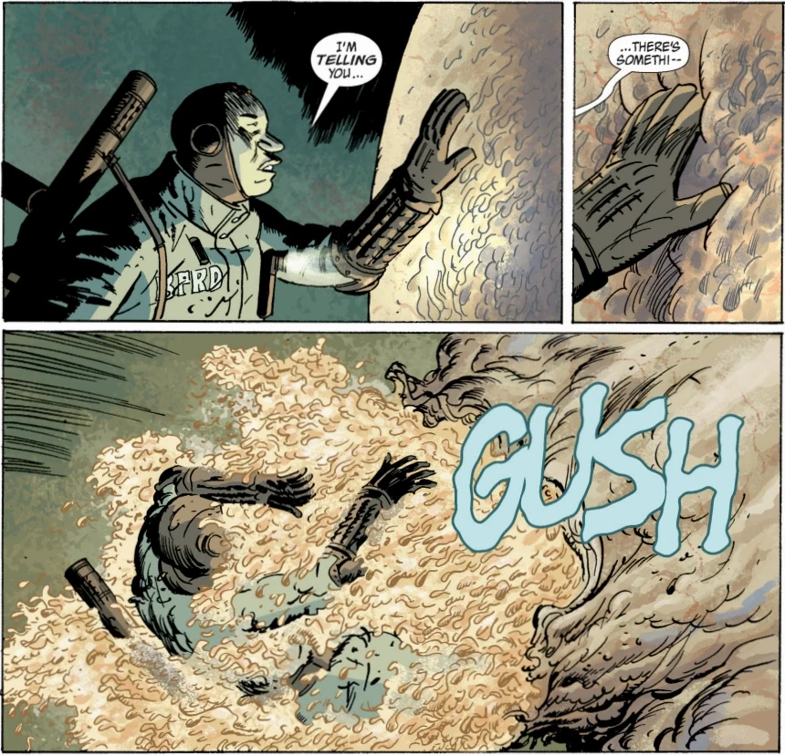

> "*Jesus*, Navarro, do you *ever* stop bitching?" -[Benjamin Daimio](/entry/Benjamin_Daimio)

Agent **Navarro** is a character in the B.P.R.D. story cycle, appearing in [The Black Flame](/entry/The_Black_Flame) as a B.P.R.D. agent. He is part of an extermination team led by Ben Daimio on a mission to clear [frog monsters](/entry/Frog_monster) from a sewage plant.

## History

Navarro is an agent of the B.P.R.D., who is mostly seen serving with Ben Daimio and [Roger](/entry/Roger) on extermination missions, which mainly consist of finding frog monster nests and hideouts and killing as many as possible with the use of heavy firearms, flame throwers, grenade launchers, and other weapons. Navarro is mainly seen wielding a gun. He is not seen outside of uniform.

Agent Navarro is with Roger during their mission outside of Raith, Ontario, when the [Black Flame](/entry/The_Black_Flame_(character)) arrives and incinerates the building and surrounding area, killing all agents and charring Roger's body.

## Personality

Agent Navarro is very vocal about his opinions while on the field, not afraid to complain about or comment on the circumstances he's in. Despite this, Agent Navarro does not balk from an assignment, and serves the BPRD loyally and with enthusiasm. Navarro is naturally curious, sometimes more than he is cautious.

While on the mission in the sewage plant, Navarro approached and touched a frog monster incubator despite Daimio's warning, and subsequently was doused in goop and tadpoles when it burst under his touch.

Navarro has a penchant for striking up conversation about anything, and might be said to lack a filter.

1.  [↑](#cite_ref-1) [The Black Flame (story)](/entry/The_Black_Flame_(story))
