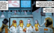

 **Ako Quantum Systems** was a top-secret quantum research institute funded by the Japanese government.

## History

### [*B.P.R.D.: Hell on Earth—The Broken Equation*](/entry/The_Broken_Equation)

In 1979, Ako Quantum Systems operated outside the federal jurisdiction of the Japanese government to have plausible deniability.

The organization was dedicated to Professor Shun Kukyo's controversial Condensed Energy System Equation which suggested that parallel realities not only existed but were feasible to reach.

The organization tested their experiments in a bunker beneath Saitama, Japan. They were successful in opening an aperture and a team of scientists led by the Professor crossed the threshold. However shortly after entering a monster emerged and slaughtered the scientists in the lab. Dr. Atama managed to electrocute the creature and was the only survivor. After the disastrous incident, the facility was dismantled and its existence was erased.

Six months after the shut-down an anomaly was detected at the abandoned laboratory where a vegetative Professor Kukyo laid waiting, behind him an open gate to another reality. The scientist discovered Kukyo's brain was receiving information from beyond the gate. For thirty years the organization has been monitoring the Professor's condition, managing to establish rudimentary communication with the professor who wrote elaborate complicated equations.

In 2011, Kukyo ceased his equations and began to draw images of a titanic monster at the same time as two [Ogdru Hem](/entry/Ogdru_Hem) began rampaging in Saitama. Seeing this disturbing change the Japanese scientists contacted the [B.P.R.D.](/entry/Bureau_for_Paranormal_Research_and_Defense) task force in the area stating they may have a means to combat the creatures. Before they could elaborate further, Kukyo had a psychotic breakdown, causing the machine maintaining the gate to fluctuate and explode. A massive creature from the other world appeared and began to fight and defeat the Ogru Hem whilst the B.P.R.D. and surviving scientists of Ako Systems watched in awe.
