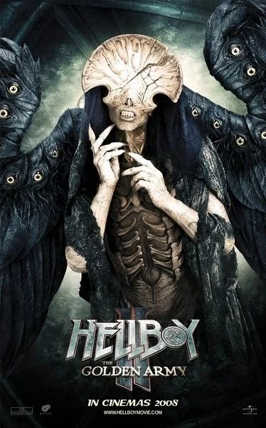

The **Angel of Death** is a personification of [Hellboy](/entry/Hellboy_%28character%29)'s personal death, having claimed to always be present at the crossroads in the half demon's life where he may die. The most distinctive feature of the Angel is that its eyes are on its wings, rather than on its skeletal face.

## Story

For ages, the Angel of Death resided in the ruins [Bethmora](/entry/Bethmora) in waiting for a dying Hellboy. The time came when, while the [BPRD](/entry/BPRD) are searching for [the Golden Army](/entry/the_Golden_Army), [Liz Sherman](/entry/Liz_Sherman) was also looking to remove the fragment of [Prince Nuada](/entry/Prince_Nuada)'s spear from Hellboy's chest. While the Angel is indifferent to Hellboy's plight, it only saves his life after having Liz choose Hellboy to live despite being warned that she will suffer most when Hellboy carries out his predestined purpose. Once removing the spear shard, and giving it to the goblin blacksmith, the Angel takes its leave.

## Physical appearance

TBA

## Gallery

The_angel_of_death.jpg

|
## Trivia

- Portrayed by [Doug Jones](/entry/Doug_Jones).
- Designed by [Wayne Barlowe](/entry/Wayne_Barlowe).
- The character was supposed to be able to fly, but the suit was too heavy.
